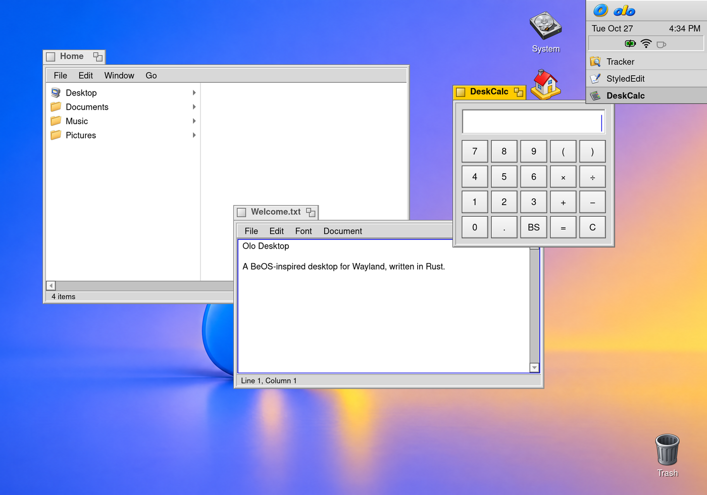

<p align="center">
  <picture>
    <source media="(prefers-color-scheme: dark)" srcset="docs/img/olo-lockup-on-dark.png">
    
  </picture>
</p>

**Olo Desktop** is a Wayland desktop environment for Linux, written in
Rust, with the look and feel of BeOS: the yellow window tabs, Deskbar,
Tracker, a menu bar in every window and a desktop that never makes you
wait. Where 2026 has a better way, it takes it: crisp at any scale, light,
dark and night modes, a command palette, tiling, and an upgrade in place
that keeps every window open.



Everything is native and in one process per app, on one shared kit:
Tracker, Terminal, StyledEdit, Viewer (pictures, PDFs and forms, media),
DeskCalc, Activity Monitor, DriveSetup, Log Viewer, Screenshot,
Notifications, Passwords (with 1Password sync), Preferences and more.
Programs from other toolkits (Chrome, GTK, Qt) run as Wayland clients and
get Olo's colours. And agents are first-class: an agent can read every
window's widgets as structured data and drive its own headless Olo screen,
without getting in your way.

## Install

On Fedora 44 or 45 (Workstation or an atomic desktop such as Silverblue or
Aurora; x86_64 or aarch64):

```sh
git clone https://github.com/benmyles/olo && cd olo && tools/setup.sh
```

Run it as yourself; it asks for sudo when it needs root. It installs what's
missing (compilers, libraries, Rust, Git LFS, drivers), builds Olo into
`~/.local/bin` and adds **Olo Desktop** to the login screen (GDM or
SDDM). Run it again any time: each step only does what isn't done
yet (`--check` only reports). After a `git pull` and a build, Deskbar
shows a green arrow; click it to upgrade the running desktop in place.

## Hacking

Start with [docs/HACKING.md](docs/HACKING.md): the layout, the kit, the
look-and-feel rules, and testing in headless sessions
(`tools/dev/tsession`). [docs/ICONS.md](docs/ICONS.md) is the icon
style guide, [docs/TODO.md](docs/TODO.md) the work list, and
[docs/journal](docs/journal) a picture of every visible change.

Olo was called Tabula until October 2026; installs from then upgrade in
place, keeping everything.
