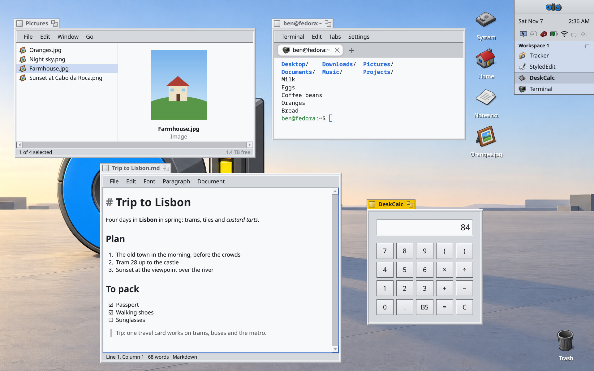
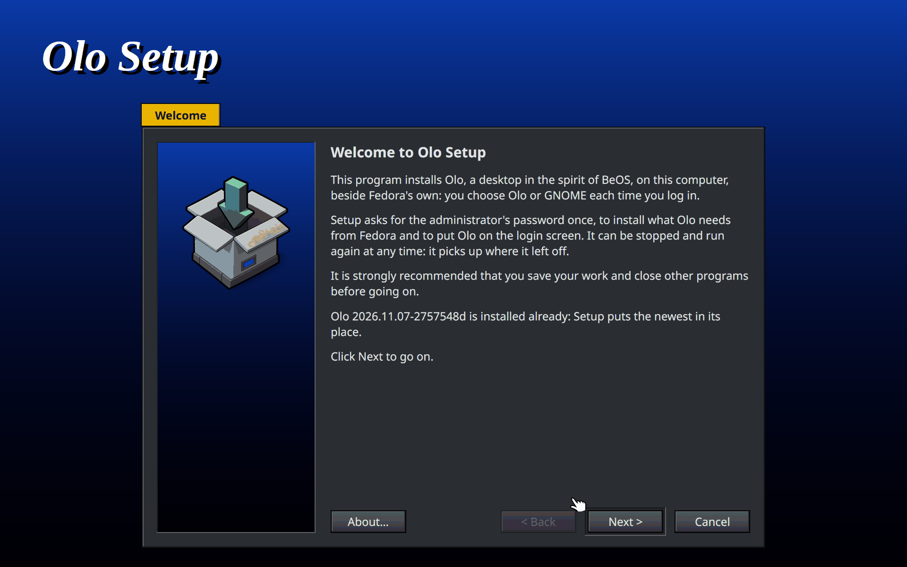
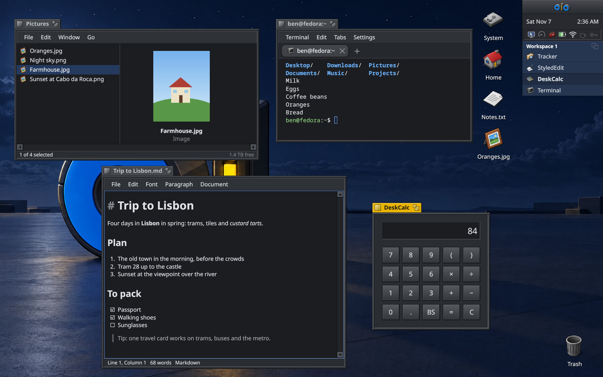
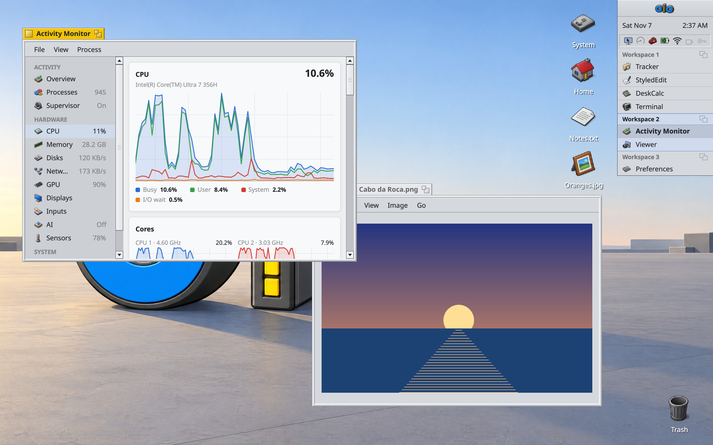

<p align="center">
  <picture>
    <source media="(prefers-color-scheme: dark)" srcset="docs/img/olo-lockup-on-dark.png">
    
  </picture>
</p>

**Olo** is a desktop for Linux in the spirit of BeOS. It's written in
Rust, runs on Wayland, and every part of it, from the window server to
the apps, is native and built on one shared kit. You get BeOS's yellow
window tabs, Deskbar, Tracker's spatial folders and a menu bar in every
window, and a desktop that never makes you wait. Where 2026 has a better
way, Olo takes it: crisp at any scale, light, dark and night modes, HDR,
tiling, a command palette, and upgrades in place that keep every window
open.



## Install

On a stock **Fedora 44 or 45 Workstation** (x86_64), download Olo Setup
from the [latest release](https://github.com/benmyles/olo/releases/latest)
and run it:

```sh
curl -LO https://github.com/benmyles/olo/releases/latest/download/olo-installer-x86_64
chmod +x olo-installer-x86_64 && ./olo-installer-x86_64
```

<p align="center"></p>

Setup is one full-screen program, Windows 95's Setup in BeOS's look:
- It installs what Olo needs from Fedora.
- It downloads Olo and checks it.
- It puts Olo in your home folder (`~/.local`) and adds it to the login screen.
- Optionally, it installs Olo's own login screen and boot splash, and RPM Fusion.

It asks for your password once, and Fedora's GNOME stays installed: you
choose Olo or GNOME each time you log in. To update, run Setup again: it
keeps what you chose and brings everything up to date.

To build from source instead (Fedora 44 or 45, Workstation or an atomic
desktop such as Silverblue; x86_64 or aarch64):

```sh
git clone https://github.com/benmyles/olo && cd olo && tools/setup.sh
```

`tools/setup.sh` installs what's missing (compilers, libraries, Rust,
Git LFS, drivers), builds Olo into `~/.local/bin` and adds it to the
login screen. Run it again any time: each step only does what isn't done
yet. After a `git pull` and a build, Deskbar offers the new build, and
its Upgrade installs it and reloads the running desktop in place.



## The desktop

- **Deskbar** in the top-right corner, as on BeOS: the Olo menu, the clock,
  a tray (sound, network, battery, Bluetooth, notifications) and each
  workspace's running apps.
- **Tracker**: the desktop, and spatial folder windows (icon, list and
  column views), with Quick Look previews of almost any file.
- **Workspaces** for each display, an overview of all of them, and
  tiling: arrange windows from the keyboard, auto-tiling, focus mode,
  window groups with tabs, and Smart Tiling by a model.
- **Command palette** (⌘Space): apps, the front app's menu commands,
  windows, files, settings and the web.
- **Notifications**: banners, a history, Do Not Disturb, and per-app
  settings.
- **Light, dark and night modes**, nine themes with their own icons and
  wallpapers, fractional scaling (1×, 1.5×, 2× and between) with
  pixel-exact drawing at every one, HDR and wide-gamut colour,
  variable refresh rate, and each display on its own GPU.
- **Keyboard profiles** for Mac, Windows and BeOS keys, keyboard hints for
  every control, a touchpad tuned like a Mac's, touch screens, and an
  emoji picker.
- **Security**: a lock screen, fingerprint, face unlock (the infrared
  camera, in process), security keys and Touch ID keyboards, Approve
  Without Asking for a while, and a polkit agent.
- **Olo's own login screen and boot splash**, the start-up sound and
  screen, and a screen saver.
- **Upgrades in place**: a new build replaces the running desktop without
  closing a window; apps come back as they were.



## The apps

| App | What it does |
| --- | --- |
| **Tracker** | Files and folders, the desktop, Quick Look, Open With and default apps |
| **Terminal** | Tabs and tab groups, Git branches and pull requests per tab, sudo in a window, command suggestions from a local model |
| **StyledEdit** | Rich text, Markdown and source code with syntax colouring, spelling, tables, pictures, find and print |
| **Viewer** | Pictures (edit, crop, rotate), PDFs (fill forms, sign), video with GPU decoding (NVIDIA, Intel, AMD) and audio |
| **DeskCalc** | BeOS's desk calculator, with scientific keys |
| **Activity Monitor** | Processes, CPU, memory, disks, network, GPU, displays and sensors, live |
| **Passwords** | Logins, passkeys and secure notes, encrypted, synced with 1Password if you like; the SSH agent and `op` |
| **Screenshot** | Pictures and recordings of the screen, a window or an area |
| **DriveSetup** and **DiskUsage** | Disks, partitions and encryption; where the space went |
| **Log Viewer** | Every program's log, searchable and live |
| **Preferences** | One panel per area: appearance, displays, keyboard, touchpad, sound, network, Bluetooth, AirPods, power, security and more |
| **Olo Doctor** | Finds what gets in Olo's way and fixes it with a button |
| **Agent Screens** | Headless Olo screens for AI agents, which you can watch and take over |
| **Token Pool** | Several Claude and ChatGPT subscriptions shared by coding agents |
| **Telegram** and **Slack** | Native chat, and Slack's web app as an Olo app |

Olo also replaces what a desktop needs from GNOME with its own: portals,
the keyring (opened by your login password), dconf for GTK programs,
notifications, the polkit agent, and AirPods and voice processing
services. Programs from other toolkits (Chrome, GTK, Qt, Electron) run
as Wayland clients and follow Olo's colours.

## Made for agents too

What you see, an agent can read: every window's widgets as structured
data, every menu command by name, and a documented API to drive them,
without moving your pointer or taking your focus. Agents get headless
screens of their own (`olo-screen`) that you can watch and take over,
and coding agents in Terminal keep their tab's title current.

## Fast and light

Idle costs nothing: no polling, no frames when nothing changed. Anything
that can take more than a frame runs on a worker thread with live
progress. Every change to something that runs per frame or while idle is
measured before and after, and the numbers are in its commit.

## Hacking

Start with [docs/HACKING.md](docs/HACKING.md): the layout, the kit, the
look-and-feel rules, and testing in headless sessions
(`tools/dev/tsession`). [docs/ICONS.md](docs/ICONS.md) is the icon style
guide, [docs/TODO.md](docs/TODO.md) the work list, and
[docs/journal](docs/journal) a picture of every visible change.
`tools/release.sh` makes a release, and `tools/dev/installer-check`
tries Setup on a fresh Fedora in a virtual machine.

Olo was called Tabula until October 2026; installs from then upgrade in
place, keeping everything.

## Licence

Olo is under the MIT License ([LICENSE](LICENSE)). It carries others'
work under their own licences: GPUI (Apache 2.0), Smithay (MIT), the
Noto fonts (SIL Open Font License 1.1), Haiku's cursors (MIT), and the
crates listed in its source.

Olo is a work of love, dedicated to Sir Samwise, the bestest English
Labrador that ever walked the earth.
