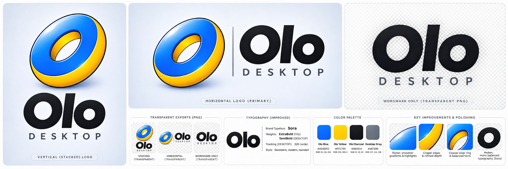

# Olo's brand

What Olo looks like as a name: its mark, its wordmark, its colours and
its typeface, where each is used and how each is made. The source of
truth is the brand sheet (Ben, 2026-11-16: "update olo to follow the new
branding in this image"):



## The parts

| Part | What | Made by | Files |
|---|---|---|---|
| **The mark** | One glossy ring, a fat torus leaning back: its face Olo blue, its thick side and the wall of its hole Olo yellow, a crisp dark outline. | First the icon model (`gpt-image-2.6-sunburst`, quality high) against the sheet's mark (`docs/brand/sheet-mark.png`): the master picture. Then drawn from it by hand, as every icon is (ICONS.md, "Drawings"): its ellipses fitted to the master's. | `data/icons/svg/olo.svg` (the drawing: the `olo` icon everywhere in Olo, rendered for the size, the same in every theme, and what `mkbrand.py` renders the logos' ring from); `docs/brand/olo-mark.png` (the master picture it was drawn from: the 1024² render trimmed, its sidecar `olo-mark.json` beside it) |
| **The wordmark** | "Olo" in Sora ExtraBold, a little tight (−0.03 em), its l a plain bar (Sora's stem without its flag: neither Sora's l nor its alternate, which has a foot, is the sheet's); under it "DESKTOP" in Sora SemiBold, tracked 0.32 em (320), as wide as "Olo". | `tools/mkbrand.py`, from the font: set, never drawn by a model. | `data/brand/olo-wordmark.png`, `olo-wordmark-on-dark.png` ("Olo" alone: the UI's) |
| **The horizontal logo** (primary) | The mark, a thin grey rule, the wordmark with DESKTOP. | `tools/mkbrand.py` | `data/brand/sizes/olo-logo-on-dark-W.png` (the veil and boot splash, W = 256 to 512 px); `website/static/brand/olo-logo*.png` |
| **The stacked logo** | The mark over the wordmark. | `tools/mkbrand.py` | `website/static/brand/olo-logo-stacked*.png` |

The mark is the same in every theme's medium: Platinum draws its own
`olo` icon, as it draws every icon. The wordmark is the brand's
lettering and the same in every theme (themes had their own lettering
until November 2026; `olo_xdg::themes::wordmark_file` reads only
`data/brand`).

## Colours

| Name | Hex | RGB | Where |
|---|---|---|---|
| Olo Blue | `#0D6EFD` | 13, 110, 253 | The mark's face; links and buttons on the website |
| Olo Yellow | `#FFC700` | 255, 199, 0 | The mark's side; highlights |
| Olo Charcoal | `#0B0D14` | 11, 13, 20 | The wordmark on light; the website's dark ground |
| Desktop Gray | `#6B7280` | 107, 114, 128 | "DESKTOP" on light; the rule |

On dark, the wordmark is `#F4F6FA` and "DESKTOP" `#A1A7B3` (the brand's
grey on Olo's dark is 3.6:1, too faint; this is 7:1). These are the
brand's colours, for the brand's pictures and the website: Olo's UI
keeps its own palette (`olo_theme`, BeOS's tab yellow and the rest).

## The typeface

**Sora** (SIL Open Font License; `data/fonts/Sora[wght].ttf`, every
weight, shipped with Olo; its licence `data/fonts/OFL-Sora.txt`). The
kit loads it with Olo's other faces; `style::brand_font(weight)` (family
`olo_theme::fonts::BRAND`) draws in it, for Olo's name where it stands
as the brand, never for a control's or a document's text (that is Noto
Sans). ExtraBold (800) for "Olo", SemiBold (600) for "DESKTOP"
(`olo_theme::fonts::BRAND_WEIGHT`, `BRAND_SUB_WEIGHT`). The website
carries it as a Latin subset (`website/static/fonts/sora.woff2`).

## Where each is used

| Place | What it shows |
|---|---|
| Deskbar's tile | The mark alone, 24 points, centred (`apps/deskbar`, `TILE_MARK`; Ben, 2026-11-16: beside the wordmark it read as "O Olo", two Os) |
| About (Preferences ▸ About) | The mark (64 points), "Olo" (30 points) and the version |
| Preferences ▸ Themes | Each theme's `olo` mark beside its name |
| The upgrade's veil and Olo's start-up screen (app_server `veil.rs`), the boot splash (`plymouth.rs`) | The horizontal logo on dark, pre-scaled per scale (`data/brand/sizes`) |
| The Installer | The mark |
| README.md, the website (olo-desktop.com), GitHub's social preview | The horizontal logo, the brand kit, `docs/img/olo-social.png` |

## Making them again

```sh
# The mark's icon is a drawing, data/icons/svg/olo.svg: edit it by hand
# (ICONS.md, "Drawings") and look at it at every size:
cargo build --release -p olo-xdg --example svgicon
/usr/bin/python3 tools/dev/icontrace.py review /var/tmp/me/olo.png olo
# (The master picture, docs/brand/olo-mark.png, was drawn by the icon
# model against the sheet's mark, docs/brand/sheet-mark.png; the tool
# that asked for it went with the icons' pictures, November 2026.)

# Everything else, from the mark's drawing and Sora (after any change to either):
/usr/bin/python3 tools/mkbrand.py --sheet /var/tmp/me/brand-sheet.png
```

`mkbrand.py` writes the wordmark, the veil's logo sizes, the website's
brand kit (logos light and on dark, favicons, the social picture) and
`docs/img/olo-social.png`. Look at its sheet on light and dark before
committing; then build the website (`website/README.md`).

## Rules

- Never redraw the wordmark with a model or in another face: it is
  Sora, set by `mkbrand.py`.
- Never recolour, outline or stretch the mark; on dark, use the
  on-dark wordmark and logo.
- Room round the logo: at least the O's height.
- The name is **Olo**, or **Olo Desktop** in full.
