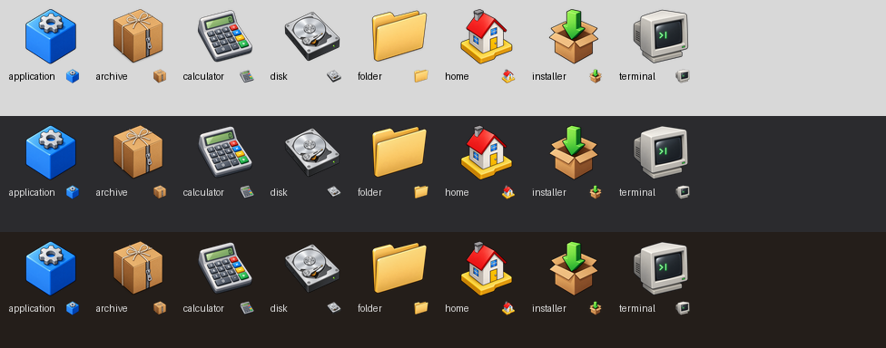

# Icons: style guide and generation

Every Olo icon belongs to one set that looks as if one artist drew it in
one sitting. That is the bar. An icon that is pretty on its own but sits
differently from its neighbours is wrong.



*The canonical reference icons (`data/icons/reference/`) on the light,
dark and night panel colours, at 64 px with the 16 px rendering beside
each.*

## Style

The look is classic BeOS (R5's Tracker and Deskbar icons), redrawn for
high-resolution displays.

| Aspect | Rule |
|---|---|
| View | Three-quarter isometric from slightly above, as if the object sits on a desk. **Never straight-on.** Badges and symbols (about, bluetooth) are thick coins or tiles standing in 3/4 view, not flat discs. |
| Outline | One crisp dark outline around the silhouette, of the same visual weight on every icon. No outline on interior detail. |
| Colour | Bold, saturated, friendly, taken from the reference set: folder tan, Be blue (application cube), BeOS tab yellow, signal green (installer arrow), alert red (home roof), and neutral greys from silver to charcoal. Don't add a new dominant hue without reason. |
| Shading | Flat-shaded faces, each with a soft gradient. One light source from the top left. The top faces are lightest and the right faces darkest. |
| Shadow | A subtle soft contact shadow beneath the object. No long drop shadows. |
| Proportion | Slightly chunky and tactile. Detail must still read at 32 px, and the silhouette must still read at 16 px. |
| Content | No text, letters or numerals, except when the glyph *is* the symbol (the "i" of About). No brand logos except protocol marks (Bluetooth). No watermarks. |
| Canvas | 1024² with a transparent background and generous padding. `mkicons.py` trims and re-pads every icon to the same 3% margin, so how much empty space the model leaves doesn't matter. |
| Themes | Icons are the same in light, dark and night themes. Check every one on all three panel colours. Dark-grey objects (trash, system, disk) need the outline and their highlights to separate them from dark panels. |

Composite icons (a document with a pencil, a folder with a magnifier) put
the primary object at the back left and the modifier in front at the lower
right, overlapping it by about a third.

## Requirements

* **Model: `gpt-image-2.5-sunburst`, quality `high` (the maximum), 1024²,
  transparent background.** `tools/genicon.py` hard-codes these. Don't
  generate icons any other way. Don't hand-draw, use another model, or
  lower the quality to save time.
* **Always generate against the reference set.** `genicon.py` sends every
  image in `data/icons/reference/` to the edits endpoint as a style
  reference. This is what makes the set consistent. A text prompt alone
  drifts (that is how the old flat `about` and `bluetooth` badges came
  about). `--no-ref` exists only for bootstrapping a new reference set.
* **Generate candidates and pick one.** For any new or replacement icon,
  use `--variants 2` (or 3). Compare the candidates against their
  neighbours on a contact sheet and promote the best. Never ship an icon
  you haven't looked at next to the rest of the set.
* The API key is read from `OPENAI_API_KEY` or `~ben/.env`. Never print,
  log or commit it.

## Writing a subject (template)

`data/icons/manifest.txt` has one line per icon: `name|subject`. The
subject describes **only the object**. `genicon.py` supplies the style.
Template:

```
<name>|<article> <object>, <material and colour from the reference hues>, <one or two distinguishing details>[, <pose if not obvious: "seen in three-quarter view…">]
```

Good:

```
calculator|a chunky desk calculator with a small green LCD, grey body and coloured buttons
trash-full|a dark grey metal waste bin with a ribbed side, seen in three-quarter view from slightly above, overflowing with crumpled white paper
```

Avoid:

* Style words ("icon", "isometric", "glossy 3D render", "BeOS"). They are
  already in the style prompt, and repeating them skews the result.
* Several unrelated objects. One object, plus at most one modifier.
* Scenes, people or backgrounds.
* Flat symbols without a pose ("a blue circle with…"). Give the symbol a
  body: a coin, a tile, a badge standing on the desk.

## Workflow

```sh
# 1. Add or edit the line in data/icons/manifest.txt, then generate candidates
python3 tools/genicon.py NAME "subject from the manifest" --variants 2
#    (tools/genicons.sh NAME… regenerates manifest entries in one go; it
#     produces one image each and skips existing ones unless named)

# 2. Compare candidates in place, next to the reference set and neighbours
python3 tools/iconsheet.py /tmp/sheet.png NAME data/icons/src/candidates/NAME-*.png \
    folder application home archive calculator disk

# 3. Promote the winner and render the shipped sizes
mv -f data/icons/src/candidates/NAME-2.png  data/icons/src/NAME.png
mv -f data/icons/src/candidates/NAME-2.json data/icons/src/NAME.json
rm -f data/icons/src/candidates/NAME-*
python3 tools/mkicons.py NAME          # → data/icons/{16,24,…,256}/NAME.png

# 4. Review the whole set once more, then commit data/icons/<px>/ and the manifest
python3 tools/iconsheet.py /tmp/all.png
```

Review checklist (on the contact sheet, at 64 px and 16 px, on all three
backgrounds):

1. Same angle as the references: you can see the top face.
2. Same outline weight. There is no outline-less "photo" look.
3. Lit from the top left, with a contact shadow and no long shadow.
4. Similar optical size to its neighbours. If it looks big or small, the
   silhouette is wrong; fix the subject wording rather than the padding.
5. Legible at 16 px. The silhouette alone identifies it.
6. No stray text, artefacts, or halo around the edges.

Raw images (`data/icons/src/`) are gitignored. Their `.json` sidecars
record the model, quality, full prompt and references, so any icon can be
reproduced. The processed sizes and the manifest are committed.

## The reference set

`data/icons/reference/` holds 512 px copies of the icons that define the
style: folder, application, home, archive, calculator, installer, disk and
terminal. They cover a warm material, a cool primary-coloured solid, a
small scene, a cardboard texture, a device with buttons, a composite, a
metallic object and a screen. Change the reference set only on purpose,
because doing so changes every icon generated afterwards. To swap a
reference, replace the file and regenerate `docs/img/icon-reference.png`:

```sh
python3 tools/iconsheet.py docs/img/icon-reference.png \
    $(ls data/icons/reference | sed 's/\.png$//')
```

## Using icons in code

`olo_kit::icons::paint(painter, rect, "name")`. Names come from the
manifest; freedesktop icon names and absolute paths also work. The kit
picks the smallest pre-scaled size that covers the rect in device pixels.
Use these sizes: 16 for lists, menus and the Deskbar; 32 for Tracker mini
icons and dialogs; 48 to 64 for the Tracker icon view and desktop; 128 for
About boxes. Don't tint, recolour or scale icons up beyond 256 px.
