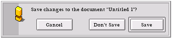

<!-- System Overview - The Interface Kit - BAlert -->

## BAlert  
  
A [`BAlert`](BAlert.md "BAlert") displays a modal window that notifies the user of an error (or the like), and provides a set of buttons (three buttons, max) that lets the user respond to the situation. For example, here's a typical "unsaved changes" alert:

When the user clicks one of the buttons, the alert panel is automatically removed from the screen, the index of the chosen button (0,1, or 2, left to right) is reported to your app, and the [`BAlert`](BAlert.md "BAlert") object is deleted.

The buttons are automatically aligned within the panel (as shown above). The rightmost button is the default button—i.e., it's mapped to the Enter key. You can assign your own shortcuts through the [`SetShortcut()`](BAlert.md#BAlert_SetShortcut "SetShortcut\(\), Shortcut\(\)") function (don't use `BWindow::AddShortcut()`).

* * *

### Construction and Deletion

[`BAlert`](BAlert.md "BAlert") objects must be constructed with `new`; you can't allocate a [`BAlert`](BAlert.md "BAlert") on the stack.

A [`BAlert`](BAlert.md "BAlert") object deletes itself when it's removed from the screen. You never need to delete the [`BAlert`](BAlert.md "BAlert") objects that you display.

* * *

### Creating and Running an Alert Panel

The following code creates and displays the alert panel shown above:
    
    
    BAlert *myAlert = new BAlert("title", "Save changes to ...")
        "Cancel", "Don't save", "Save",
        B_WIDTH_AS_USUAL, B_OFFSET_SPACING, B_WARNING_ALERT);
    
    myAlert->SetShortcut(0, B_ESCAPE);
    int32 button_index = alert->Go();

This is the canonical "Do it/Don't do it/Cancel" alert. Any alert that has a Cancel button should map the Escape key as a shortcut, as shown here.

The [`Go()`](BAlert.md#BAlert_Go "Go\(\)") function runs the panel: It displays the panel, removes the panel when the user is done, and returns the index of the button that the user clicked.

* * *

### Asynchronous Alerts

The default (no argument) version of [`Go()`](BAlert.md#BAlert_Go "Go\(\)") shown above is synchronous: It doesn't return until the user clicks a button. There's also an asynchronous version of [`Go()`](BAlert.md#BAlert_Go "Go\(\)") that returns immediately and (optionally) sends back the user's response in a [`BMessage`](BMessage.md "BMessage"). See [`Go()`](BAlert.md#BAlert_Go "Go\(\)") for details.

* * *

### Look and Feel

By default, a [`BAlert`](BAlert.md "BAlert") object uses the `B_MODAL_APP_WINDOW_FEEL`. This means that it blocks your application's other windows. If you want to broaden the feel so it blocks all windows (`B_MODAL_ALL_WINDOW_FEEL`), or restrict it so it blocks only a few of your app's windows (`B_MODAL_SUBSET_WINDOW_FEEL`), call [`BWindow::SetFeel()`](BWindow.md#BWindow_SetFeel "SetFeel\(\), Feel\(\)"). In the subset case, you'll also have to call [`BWindow::AddToSubset()`](BWindow.md#BWindow_AddToSubset "AddToSubset\(\), RemoveFromSubset\(\)").

Note

Never change the object's look (`B_MODAL_WINDOW_LOOK`).
