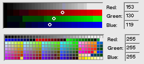

<!-- System Overview - The Interface Kit - BColorControl -->

## BColorControl  
  
A [`BColorControl`](BColorControl.md "BColorControl") object displays an on-screen device that permits users to pick a color. It reports the color as its current value—an rgb_color data structure stored as a 32-bit integer. If a model message is provided, it announces each change in value by sending a copy of the message to a designated target.

When the screen is 8 bits deep, the [`BColorControl`](BColorControl.md "BColorControl") object presents users with a matrix of the 256 available colors. The user chooses a color by pressing the primary mouse button while the cursor is over one of the cells in the matrix. Dragging from cell to cell changes the selected color. The arrow keys can similarly change the selection when the object is the focus view. The [`BColorControl`](BColorControl.md "BColorControl")'s value changes each time the selection does.

When the screen is 15, 16, or 32 bits deep, the [`BColorControl`](BColorControl.md "BColorControl") object displays ramps for each color component. The user changes the current color by modifying a red, green, or blue component value.

In addition to the color matrix and ramp, a [`BColorControl`](BColorControl.md "BColorControl") has three text fields where the user can set a color by typing in its red, green, and blue component values. The text fields ([`BTextControl`](BTextControl.md "BTextControl") objects) are children of the [`BColorControl`](BColorControl.md "BColorControl").
