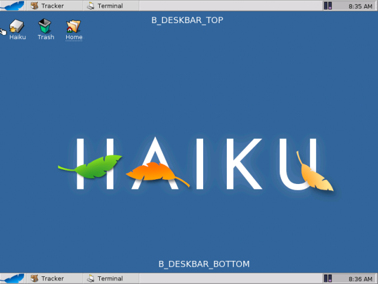
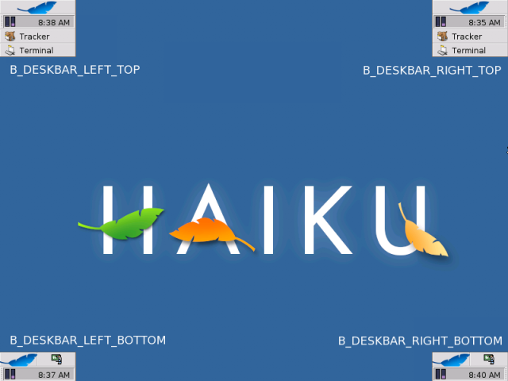
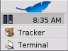
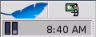

<!-- Special Topics - The Deskbar - BDeskbar -->

## BDeskbar

| Derived From:| –  
---|---  
Mix-in Classes:| –  
Declared In:| `be_apps/Deskbar/Deskbar.h`  
Library:| `libbe.so`  
Allocation:| Constructor or on the stack  
  
  * [Constructor and Destructor](BDeskbar.md#BDeskbar_ConstructorDestructor)
  * [Member Functions](BDeskbar.md#BDeskbar_MemberFunctions)
  * [Deskbar Types](BDeskbar.md#BDeskbar_Types)

  
  
* * *

### Constructor and Destructor

#### BDeskbar()

`BDeskbar();`

The constructor creates and returns a new `BDeskbar` object.

#### ~BDeskbar()

`BDeskbar();`

Deletes the `BDeskbar` object.

* * *

### Member Functions

####  AddItem(), RemoveItem(), CountItems(), HasItem(), GetItemInfo()

`status_t AddItem([`BView`](BView.md "BView")* view,  
int32* id = NULL);` `status_t AddItem(entry_ref* addon,  
int32* id = NULL);`

`status_t RemoveItem(int32 id);` `status_t RemoveItem(const char* name);`

`int32 CountItems() const;`

`bool HasItem(int32 id) const;` `bool HasItem(const char* name) const;`

`status_t GetItemInfo(int32 for_id,  
const char** found_name);` `status_t GetItemInfo(const char* for_name,  
const int32* found_id);`

Warning

A view that's sitting on the Deskbar's shelf may not call any of these functions.

The Deskbar contains a shelf that contains replicants (archivable [`BView`](BView.md "BView")s). Typically, these replicants monitor or control some service. For example, the BeOS provides shelf items that monitor and control the input method mechanism, PPP, and the mail daemon (the date/time view is not a shelf replicant):

`AddItem()` puts a new item on the Deskbar's shelf. `view`, the [`BView`](BView.md "BView") that will be displayed on the shelf, must be archivable (see [`BArchivable`](BArchivable.md "BArchivable")). An item on the shelf is identified by name and an integer id. The name is that of the view itself (i.e., as assigned in the [`BView`](BView.md "BView") constructor); the id is generated by the Deskbar and is guaranteed to be unique. `id`, if supplied, is set to the added item's unique id number.

You can also add an item to the Deskbar by passing an entry_ref, `addon`, to the Deskbar add-on to place there.

`RemoveItem()` removes the shelf item identified by `name` or `id`.

`CountItems()` returns the number of items currently on the shelf (keep in mind that it doesn't count the date/time view).

`HasItem()` returns `true` if the Deskbar shelf contains the item identified by `name` or `id`.

`GetItemInfo()` points *`found_name` to the name of the item identified by `for_id`, or sets `found_id` of the item identified by `for_nam`e.

Warning

The caller is responsible for freeing found_name.

Return Code| Description  
---|---  
`B_OK`.| The request to add, remove, or get info on the item was successfully communicated to the Deskbar. Note that this doesn't mean that the function actually did what it was supposed to do.  
`B_BAD_VALUE`.| (`GetItemInfo()`) *`found_name` is `NULL`.  
Negative values.| A message-sending error occurred.  
  
#### Frame()

`[`BRect`](BRect.md "BRect") Frame() const;`

Returns the Deskbar's frame in screen coordinates.

####  Location(), IsExpanded(), SetLocation(), Expand()

`deskbar_location Location(bool* isExpanded = NULL) const;``bool IsExpanded() const;``status_t SetLocation(deskbar_location location,  
bool isExpanded = false);``status_t Expand(bool expand);`

`Location()` returns a symbolic description of the Deskbar's current location; see [deskbar_location](BDeskbar.md#Types_deskbar_location "Deskbar Location") for the list of pre-defined locations. `isExpanded` (if supplied) is set to `true` if the Deskbar is expanded, and `false` if it's contracted; `IsExpanded()` returns the expansion value directly. Expansion and contraction is variable only if the Deskbar's location is left-top or right-top; for all other locations, the expansion state is hard-wired. See [deskbar_location](BDeskbar.md#Types_deskbar_location "Deskbar Location") for illustrations.

`SetLocation()` sets the Deskbar's location and expands/contracts the Deskbar; for some locations, the expansion/contraction is hard-wired. `Expand()` expands/contracts the Deskbar (if the setting isn't hard-wired) without setting its location. You should very rarely need to call these functions. Moving and expanding the Deskbar is in the user's domain.

`SetLocation()` and `Expand()` return…

Return Code| Description  
---|---  
`B_OK`.| The new location or expansion request was successfully communicated to the Deskbar. Whether the parameters were actually enforced isn't indicated.  
Negative values.| The Deskbar isn't running, or some other message-sending error occurred.  
  
* * *

### Deskbar Types

#### Deskbar Location
    
    
    enum deskbar_location;

Constant| Description  
---|---  
`B_DESKBAR_TOP`| Expanded (only) along the top.  
`B_DESKBAR_BOTTOM`| Expanded (only) along the bottom.  
`B_DESKBAR_LEFT_BOTTOM`| Contracted (only) in bottom left corner.  
`B_DESKBAR_RIGHT_BOTTOM`| Contracted (only) in bottom right corner.  
`B_DESKBAR_LEFT_TOP`| In the top left corner (expanded or contracted).  
`B_DESKBAR_RIGHT_TOP`| In the top right corner (expanded or contracted).  
  
The deskbar_location constants are used to set and return the Deskbar's location (see [`Location()`](BDeskbar.md#BDeskbar_Location "Location\(\), IsExpanded\(\), SetLocation\(\), Expand\(\)")). The six locations are shown in the two illustrations below:

The deskbar_location value affects the Deskbar's expanded state: The Deskbar can be expanded or contracted in `B_DESKBAR_LEFT_TOP` and `B_DESKBAR_RIGHT_TOP` locations only. In the other locations, the expansion/contraction is hard-wired. The illustration below shows a left-top Deskbar in its expanded and contracted states:

Expanded| Contracted  
---|---  
 |  
