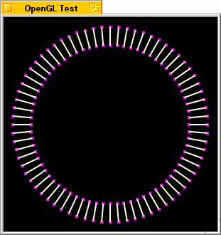

<!-- System Overview - The OpenGL Kit - BGLView -->

## BGLView

The [`BGLView`](BGLView.md "BGLView") class provides a means for rendering graphics using OpenGL calls in a view.

* * *

### The Graphics Buffers

A [`BGLView`](BGLView.md "BGLView") automatically manages video buffers and interfaces to supported hardware acceleration chipsets; all you have to do is call the appropriate OpenGL calls to render your graphics.

The frontbuffer is the graphics buffer that is currently visible on the screen. A backbuffer is a graphics buffer that is located offscreen.

In a single-buffered context, drawing commands are performed in the frontbuffer. Drawing performed in single-buffered mode immediately appears on the screen.

In double-buffered contexts, drawing is performed in the backbuffer and is not visible onscreen until the [`SwapBuffers()`](BGLView.md#BGLView_SwapBuffers "SwapBuffers\(\)") function is called to swap the two buffers and refresh the screen image.

Note

The BGLView class currently only supports double-buffered OpenGL contexts.

#### BGLView & BDirectWindow

The [`BGLView`](BGLView.md "BGLView") class provides a function, [`DirectConnected()`](BGLView.md#BGLView_DirectConnected "DirectConnected\(\)"), that your [`BDirectWindow::DirectConnected()`](BDirectWindow.md#BDirectWindow_DirectConnected "DirectConnected\(\)") function can call to handle the work of refreshing the OpenGL display.

* * *

### Using OpenGL

Long-winded discussion of how to use OpenGL is well beyond the realm of what this book is intended to cover; for complete information on OpenGL, see the OpenGL web site at http://www.opengl.org, where you'll find complete documentation and sample code.

However, it's important to understand how OpenGL fits into the framework of a BeOS application. The example that follows will draw a pattern of lines around a central point, as seen in the picture below.

This code has been structured to make it relatively easy to port sample programs from the OpenGL web site; however, most of those samples use GLUT features, which aren't available yet in the BeOS implementation of OpenGL. In particular, most of the samples on the OpenGL web site use GLUT functions to handle user interface of some form. You'll have to add code for this yourself.

The complete source code and project file can be found on the Be web site at <<<insert URL here>>>.

The first thing that's needed, as always, is an application object, which we establish as follows:
    
    
    class SampleGLApp : public BApplication {
       public:
                         SampleGLApp();
          private:
             SampleGLWindow      theWindow;
    };

The `SampleGLApp` class has a constructor and a private pointer to the application's window. The constructor looks like this:
    
    
    SampleGLApp::SampleGLApp()
             : BApplication("application/x-vnd.Be-GLSample") {
       BRect windowRect;
       uint32 type;
    
       // Set type to the appropriate value for the
       // sample program you're working with.
    
       type = BGL_RGB|BGL_DOUBLE;
    
       windowRect.Set(50,50,350,350);
       theWindow = new SampleGLWindow(windowRect, type);
    }

The first thing the constructor here does is set the variable `type` to describe the context we need. In this example, we want an RGB context with double-buffering on, so we specify `BGL_RGB` and `BGL_DOUBLE`. Then we create the window using the new function.

The `SampleGLWindow` class is almost as simple:
    
    
    class SampleGLWindow : public BWindow {
       public:
                      SampleGLWindow(BRect frame, uint32 type);
          virtual bool   QuitRequested();
    
       private:
          SampleGLView* theView;
    };

The constructor accepts a `frame` rectangle for the window and the OpenGL context type parameter that will be passed to `SampleGLView`'s constructor. As always, [`QuitRequested()`](BApplication.md#BApplication_QuitRequested "QuitRequested\(\)") is overridden to post a `B_QUIT_REQUESTED` message to the application and return true. A pointer to the `SampleGLView` object is maintained as well.

The constructor is fairly trivial:
    
    
    SampleGLWindow::SampleGLWindow(BRect frame, uint32 type)
             : BWindow(frame, "OpenGL Test", B_TITLED_WINDOW, 0) {
       AddChild(theView=new SampleGLView(Bounds(), type));
       Show();
       theView->Render();
    }

This code establishes the window, then creates the `SampleGLView` and adds it as a child of the window. Once that's done, the window is made visible by calling `Show()`. Finally, the `SampleGLView`'s contents are drawn by calling the `SampleGLView`'s [`Render()`](BGLView_Overview.md#SampleGLView_Render) function.

The meat of this program is in the `SampleGLView` class, which follows:
    
    
    class SampleGLView : public BGLView {
       public:
                       SampleGLView(BRect frame, uint32 type);
          virtual void AttachedToWindow(void);
          virtual void FrameResized(float newWidth, float newHeight);
          virtual void ErrorCallback(GLenum which);
    
          void         Render(void);
    
       private:
          void         gInit(void);
          void         gDraw(void);
          void         gReshape(int width, int height);
    
          float        width;
          float        height;
    };

The `SampleGLView` class implements the constructor and reimplements three of the functions of the [`BGLView`](BGLView.md "BGLView") class: [`AttachedToWindow()`](BGLView.md#BGLView_AttachedToWindow "AttachedToWindow\(\)"), [`FrameResized()`](BGLView.md#BGLView_FrameResized "FrameResized\(\)"), and [`ErrorCallback()`](BGLView.md#BGLView_ErrorCallback "ErrorCallback\(\)"). An additional public method, [`Render()`](BGLView_Overview.md#SampleGLView_Render), will contain the actual code for drawing the contents of the view.

In addition, there are three private methods that will contain the actual OpenGL calls for initializing, drawing, and resizing the [`BGLView`](BGLView.md "BGLView")'s contents and a pair of values to represent the width and height of the [`BGLView`](BGLView.md "BGLView").

The constructor is very simple:
    
    
    SampleGLView::SampleGLView(BRect frame, uint32 type)
             : BGLView(frame, "SampleGLView", B_FOLLOW_ALL_SIDES, 0,
                type) {
       width = frame.right-frame.left;
       height = frame.bottom-frame.top;
    }

For the most part, the constructor defers to the [`BGLView`](BGLView.md "BGLView") constructor, setting the `resizingMode` to `B_FOLLOW_ALL_SIDES` and the OpenGL context type to the value specified.

The only addition is that the width and height of the view are cached, based upon the frame rectangle specified. This is done because we'll need that information when the view is attached to the window, and the [`BGLView`](BGLView.md "BGLView") class doesn't include `Width()` and `Height()` functions.

The [`AttachedToWindow()`](BGLView.md#BGLView_AttachedToWindow "AttachedToWindow\(\)") function, which is called when the `SampleGLView` is attached to its parent window, looks like this:
    
    
    void SampleGLView::AttachedToWindow(void) {
       LockGL();
       BGLView::AttachedToWindow();
       gInit();
       gReshape(width, height);
       UnlockGL();
    }

This performs the initialization of the OpenGL context. First, [`LockGL()`](BGLView.md#BGLView_LockGL "LockGL\(\), UnlockGL\(\)") is called to lock the context and let the OpenGL Kit know which view should be targeted by future OpenGL calls. Then the inherited version of [`AttachedToWindow()`](BView.md#BView_AttachedToWindow "AttachedToWindow\(\), AllAttached\(\)") is called to let [`BGLView`](BGLView.md "BGLView") set up the view normally.

Once that's done, the `gInit()` and [`gReshape()`](BGLView_Overview.md#SampleGLView_gReshape) functions are called. [`gInit()`](BGLView_Overview.md#SampleGLView_gInit), as we'll see shortly, is responsible for initializing the context. [`gReshape()`](BGLView_Overview.md#SampleGLView_gReshape) is called to configure the OpenGL coordinate system for the [`BGLView`](BGLView.md "BGLView") given the current width and height of the view.

Finally, [`UnlockGL()`](BGLView.md#BGLView_UnlockGL) is called to release the OpenGL context for the `SampleGLView` and to indicate that we're done using the context for the time being.

The [`FrameResized()`](BGLView.md#BGLView_FrameResized "FrameResized\(\)") function is called automatically whenever the `SampleGLView` is resized:
    
    
    void SampleGLView::FrameResized(float newWidth, float newHeight) {
       LockGL();
       BGLView::FrameResized(width, height);
       width = newWidth;
       height = newHeight;
    
       gReshape(width,height);
    
       UnlockGL();
       Render();
    }

As always, this function begins by locking the OpenGL context. It then calls the inherited version of `FrameResized()` to let [`BGLView`](BGLView.md "BGLView") perform whatever tasks it may need to do.

The new width and height of the view are saved in the `width` and `height` variables, then the [`gReshape()`](BGLView_Overview.md#SampleGLView_gReshape) function is called to adjust the OpenGL context given the new size of the view.

Finally, the context is unlocked, and [`Render()`](BGLView_Overview.md#SampleGLView_Render) is called to redraw the view's contents at the new size.

Although the default [`ErrorCallback()`](BGLView.md#BGLView_ErrorCallback "ErrorCallback\(\)") function provided by [`BGLView`](BGLView.md "BGLView") would be acceptable, we include one of our own anyway:
    
    
    void SampleGLView::ErrorCallback(GLenum whichError) {
       fprintf(stderr, "Unexpected error occured (%d):\n", whichError);
       fprintf(stderr, " %s\n", gluErrorString(whichError));
    }

Note the use of the `gluErrorString()` OpenGL function to obtain an appropriate error message for the error code. You can use this function to avoid displaying error messages for errors that are acceptable or expected.

The `gInit()` function sets up the OpenGL context and initializes variables that will be used later:
    
    
    void SampleGLView::gInit(void) {
       glClearColor(0.0, 0.0, 0.0, 0.0);
       glLineStipple(1, 0xF0E0);
       glBlendFunc(GL_SRC_ALPHA, GL_ONE);
       use_stipple_mode = GL_FALSE;
       use_smooth_mode = GL_TRUE;
       linesize = 2;
       pointsize = 4;
    }

Briefly, this sets the clear color (the background color) of the view to black, configures the pattern for stippled lines and the blending function to be used when blending is enabled. It also selects not to use stippled lines (you can change this by setting `use_stipple_mode` to `GL_TRUE`) and to use anti-aliasing when drawing the lines (you can change this by setting `use_smooth_mode` to `GL_FALSE`). It also chooses to use 2 pixel wide lines, and 4 pixel wide points.

This function doesn't call [`LockGL()`](BGLView.md#BGLView_LockGL "LockGL\(\), UnlockGL\(\)") and [`UnlockGL()`](BGLView.md#BGLView_UnlockGL), so they must be called by the calling function (and if you look at the [`AttachedToWindow()`](BGLView.md#BGLView_AttachedToWindow "AttachedToWindow\(\)") code above, you'll see that this is the case).

There are some global variables used by this program (some of them accessed in the above code), so lets' take a quick look at those:
    
    
    GLenum float use_stipple_mode;      // GL_TRUE to use dashed lines
    GLenum float use_smooth_mode;     // GL_TRUE to use anti-aliased lines
    GLint float linesize;             // Line width
    GLint float pointsize;            // Point diameter
    
    float float pntA[3] = {
       -160.0, 0.0, 0.0
    };
    float pntB[3] = {
       -130.0, 0.0, 0.0
    };

The varaibles `use_stipple_mode`, `use_smooth_mode`, `linesize`, and `pointsize` are discussed in the `gInit()` function above. The two float arrays define points in three-dimensional space. These points will be used as the endpoints of the lines drawn by the `gDraw()` function.

The `gDraw()` function does the actual drawing into the OpenGL context:
    
    
    void SampleGLView::gDraw(void) {
       GLint i;
    
       glClear(GL_COLOR_BUFFER_BIT);
       glLineWidth(linesize);
    
       if (use_stipple_mode) {
          glEnable(GL_LINE_STIPPLE);
       } else {
          glDisable(GL_LINE_STIPPLE);
       }
    
       if (use_smooth_mode) {
          glEnable(GL_LINE_SMOOTH);
          glEnable(GL_BLEND);
       } else {
          glDisable(GL_LINE_SMOOTH);
          glDisable(GL_BLEND);
       }
    
       glPushMatrix();
    
       for (i = 0; i < 360; i += 5) {
          glRotatef(5.0, 0,0,1);     // Rotate right 5 degrees
          glColor3f(1.0, 1.0, 0.0);  // Set color for line
          glBegin(GL_LINE_STRIP);    // And create the line
          glVertex3fv(pntA);
          glVertex3fv(pntB);
          glEnd();
    
          glPointSize(pointsize);    // Set size for point
          glColor3f(0.0, 1.0, 0.0);  // Set color for point
          glBegin(GL_POINTS);
          glVertex3fv(pntA);         // Draw point at one end
          glVertex3fv(pntB);         // Draw point at other end
          glEnd();
       }
    
       glPopMatrix();                // Done with matrix
    }

Without getting too deeply-involved in OpenGL specifics, this code begins by clearing the context's buffer and setting the line width. It then enables the features selected by the `use_stipple_mode` and `use_line_mode` variables.

Once that's done, it establishes a matrix to be used for rotating the lines and draws the lines with points at each end, drawing one every five degrees in a 360-degree circle around the center of the window. After drawing all the lines, the matrix is destroyed and the function returns.

The `gReshape()` function handles adjusting the OpenGL context's coordinate system and viewport when the `SampleGLView` is first created, and whenever the view is resized:
    
    
    void SampleGLView::gReshape(int width, int height) {
       glViewport(0, 0, width, height);
       glMatrixMode(GL_PROJECTION);
       glLoadIdentity();
       gluOrtho2D(-175, 175, -175, 175);
       glMatrixMode(GL_MODELVIEW);
    }

This code simply sets the viewport's coordinate system to reflect the new width and height of the view, and establishes a projection matrix such that no matter what the size and shape of the window, the center of the window is considered to be (0,0) and the window is 300 units wide and 300 units tall. This lets the rendering code draw without having to worry about scaling; OpenGL handles it for us.

The details of how this works are, again, beyond the scope of this chapter.

Finally, the `Render()` function is the high-level function used to actually update the contents of the `SampleGLView` whenever we wish to redraw it:
    
    
    void SampleGLView::Render(void) {
       LockGL();
       gDraw();
       SwapBuffers();
       UnlockGL();
    }

[`LockGL()`](BGLView.md#BGLView_LockGL "LockGL\(\), UnlockGL\(\)") is called to lock the context before calling `gDraw()` to do the actual OpenGL calls to draw the view. Then the [`SwapBuffers()`](BGLView.md#BGLView_SwapBuffers "SwapBuffers\(\)") function is called to swap the backbuffer that was just drawn to the screen, and the context is unlocked.

* * *

### Adapting OpenGL Sample Code

The program described above can easily be adapted to be used with other sample code from the OpenGL web site. First, replace the code in the `gInit()`, `gDraw()`, and [`gReshape()`](BGLView_Overview.md#SampleGLView_gReshape) functions with the code from the [`gInit()`](BGLView_Overview.md#SampleGLView_gInit), [`gDraw()`](BGLView_Overview.md#SampleGLView_gDraw), and [`gReshape()`](BGLView_Overview.md#SampleGLView_gReshape) functions in the sample code (some of the sample programs give these functions slightly different names).

Keep in mind that the current implementation of OpenGL under BeOS doesn't support single-buffered graphics, so you'll need to make whatever adjustments are necessary to use double-buffering.

Once these functions have been implemented, copy any global variables from the sample program into your project. Finally, in the `SampleGLApp` constructor, fix the OpenGL context type and window size information to match that used by the sample program.

You may also wish to implement code to handle user interface to let you configure the sample program; that's beyond the scope of this chapter—see the Interface Kit chapter of the Be Developer's Guide for further information on handling user input.
