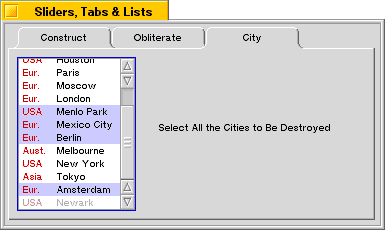

<!-- System Overview - The Interface Kit - BListItem -->

## BListItem

A [`BListItem`](BListItem.md "BListItem") represents a single item in a [`BListView`](BListView.md "BListView") (or [`BOutlineListView`](BOutlineListView.md "BOutlineListView")). The [`BListItem`](BListItem.md "BListItem") object provides drawing instructions that can draw the item (through [`DrawItem()`](BListItem.md#BListItem_DrawItem "DrawItem\(\)")), and keeps track of the item's state. To use a [`BListItem`](BListItem.md "BListItem"), you must add it to a [`BListView`](BListView.md "BListView") through [`BListView::AddItem()`](BListView.md#BListView_AddItem "AddItem\(\)") ([`BOutlineListView`](BOutlineListView.md "BOutlineListView") provides additional item-adding functions). The [`BListView`](BListView.md "BListView") object provides the drawing context for the [`BListItem`](BListItem.md "BListItem")'s [`DrawItem()`](BListItem.md#BListItem_DrawItem "DrawItem\(\)") function.

[`BListItem`](BListItem.md "BListItem") is abstract; each subclass must implement [`DrawItem()`](BListItem.md#BListItem_DrawItem "DrawItem\(\)"). [`BStringItem`](BStringItem.md "BStringItem")—the only [`BListItem`](BListItem.md "BListItem") subclass provided by Be—implements the function to draw the item as a line of text. For an example of a custom [`BListView`](BListView.md "BListView") subclass, see "[Creating a Custom List Item](BListItem_Overview.md#BListItem_Overview_Custom "Creating a Custom List Item")".

* * *

### Synchronizing a List Item with its List View

A [`BListItem`](BListItem.md "BListItem") object doesn't automatically get redrawn when the item changes. If you change a list item's content or state, you must tell the item's owner (the [`BListView`](BListView.md "BListView") object) to redraw the item by calling [`BListView::InvalidateItem()`](BListView.md#BListView_InvalidateItem "InvalidateItem\(\)"). For example:
    
    
    /* listItem belongs to listView.
       We change the state of the item... */
    listItem->SetEnabled(false);
    
    /* ...so we have to tell the list view to redraw it. */
    listView->LockLooper();
    listView->InvalidateItem(listView->IndexOf(listItem));
    listView->UnlockLooper();

If you're making a lot of changes, you can flush them all at the same time through a single [`BView::Invalidate()`](BView.md#BView_Invalidate "Invalidate\(\)") call:
    
    
    listItemA->SetEnabled(false);
    listItemB->SetEnabled(false);
    listItemC->SetEnabled(false);
    listView->LockLooper();
    listView->Invalidate();
    listView->UnlockLooper();

Note that you don't have to lock the list view's window to change one of its items—you only have to lock the window when you talk to the list view itself.

[`BListView`](BListView.md "BListView") provides its own smart version

* * *

### Creating a Custom List Item

Although much of the time all you need to draw in a list are strings (in which case you can use the [`BStringItem`](BStringItem.md "BStringItem") class), from time-to-time you may need to display more than a simple text string—maybe you need to display multiple pieces of information per item, or maybe you just want to jazz up the display with some icons.

For example, let's say you need to let the user select a city from a list, but also need to display the part of the world that each city is in. You could just use [`BStringItem`](BStringItem.md "BStringItem") objects with strings like "Chicago (USA)", but it might look nicer if you could lay out your list items in two colums, maybe with a splash of color:

To change the appearance of a list item, you override the [`DrawItem()`](BListItem.md#BListItem_DrawItem "DrawItem\(\)") function to draw the item's contents however you want it to look.

The following sections define the class that creates these list items.

#### The CityItem Declaration

The declaration for our `CityItem` class looks like this:
    
    
    #include <String.h>
    #include <ListItem.h>
    
    class CityItem : public BListItem
    {
       public:
          CityItem(const char *city, int32 region = 0);
          virtual void DrawItem(BView *owner,
                BRect frame,
                bool complete = false);
          enum { USA, ASIA, EUROPE, AUSTRALIA, OTHER };
    
       private:
          BString kCity;
          int32 kRegion;
    };
    
    const char *region_names[] = {
       "USA", "Asia", "Eur.", "Aust.", "Other"
    };

A `CityItem` object contains two pieces of data: a city name, and a region code. The region code is used as an index into the array of region names.

#### The CityItem Definition

The constructor looks like this:
    
    
    CityItem::CityItem(const char *city, int32 region)
             : BListItem()
    {
       kCity = city;
       kRegion = region;
    }

The [`DrawItem()`](BListItem.md#BListItem_DrawItem "DrawItem\(\)") function does the actual work of drawing the item. [`DrawItem()`](BListItem.md#BListItem_DrawItem "DrawItem\(\)") receives three parameters:

  * A [`BView`](BView.md "BView") "owner"; this is the view that contains the [`BListItem`](BListItem.md "BListItem"). All drawing calls you issue should be made through this BView. For example:
        
        owner->DrawString(item_text);

  * A [`BRect`](BRect.md "BRect"), which is the rectangle in which the item should be drawn.

  * A bool, which is `true` if the item needs to be erased and redrawn, or `false` if the item's contents can be safely redrawn without erasing the current contents.

[`DrawItem()`](BListItem.md#BListItem_DrawItem "DrawItem\(\)") begins by checking to see if the item is selected (by calling [`IsSelected()`](BListItem.md#BListItem_IsSelected)) or if a complete redraw is required. In either of these cases, we want to redraw the background, to either the highlight color, or the owner's view color:
    
    
    void CityItem::DrawItem(BView *owner, BRect frame,
                            bool complete)
    {
       if (IsSelected() || complete) {
          rgb_color color;
          if (IsSelected()) {
             color = kHighlight;
          }
          else {
             color = owner->ViewColor();
          }
          owner->SetHighColor(color);
          owner->FillRect(frame);
       }

Now we draw the text. First, we move the owner view's pen so it's inset from the bottom left corner of the item's frame. (In a real application, you would want to make the inset adjustments based on the font that's being used; see the [`BFont`](BFont.md "BFont") class for more information.):
    
    
    owner->MovePenTo(frame.left+4, frame.bottom-2);

If the item is enabled (selectable), we set the owner view's high color to a shade of medium red; if it's disabled, we use a lighter red color (the color definitions aren't shown). Then we use [`DrawString()`](BView.md#BView_DrawString "DrawString\(\)") to draw the region name:.
    
    
       if (IsEnabled()) {
          owner->SetHighColor(kRedColor);
       }
       else {
          owner->SetHighColor(kDimRedColor);
       }
       owner->DrawString(region_names[kRegion]);

Move the pen to the right column and draw the city name:
    
    
       owner->MovePenTo(frame.left+38, frame.bottom-2);
       if (IsEnabled()) {
          owner->SetHighColor(kBlackColor);
       }
       else {
          owner->SetHighColor(kMedGray);
       }
       owner->DrawString(kCity.String());
    }

#### Using a CityItem Object

To use a `CityItem` object, simply construct a new object and pass it to [`BListView::AddItem()`](BListView.md#BListView_AddItem "AddItem\(\)"):
    
    
    listView->AddItem(new CityItem("Chicago", CityItem::USA));
