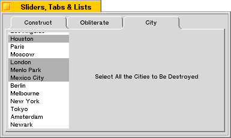

<!-- System Overview - The Interface Kit - BListView -->

## BListView

A [`BListView`](BListView.md "BListView") displays a list of items the user can select and invoke. Each item is a kind of [`BListItem`](BListItem.md "BListItem") object. The [`BListView`](BListView.md "BListView") manages the layout of the list and the interaction with the user; it leaves the display of each item to the [`BListItem`](BListItem.md "BListItem") objects. A [`BListItem`](BListItem.md "BListItem") is not a view and draws only when called upon by the [`BListView`](BListView.md "BListView").

The figure below depicts a window that contains a sample [`BListView`](BListView.md "BListView").

A [`BListView`](BListView.md "BListView") displays all items unindented at a single level. A derived class, [`BOutlineListView`](BOutlineListView.md "BOutlineListView"), can arrange items in an hierarchical outline.

* * *

### Lists and List Views

This class is based on the [`BList`](BList.md "BList") class of the [Support Kit](TheSupportKit.md "The Support Kit"). It implements counterparts for all [`BList`](BList.md "BList") member functions, so you can treat a [`BListView`](BListView.md "BListView") object just like a [`BList`](BList.md "BList"). [`BListView`](BListView.md "BListView") simply makes the list visible.

[`BListView`](BListView.md "BListView") functions work identically to their [`BList`](BList.md "BList") counterparts, except for two things:

  * A [`BListView`](BListView.md "BListView") assumes that the list contains pointers to [`BListItem`](BListItem.md "BListItem") objects, not void* pointers.

  * A [`BListView`](BListView.md "BListView") makes sure that the on-screen display is properly updated whenever the items in the list change.

In both classes, the list keeps track of data pointers—void* pointers in the case of [`BList`](BList.md "BList") and pointers to [`BListItem`](BListItem.md "BListItem")s in the case of [`BListView`](BListView.md "BListView"). Adding an item to the list adds only the pointer; the pointed-to object isn't copied.

* * *

### Updating the List

When the contents of the list change, the [`BListView`](BListView.md "BListView") makes sure the visible list on-screen is updated. However, since it records only pointers to data, it can know that something changed only when a [`BListItem`](BListItem.md "BListItem") is added or removed. If an item pointer remains the same but the data the item displays is altered, the [`BListView`](BListView.md "BListView") won't know about it. In this case, you must force the list to be redrawn (by calling the [`InvalidateItem()`](BListView.md#BListView_InvalidateItem "InvalidateItem\(\)") function or [`BView`](BView.md "BView")'s [`Invalidate()`](BView.md#BView_Invalidate "Invalidate\(\)")).

* * *

### Selecting and Invoking Items

The user can click an item in the list to select it and double-click an item to both select and invoke it. The user can also select and invoke items from the keyboard. The navigation keys (such as Down Arrow, Home, and Page Up) select items; Enter and the space bar invoke them.

By default, a [`BListView`](BListView.md "BListView") permits only one item to be selected at a time. However, at construction and with the [`SetListType()`](BListView.md#BListView_SetListType "SetListType\(\) , ListType\(\)") function, you can set it up to allow multiple selections. The user can make contiguous extensions to the current selection by holding down a Shift key, and discontinuous extensions by holding down an Option key.

The [`BListView`](BListView.md "BListView") highlights items as they're selected, but otherwise it doesn't define what, if anything, should take place when the selection changes. You can determine that yourself either by implementing a [`SelectionChanged()`](BListView.md#BListView_SelectionChanged "SelectionChanged\(\)") function in a derived class or by registering a selection message (a [`BMessage`](BMessage.md "BMessage") object) with the [`BListView`](BListView.md "BListView"). The function is called and the message is delivered to a target destination whenever the user modifies the selection.

Similarly, the [`BListView`](BListView.md "BListView") doesn't define what it means to "invoke" an item. You can register a separate invocation message that's sent whenever the user double-clicks an item or presses Enter or the space bar while items are selected. For example, if the user double-clicks an item in a list of file names, the message might tell the [`BApplication`](BApplication.md "BApplication") object to open that file.

A [`BListView`](BListView.md "BListView") doesn't have default selection and invocation messages. Messages are sent only if registered with the [`SetSelectionMessage()`](BListView.md#BListView_SetSelectionMessage "SetSelectionMessage\(\), SelectionMessage\(\), SelectionCommand\(\)") and [`SetInvocationMessage()`](BListView.md#BListView_SetInvocationMessage "SetInvocationMessage\(\), InvocationMessage\(\), InvocationCommand\(\)") functions. Before sending either type of message, the [`BListView`](BListView.md "BListView") adds information to it identifying itself and the items that are currently selected. See the [`Invoke()`](BInvoker.md#BInvoker_Invoke "Invoke\(\), InvokeNotify\(\)") function for details.

* * *

### Autoscrolling and Dragging Items

[`BListView`](BListView.md "BListView") provides an autoscroll feature: There's an invisible area about 25 pixels high both above and below the list view; if the user clicks inside the list view and then drags into this autoscroll area, the contents of the list will scroll in the direction of the mouse.

[`BListView`](BListView.md "BListView") also provides optional item-dragging that let's the user reorder the items in the list. To turn on this feature, you have to subclass [`BListView`](BListView.md "BListView") and implement [`InitiateDrag()`](BListView.md#BListView_InitiateDrag "InitiateDrag\(\)") to return `true`.

* * *

### Adding a Scroll Bar to a BListView

Note that although a [`BListView`](BListView.md "BListView") is scrollable, it doesn't provide scroll bars. You can place the [`BListView`](BListView.md "BListView") inside a [`BScrollView`](BScrollView.md "BScrollView") to get the more traditional appearance for your list:

The code for this might look something like this:
    
    
    BListView* list = new BListView(r, "City",
                                    B_MULTIPLE_SELECTION_LIST);
    
    list->AddItem(new BStringItem("Chicago"));
    ...
    theView->AddChild(new BScrollView("scroll_cities", list,
             B_FOLLOW_LEFT | B_FOLLOW_TOP, 0, false, true));

See the [`BScrollView`](BScrollView.md "BScrollView") class for a more in-depth explanation of scrolling views.

See also: the [`BList`](BList.md "BList") class in the Support Kit, the [`BOutlineListView`](BOutlineListView.md "BOutlineListView") and [`BListItem`](BListItem.md "BListItem") classes
