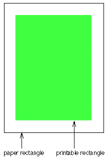
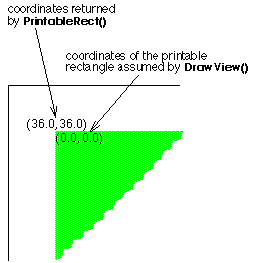

<!-- System Overview - The Interface Kit - BPrintJob -->

## BPrintJob

A [`BPrintJob`](BPrintJob.md "BPrintJob") object runs a printing session. It negotiates everything after the user's initial request to print—from engaging the Print Server to calling upon [`BView`](BView.md "BView")s to draw and spooling the results to the printer. It also handles a secondary and somewhat separate matter related to printing—configuring the page layout.

* * *

### Setting Up the Page Layout

Users typically don't decide how a document fits on a page—the size of the paper, the width of the margins, the orientation of the image, and so on—each time they print. These decisions are usually made when setting up the document, perhaps from a Page Layout menu item, rather than Print.

To set up the page parameters for a document, an application should create a [`BPrintJob`](BPrintJob.md "BPrintJob") object, assign it a name, and call [`ConfigPage()`](BPrintJob.md#BPrintJob_ConfigPage "ConfigPage\(\), ConfigJob\(\)"):
    
    
    status_t MyDocumentManager::SetUpPage()
    {
       BPrintJob job("document");
       return job.ConfigPage();
    }

[`ConfigPage()`](BPrintJob.md#BPrintJob_ConfigPage "ConfigPage\(\), ConfigJob\(\)") has the Print Server interact with the user to set up the page configuration. Configuration settings are stored in a [`BMessage`](BMessage.md "BMessage") object that will be handed to the server when the document is printed. The [`BMessage`](BMessage.md "BMessage") is important to the server, but the application doesn't need to look at it directly; functions are provided to access the useful data it contains. However, you may want to get the object and store it with the document so that the configuration can be reused whenever the document is printed—and so that the user's previous choices can be the default settings when [`ConfigPage()`](BPrintJob.md#BPrintJob_ConfigPage "ConfigPage\(\), ConfigJob\(\)") is called again. This is good behavior for an application to follow, and is highly recommended.

[`Settings()`](BPrintJob.md#BPrintJob_Settings) returns the page configuration the user set up; [`SetSettings()`](BPrintJob.md#BPrintJob_SetSettings "SetSettings\(\), Settings\(\), IsSettingsMessageValid\(\)") initializes the configuration that's presented to the user. For example:
    
    
    BMessage *setup;
    . . .
    status_t MyDocumentManager::SetUpPage() {
       status_t result;
       BPrintJob job("document's name");
    
       if (setup) {
          job.SetSettings(new BMessage(*setup));
       }
    
       result = job.ConfigPage();
    
       if (result == B_OK) {
          setup = job.Settings();
    
          /* record the settings for your own use */
          paper_rect = job.PaperRect();
          printable_rect = job.PrintableRect();
       }
    
       return result;
    }

In this example, the setup [`BMessage`](BMessage.md "BMessage") presumably is flattened and saved with the document whenever the document is saved, and unflattened whenever the document is open and the page settings are needed.

* * *

### Printing

To print a document, an application must go through several ordered steps:

  * Engaging the Print Server and setting parameters for the job.

  * Setting up a spool file to hold image data.

  * Asking [`BView`](BView.md "BView")s to draw each page.

  * After each page is drawn, putting the data for the page in the spool file.

  * Committing the spool file to the Print Server.

A [`BPrintJob`](BPrintJob.md "BPrintJob") object has member functions that assist with each step.

#### Setting Up a Print Job

A print job begins when the user requests the application to print something. In response, the application should create a [`BPrintJob`](BPrintJob.md "BPrintJob") object, assign the job a name, and call [`ConfigJob()`](BPrintJob.md#BPrintJob_ConfigJob) to initialize the printing environment. For example:
    
    
    BMessage *setup;
    . . .
    status_t MyDocumentManager::Print()
    {
       BPrintJob job("document");
       status_t err;
    
       if ( setup )
          job.SetSettings(new BMessage(*setup));
       if ( (err = job.ConfigJob()) == B_OK ) {
          delete setup;
          setup = job.Settings();
       }
       . . .
    }

So far, this looks much like the code for configuring the page presented in the previous "[Setting Up the Page Layout](BPrintJob_Overview.md#BPrintJob_Overview_SettingUpThePageLayout "Setting Up the Page Layout")" section. The idea is the same. [`ConfigJob()`](BPrintJob.md#BPrintJob_ConfigJob) gets the Print Server ready for a new printing session and has it interact with the user to set up the parameters for the job—which pages, how many copies, and so on. It uses the same settings [`BMessage`](BMessage.md "BMessage") to record the user's choices as [`ConfigPage()`](BPrintJob.md#BPrintJob_ConfigPage "ConfigPage\(\), ConfigJob\(\)") did, though it records information that's more immediate to the particular printing session.

Again, you may want to store the user's choices with the document so that they can be used to set the initial configuration for the job when the document is next printed. By calling [`Settings()`](BPrintJob.md#BPrintJob_Settings), you can get the job configuration the user set up; [`SetSettings()`](BPrintJob.md#BPrintJob_SetSettings "SetSettings\(\), Settings\(\), IsSettingsMessageValid\(\)") initializes the configuration that's presented to the user.

Information about the page layout will be required while printing. If that information isn't available in the [`Settings()`](BPrintJob.md#BPrintJob_Settings) [`BMessage`](BMessage.md "BMessage"), [`ConfigJob()`](BPrintJob.md#BPrintJob_ConfigJob) will begin, in essence, by calling [`ConfigPage()`](BPrintJob.md#BPrintJob_ConfigPage "ConfigPage\(\), ConfigJob\(\)") so that the server can ask the user to supply it.

To discover which pages the user wants to print, you can call the [`FirstPage()`](BPrintJob.md#BPrintJob_FirstPage "FirstPage\(\), LastPage\(\)") and [`LastPage()`](BPrintJob.md#BPrintJob_LastPage) functions after [`ConfigJob()`](BPrintJob.md#BPrintJob_ConfigJob) returns:
    
    
    int32 pageCount = job.LastPage() - job.FirstPage() + 1;

#### The Spool File

The next step after configuring the job is to call [`BeginJob()`](BPrintJob.md#BPrintJob_BeginJob "BeginJob\(\)") to set up a spool file and begin the production of pages. After all the pages are produced, [`CommitJob()`](BPrintJob.md#BPrintJob_CommitJob "CommitJob\(\)") is called to commit them to the printer.
    
    
    job.BeginJob();
    /* draw pages here*/
    job.CommitJob();

[`BeginJob()`](BPrintJob.md#BPrintJob_BeginJob "BeginJob\(\)") and [`CommitJob()`](BPrintJob.md#BPrintJob_CommitJob "CommitJob\(\)") bracket all the drawing that's done during the job.

#### Cancellation

A number of things can happen to derail a print job after it has started—most significantly, the user can cancel it at any time. To be sure that the job hasn't been canceled or something else hasn't happened to defeat it, you can call [`CanContinue()`](BPrintJob.md#BPrintJob_CanContinue "CanContinue\(\)") at critical junctures in your code. This function will tell you whether it's sensible to continue with the job. In the following example, a while loop is used to loop through all the pages in the document, or until [`CanContinue()`](BPrintJob.md#BPrintJob_CanContinue "CanContinue\(\)") returns false, indicating that the job has been canceled:
    
    
    job.BeginJob();
    while (job.CanContinue() && page <= pageCount) {
       /* draw each page here*/
       page++;
    }
    job.CommitJob();

#### Drawing on the Page

A page is produced by asking one or more [`BView`](BView.md "BView")s to draw within a rectangle that can be mapped to a sheet of paper (excluding the margins at the edge of the paper). [`DrawView()`](BPrintJob.md#BPrintJob_DrawView "DrawView\(\) , SpoolPage\(\)") requests one [`BView`](BView.md "BView") to draw some portion of its data and specifies where the data should appear on the page. You can call [`DrawView()`](BPrintJob.md#BPrintJob_DrawView "DrawView\(\) , SpoolPage\(\)") any number of times for a single page to ask any number of [`BView`](BView.md "BView")s to contribute to the page. After all views have drawn, [`SpoolPage()`](BPrintJob.md#BPrintJob_SpoolPage) spools the data to the file that will eventually be committed to the printer. [`SpoolPage()`](BPrintJob.md#BPrintJob_SpoolPage) is called just once for each page. For example:
    
    
    for (int i = job.FirstPage();
    job.CanContinue() && i <= job.LastPage();
    i++) {
       . . .
       job.DrawView(someView, viewRect, pointOnPage);
       job.DrawView(anotherView, anotherRect, differentPoint);
       . . .
       job.SpoolPage();
    }

[`DrawView()`](BPrintJob.md#BPrintJob_DrawView "DrawView\(\) , SpoolPage\(\)") calls the [`BView`](BView.md "BView")'s [`Draw()`](BView.md#BView_Draw "Draw\(\)") function. That function must be prepared to draw either for the screen or on the printed page. It can test the destination of its output by calling the [`Draw()`](BView.md#BView_Draw "Draw\(\)") [`IsPrinting()`](BView.md#BView_IsPrinting "IsPrinting\(\)") function.

Note

Don't use the [`BView::Bounds()`](BView.md#BView_Bounds "Bounds\(\)") function to determine the area to render. Instead, use the update rectangle passed to the [`BView::Draw()`](BView.md#BView_Draw "Draw\(\)") function.

#### A Complete Printing Function

This function puts together all the above code snippets and handles the printing of a document (minus the actual drawing and visual status information presented to the user as printing goes on).
    
    
    status_t MyDocumentManager::Print() {
       status_t result = B_OK;
       BPrintJob job("document's name");
    
       // If we have no setup message, we should call ConfigPage()
       // You must use the same instance of the BPrintJob object
       // (you can't call the previous "PageSetup()" function, since it
       // creates its own BPrintJob object).
    
       if (!setup) {
          result = job.ConfigPage();
          if (result == B_OK) {
             // Get the user Settings
             setup = job.Settings();
    
             // Use the new settings for your internal use
             paper_rect = job.PaperRect();
             printable_rect = job.PrintableRect();
          }
       }
    
       if (result == B_OK) {
          // Setup the driver with user settings
          job.SetSettings(setup);
    
          result = job.ConfigJob();
          if (result == B_OK) {
             // WARNING: here, setup CANNOT be NULL.
             if (setup == NULL) {
                // something's wrong, handle the error and bail out
             }
             delete setup;
    
             // Get the user Settings
             setup = job.Settings();
    
             // Use the new settings for your internal use
             // They may have changed since the last time you read it
             paper_rect = job.PaperRect();
             printable_rect = job.PrintableRect();
    
             // Now you have to calculate the number of pages
             // (note: page are zero-based)
             int32 firstPage = job.FirstPage();
             int32 lastPage = job.LastPage();
    
             // Verify the range is correct
             // 0 ... LONG_MAX -> Print all the document
             // n ... LONG_MAX -> Print from page n to the end
             // n ... m -> Print from page n to page m
    
             if (lastPage > your_document_last_page)
                last_page = your_document_last_page;
    
             int32 nbPages = lastPage - firstPage + 1;
    
             // Verify the range is correct
             if (nbPages <= 0)
                return B_ERROR;
    
             // Now you can print the page
             job.BeginJob();
    
             // Print all pages
             bool can_continue = job.CanContinue();
    
             for (int i=firstPage ; can_continue && i<=lastPage ; i++) {
                // Draw all the needed views
                job.DrawView(someView, viewRect, pointOnPage);
                job.DrawView(anotherView, anotherRect, differentPoint);
    
                // If the document have a lot of pages, you can update
                   a BStatusBar, here
                // or else what you want...
                update_status_bar(i-firstPage, nbPages);
    
                // Spool the page
                job.SpoolPage();
    
                // Cancel the job if needed.
                // You can for exemple verify if the user pressed the
                // ESC key or (SHIFT + '.')...
                if (user_has_canceled)
                {
                   // tell the print_server to cancel the printjob
                   job.CancelJob();
                   can_continue = false;
                   break;
                }
    
                // Verify that there was no error (disk full for example)
                can_continue = job.CanContinue();
             }
    
             // Now, you just have to commit the job!
             if (can_continue)
                job.CommitJob();
             else
                result = B_ERROR;
          }
       }
    
       return result;
    }

#### Drawing Coordinates

When a [`BView`](BView.md "BView") draws for the printer, it draws within the printable rectangle of a page—a rectangle that matches the size of a sheet of paper minus the unprinted margin around the paper's edge. The [`PaperRect()`](BPrintJob.md#BPrintJob_PaperRect "PaperRect\(\) , PrintableRect\(\)") function returns a rectangle that measures a sheet of paper and [`PrintableRect()`](BPrintJob.md#BPrintJob_PrintableRect) returns the printable rectangle, as illustrated in this diagram.

Both rectangles are stated in a coordinate system that has its origin at the left top corner of the page. Thus, the left and top sides of the rectangle returned by [`PaperRect()`](BPrintJob.md#BPrintJob_PaperRect "PaperRect\(\) , PrintableRect\(\)") are always 0.0. [`PrintableRect()`](BPrintJob.md#BPrintJob_PrintableRect) locates the printable rectangle on the paper rectangle. However, [`DrawView()`](BPrintJob.md#BPrintJob_DrawView "DrawView\(\) , SpoolPage\(\)") assumes coordinates that are local to the printable rectangle—that is, an origin at the left top corner of the printable rectangle rather than the paper rectangle.

The diagram below shows the left top coordinates of the printable rectangle as [`PrintableRect()`](BPrintJob.md#BPrintJob_PrintableRect) would report them and as [`DrawView()`](BPrintJob.md#BPrintJob_DrawView "DrawView\(\) , SpoolPage\(\)") would assume them, given a half-inch margin.

[`Draw()`](BView.md#BView_Draw "Draw\(\)") always draws in the [`BView`](BView.md "BView")'s own coordinate system. Those coordinates are mapped to locations in the printable rectangle as specified by the arguments passed to [`DrawView()`](BPrintJob.md#BPrintJob_DrawView "DrawView\(\) , SpoolPage\(\)").

See also: [`BView::IsPrinting()`](BView.md#BView_IsPrinting "IsPrinting\(\)")
