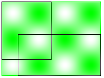

<!-- Classes And Methods - The Interface Kit - BRect -->

## BRect

| Derived From:| –  
---|---  
Mix-in Classes:| –  
Declared In:| `interface/Screen.h`  
Library:| `libbe.so`  
Allocation:| Constructor or on the stack, typically the latter.  
[Class Overview](BRect_Overview.md "BRect")

  * [Data Members](BRect.md#BRect_DataMembers)
  * [Constructor and Destructor](BRect.md#BRect_ConstructorDestructor)
  * [Member Functions](BRect.md#BRect_MemberFunctions)
  * [Operators](BRect.md#BRect_Operators)

  
  
* * *

### Data Members

Member| Description  
---|---  
float `left`| The value of the rectangle's left side.  
float `top`| The value of the rectangle's top.  
float `right`| The value of the rectangle's right side.  
float `bottom`| The value of the rectangle's bottom.  
  
* * *

### Constructor and Destructor

#### BRect()

`inline BRect(float left,  
float top,  
float right,  
float bottom);` `inline BRect([`BPoint`](BPoint.md "BPoint") leftTop,  
[`BPoint`](BPoint.md "BPoint") rightBottom);` `inline BRect(BRect& rect);` `inline BRect();`

Initializes a `BRect` as four sides, as two diametrically opposed corners, or as a copy of some other `BRect` object. A rectangle that's not assigned any initial values is invalid, until a specific assignment is made, either through a [`Set()`](BRect.md#BRect_Set "Set\(\), SetLeftTop\(\), SetLeftBottom\(\), SetRightTop\(\), SetRightBottom\(\)") function or by setting the object's data members directly.

* * *

### Member Functions

####  Contains(), Intersects()

`bool Contains([`BPoint`](BPoint.md "BPoint") point) const;` `bool Contains(BRect rect) const;`

`bool Intersects(BRect rect) const;`

`Contains()` returns `true` if `point` or `rect` lies entirely within the `BRect`'s rectangle (and `false` if not). A rectangle contains the points that lie along its edges; for example, two identical rectangles contain each other.

`Intersect()` returns `true` if the `BRect` has any area—even a corner or part of a side—in common with `rect`, and `false` if it doesn't.

Note

This function's results are unpredictable if either rectangle is invalid.

See also: [`& (intersection)`](BRect.md#BRect_operator_intersection "& \(intersection\)"), [`| (union)`](BRect.md#BRect_operator_union "| \(union\)"), [`BPoint::ConstrainTo()`](BPoint.md#BPoint_ConstrainTo "ConstrainTo\(\)")

####  InsetBy(), InsetBySelf(), InsetByCopy(), OffsetBy(), OffsetBySelf() , OffsetByCopy(), OffsetTo(), OffsetToSelf(), OffsetToCopy()

`void InsetBy(float x,  
float y);` `void InsetBy([`BPoint`](BPoint.md "BPoint") point);`

`BRect& InsetBySelf(float x,  
float y);` `BRect& InsetBySelf([`BPoint`](BPoint.md "BPoint") point);`

`BRect InsetByCopy(float x,  
float y);` `BRect InsetByCopy([`BPoint`](BPoint.md "BPoint") point);`

`void OffsetBy(float x,  
float y);` `void OffsetBy([`BPoint`](BPoint.md "BPoint") point);`

`BRect& OffsetBySelf(float x,  
float y);` `BRect& OffsetBySelf([`BPoint`](BPoint.md "BPoint") point);`

`BRect OffsetByCopy(float x,  
float y);` `BRect OffsetByCopy([`BPoint`](BPoint.md "BPoint") point);`

`void OffsetTo(float x,  
float y);` `void OffsetTo([`BPoint`](BPoint.md "BPoint") point);`

`BRect& OffsetToSelf(float x,  
float y);` `BRect& OffsetToSelf([`BPoint`](BPoint.md "BPoint") point);`

`BRect OffsetToCopy(float x,  
float y);` `BRect OffsetToCopy([`BPoint`](BPoint.md "BPoint") point);`

Sorting out the different versions, there are three basic rectangle-manipulation functions here:

  * `InsetBy()` insets the sides of the `BRect`'s rectangle by `x` units (left and right sides) and `y` units (top and bottom). Positive inset values shrink the rectangle; negative values expand it. Note that both sides of each pair moves the full amount. For example, if you inset a `BRect` by (4,4), the left side moves (to the right) four units and the right side moves (to the left) four units (and similarly with the top and bottom).

  * `OffsetBy()` moves the `BRect` horizontally by `x` units and vertically by `y` units. The rectangle's size doesn't change.

  * `OffsetTo()` moves the `BRect` to the location (`x`,`y`).

If a [`BPoint`](BPoint.md "BPoint") argument is used, the [`BPoint`](BPoint.md "BPoint")'s `x` and `y` values are used as the `x` and `y` arguments.

The `…Self()` versions of the functions are the same as the simpler versions, but they conveniently return the modified `BRect`.

The `…Copy()` versions copy the `BRect`, and then modify and return the copy (without changing the original).

#### IsValid()

`inline bool IsValid() const;`

Returns `true` if the `BRect`'s right side is greater than or equal to its left and its bottom is greater than or equal to its top, and `false` otherwise. An invalid rectangle can't be used to define an interface area (such as the frame of a view or window).

#### PrintToStream()

`void PrintToStream() const;`

Prints the contents of the `BRect` object to standard out in the form:
    
    
    "BRect(left, top, right, bottom)"
    

####  Set(), SetLeftTop(), SetLeftBottom(), SetRightTop(), SetRightBottom()

`inline void Set(float left,  
float top,  
float right,  
float bottom);``void SetLeftTop(const [`BPoint`](BPoint.md "BPoint") point);``void SetLeftBottom(const [`BPoint`](BPoint.md "BPoint") point);``void SetRightTop(const [`BPoint`](BPoint.md "BPoint") point);``void SetRightBottom(const [`BPoint`](BPoint.md "BPoint") point);``[`BPoint`](BPoint.md "BPoint") LeftTop() const;``[`BPoint`](BPoint.md "BPoint") LeftBottom() const;``[`BPoint`](BPoint.md "BPoint") RightTop() const;``[`BPoint`](BPoint.md "BPoint") RightBottom() const;`

`Set()` sets the object's rectangle by defining the coordinates of all four sides. The other `Set…()` functions move one of the rectangle's corners to the [`BPoint`](BPoint.md "BPoint") argument; the other corners and sides are modified concomittantly. None of these functions prevents you from creating an invalid rectangle.

The [`BPoint`](BPoint.md "BPoint")-returning functions return the coordinates of one of the rectangle's four corners.

####  Width(), IntegerWidth(), Height(), IntegerHeight()

`inline float Width() const;``inline int32 IntegerWidth() const;``inline float Height() const;``inline int32 IntegerHeight() const;`

`Width()` returns the numerical difference between the rectangle's right and left sides (i.e. `right` \- `left`). `IntegerWidth()` does the same, but rounds up in the case of a fractional difference.

`Height()` and `IntegerHeight()` perform similar calculations for the height of the rectangle (i.e. `bottom` \- `top` and ceil(`bottom` \- `top`)).

The width and height of a `BRect`'s rectangle, as returned through these functions

* * *

### Operators

#### = (assignment)

`inline BRect& operator =(const [`BRect`](BRect.md "BRect") from);`

Copies `from`'s rectangle data into the left-side object.

####  == (equality), != (inequality)

`bool operator ==(BRect ) const;``bool operator !=(BRect ) const;`

`==` returns `true` if the two objects' rectangles exactly coincide.

`!=` returns `true` if the two objects' rectangles don't coincide.

#### & (intersection)

`BRect operator &(BRect ) const;`

Creates and returns a new `BRect` that's the intersection of the two operands. The new `BRect` encloses the area that the two operands have in common. If the two operands don't intersect, the new `BRect` will be invalid.

#### | (union)

`BRect operator |(BRect ) const;`

Creates and returns a new `BRect` that minimally but completely encloses the area defined by both of the operands. The shaded area illustrates the union of the two outlined rectangles:

