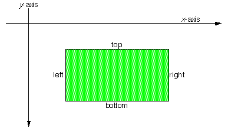
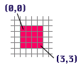
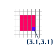

<!-- System Overview - The Interface Kit - BRect -->

## BRect

A [`BRect`](BRect.md "BRect") object represents a rectangle. [`BRect`](BRect.md "BRect")s are used throughout the Interface Kit to define the frames of windows, views, bitmaps—even the screen itself. A [`BRect`](BRect.md "BRect") is defined by its four sides, expressed as the public data members `left`, `top`, `right`, and `bottom`.

When used in the screen coordinate system(as a window or view's frame, for example) a [`BRect`](BRect.md "BRect")'s sides are aligned with the x and y axes (as shown here), and its coordinate values, which are stored as floats, are floored.

* * *

### Rectangle Size and Area

You would expect a [`BRect`](BRect.md "BRect") defined thus…:
    
    
    [BRect](BRect.md "BRect") rect(0, 0, 3, 3);

…to have a width of 3.0 and a height of 3.0. These, indeed, are the values returned by the [`Width()`](BRect.md#BRect_Width "Width\(\), IntegerWidth\(\), Height\(\), IntegerHeight\(\)") and [`Height()`](BRect.md#BRect_Height) functions. However, the coordinate system considers integer coordinates to fall in the center of pixels, so the rectangle "touches" a 4x4 pixel grid when it's applied to the screen—it appears one pixel wider and one higher than [`Width()`](BRect.md#BRect_Width "Width\(\), IntegerWidth\(\), Height\(\), IntegerHeight\(\)") and [`Height()`](BRect.md#BRect_Height) would have you believe. The mapping of rectangle coordinates to pixels is explained in greater detail in "[The Coordinate Space](TheInterfaceKit_The_Coordinate_Space.md "The Coordinate Space")".

A rectangle's area includes the points that lie along its sides, but it doesn't necessarily contain the entire area of the pixels that it "lights up." For example, consider the point at (3.1, 3.1). This point falls outside the (0,0,3,3) [`BRect`](BRect.md "BRect") defined above (i.e the point doesn't Intersect() with the [`BRect`](BRect.md "BRect")), even though it corresponds to one of the pixels that the [`BRect`](BRect.md "BRect") touches (as shown here).

* * *

### Rectangle Validity

To represent a valid rectangle, a [`BRect`](BRect.md "BRect")'s top value must be less than or equal to bottom, and its left must be less than or equal to right. Invalid rectangles are meaningless and can't be used (to define a window or view's area, etc.) Note that the [`BRect`](BRect.md "BRect") constructor and `Set…()` function don't prevent you from creating an invalid rectangle. Use the [`IsValid()`](BRect.md#BRect_IsValid "IsValid\(\)") boolean function to test a [`BRect`](BRect.md "BRect") object's validity.
