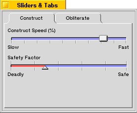
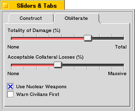

<!-- System Overview - The Interface Kit - BTabView -->

## BTabView

The tab view is a fairly common construct in modern user interfaces. The [`BTabView`](BTabView.md "BTabView") class serves as a container for a series of [`BTab`](BTab.md "BTab") objects as well as their target views; the tabs run horizontally across the top of the view from left to right, and beneath them is a container view in which the currently-selected tab's target view is presented. A box is drawn around the container view to clearly define the relationship between the tabs and the container view.

* * *

### Creating a BTabView

In the figure below, we see a window that contains a [`BTabView`](BTabView.md "BTabView") with two [`BTab`](BTab.md "BTab") objects attached, called "Construct" and "Obliterate." The "Construct" tab is currently selected, and its target view is visible. The target view for the "Construct" tab contains two [`BSlider`](BSlider.md "BSlider") objects (these sliders are used as an example in the [`BSlider`](BSlider.md "BSlider") section and you can learn more about them there).

The [`BTabView`](BTabView.md "BTabView") in this window is constructed using the following code, which can be used in the constructor of the parent window:
    
    
    BRect r;
    BTabView *tabView;
    BTab *tab;
    
    r = Bounds();
    r.InsetBy(5,5);
    
    tabView = new BTabView(r, "tab_view");
    tabView->SetViewColor(216,216,216,0);
    
    r = tabView->Bounds();
    r.InsetBy(5,5);
    r.bottom -= tabView->TabHeight();
    tab = new BTab();
    tabView->AddTab(new ConstView(r), tab);
    tab->SetLabel("Construct");
    tab = new BTab();
    tabView->AddTab(new DestView(r), tab);
    tab->SetLabel("Obliterate");

This code creates a [`BTabView`](BTabView.md "BTabView"), then sets its view color to the shade of grey used by standard [`BTabView`](BTabView.md "BTabView") and [`BTab`](BTab.md "BTab") objects.

Notice that the frame rectangle for the tabs' target views is being computed by taking the bounds rectangle of the [`BTabView`](BTabView.md "BTabView"), insetting it by five pixels on each side (to leave some room between it and the bounding box of the [`BTabView`](BTabView.md "BTabView")), and subtracting the tab height from the bottom edge of the rectangle. This places the target view inside the tab view. You can adjust this computation to position the target view to your liking.

Then two [`BTab`](BTab.md "BTab") objects are created and added to the [`BTabView`](BTabView.md "BTabView"). The `ConstView` and `DestView` classes are derived fro [`BView`](BView.md "BView") and represent the "Construct" and "Obliterate" panels of the window (including the various controls contained in those panels).

When the user clicks the "Obliterate" tab, the window will change to look like this:

