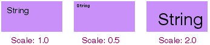
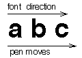
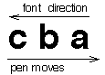
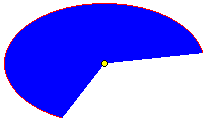

<!-- Classes And Methods - The Interface Kit - BView -->

## BView

| Derived From:| [BHandler](BHandler.md "BHandler")  
---|---  
Mix-in Classes:| –  
Declared In:| `interface/View.h`  
Library:| `libbe.so`  
Allocation:| –  
[Class Overview](BView_Overview.md "BView")

  * [Constructor and Destructor](BView.md#BView_ConstructorDestructor)
  * [Hook Functions](BView.md#BView_Hook)
  * [General Functions](BView.md#BView_General)
  * [View Hierarchy Functions](BView.md#BView_ViewHierarchy)
  * [Input Related Functions](BView.md#BView_Input)
  * [Graphics State Functions](BView.md#BView_Graphics)
  * [Drawing Related Functions](BView.md#BView_Drawing)
  * [Static Functions](BView.md#BView_StaticFunctions)
  * [Scripting Support](BView.md#BView_Scripting)
  * [Archived Fields](BView.md#BView_ArchivedFields)

  
  
* * *

### Constructor and Destructor

#### BView()

`BView([`BRect`](BRect.md "BRect") frame,  
const char* name,  
uint32 resizingMode,  
uint32 flags);` `BView([`BMessage`](BMessage.md "BMessage")* archive);`

Sets up a view with the `frame` rectangle, which is specified in the coordinate system of its eventual parent, and assigns the `BView` an identifying `name`, which can be `NULL`.

When it's created, a `BView` doesn't belong to a window and has no parent. It's assigned a parent by having another `BView` adopt it with the [`AddChild()`](BView.md#BView_AddChild "AddChild\(\), RemoveChild\(\)") function. If the other view is in a window, the `BView` becomes part of that window's view hierarchy. A `BView` can be made a child of the window's top view by calling [`BWindow`](BWindow.md "BWindow")'s [version](BWindow.md#BWindow_AddChild "AddChild\(\), RemoveChild\(\), ChildAt\(\), CountChildren\(\)") of the `AddChild()` function.

When the `BView` gains a parent, the values in `frame` are interpreted in the parent's coordinate system. The sides of the view must be aligned on screen pixels. Therefore, the `frame` rectangle should not contain coordinates with fractional values. Fractional coordinates will be rounded to the first lower whole number (for example 1.2 will be rounded down to 1.0).

The `resizingMode` mask determines the behavior of the view when its parent is resized. It should combine one constant for horizontal resizing,

  * `B_FOLLOW_LEFT`
  * `B_FOLLOW_RIGHT`
  * `B_FOLLOW_LEFT_RIGHT`
  * `B_FOLLOW_H_CENTER`

with one for vertical resizing:

  * `B_FOLLOW_TOP`
  * `B_FOLLOW_BOTTOM`
  * `B_FOLLOW_TOP_BOTTOM`
  * `B_FOLLOW_V_CENTER`

For example, if `B_FOLLOW_LEFT` is chosen, the margin between the left side of the view and the left side of its parent will remain constant—the view will "follow" the parent's left side. Similarly, if `B_FOLLOW_RIGHT` is chosen, the view will follow the parent's right side. If `B_FOLLOW_H_CENTER` is chosen, the view will maintain a constant relationship to the horizontal center of the parent.

If the constants name opposite sides of the view rectangle—left and right, or top and bottom—the view will necessarily be resized in that dimension when the parent is. For example, `B_FOLLOW_LEFT_RIGHT` means that the margin between the left side of the view and left side of the parent will remain constant, as will the margin between the right side of the view and the right side of the parent. As the parent is resized horizontally, the child will be resized with it. Note that `B_FOLLOW_LEFT_RIGHT` is not the same as combining `B_FOLLOW_LEFT` and `B_FOLLOW_RIGHT`, an illegal move. The `resizingMode` mask can contain only one horizontal constant and one vertical constant.

If a side is not mentioned in the mask, the distance between that side of the view and the corresponding side of the parent is free to fluctuate. This may mean that the view will move within its parent's coordinate system when the parent is resized. `B_FOLLOW_RIGHT` plus `B_FOLLOW_BOTTOM`, for example, would keep a view from being resized, but the view will move to follow the right bottom corner of its parent whenever the parent is resized. `B_FOLLOW_LEFT` plus `B_FOLLOW_TOP` prevents a view from being resized and from being moved.

In addition to the constants listed above, there are two other possibilities:

  * `B_FOLLOW_ALL_SIDES`
  * `B_FOLLOW_NONE`

`B_FOLLOW_ALL_SIDES` is a shorthand for `B_FOLLOW_LEFT_RIGHT` and `B_FOLLOW_TOP_BOTTOM`. It means that the view will be resized in tandem with its parent, both horizontally and vertically.

`B_FOLLOW_NONE` behaves just like `B_FOLLOW_LEFT` | `B_FOLLOW_TOP`; the view maintains the same position in its parent's coordinate system, but not in the screen coordinate system.

Typically, a parent view is resized because the user resizes the window it's in. When the window is resized, the top view is too. Depending on how the `resizingMode` flag is set for the top view's children and for the descendants of its children, automatic resizing can cascade down the view hierarchy. A view can also be resized programmatically by the [`ResizeTo()`](BView.md#BView_ResizeTo) and [`ResizeBy()`](BView.md#BView_ResizeBy "ResizeBy\(\), ResizeTo\(\)") functions.

The resizing mode can be changed after construction with the [`SetResizingMode()`](BView.md#BView_SetResizingMode "SetResizingMode\(\), ResizingMode\(\)") function.

The `flags` mask determines what kinds of notifications the `BView` will receive. It can be any combination of the following constants:

Constant| Description  
---|---  
`B_WILL_DRAW`| Indicates that the `BView` does some drawing of its own and therefore can't be ignored when the window is updated. If this flag isn't set, the `BView` won't receive update notifications—its [`Draw()`](BView.md#BView_Draw "Draw\(\)") function won't be called—and it won't be erased to its background view color if the color is other than white.  
`B_PULSE_NEEDED`| Indicates that the `BView` should receive [`Pulse()`](BView.md#BView_Pulse "Pulse\(\)") notifications.  
`B_FRAME_EVENTS`| Indicates that the `BView` should receive [`FrameResized()`](BView.md#BView_FrameResized "FrameResized\(\)") and [`FrameMoved()`](BView.md#BView_FrameMoved "FrameMoved\(\)") notifications when its frame rectangle changes—typically as a result of the automatic resizing behavior described above. [`FrameResized()`](BView.md#BView_FrameResized "FrameResized\(\)") is called when the dimensions of the view change; [`FrameMoved()`](BView.md#BView_FrameMoved "FrameMoved\(\)") is called when the position of its left top corner in its parent's coordinate system changes.  
`B_FULL_UPDATE_ON_RESIZE`| Indicates that the entire view should be updated when it's resized. If this flag isn't set, only the portions that resizing adds to the view will be included in the clipping region. This doesn't affect the view's children; their own flags determine when updates will occur.  
`B_NAVIGABLE`| Indicates that the `BView` can become the focus view for keyboard actions. This flag makes it possible for the user to navigate to the view and put it in focus by pressing the Tab key. See "[Keyboard Navigation](TheInterfaceKit_Responding.md#TheInterfaceKit_Listening_KeyboardNavigation "Keyboard Navigation")" at the beginning of this chapter.  
`B_NAVIGABLE_JUMP`| Marks the position of a group of views for keyboard navigation. By pressing Control+Tab, the user can jump from group to group. The focus lands on the first `BView` in the group that has the `B_NAVIGABLE` flag set. This may be the same `BView` that has the `B_NAVIGABLE_JUMP` marker, or the `B_NAVIGABLE_JUMP` `BView` may be the parent of a group of `B_NAVIGABLE` views.  
`B_SUBPIXEL_PRECISE`| Instructs the rendering methods to use subpixel precision when drawing. If you don't set this flag, coordinates are rounded to the nearest unit.  
  
If none of these constants apply, `flags` can be `NULL`. The flags can be reset after construction with the [`SetFlags()`](BView.md#BView_SetFlags "SetFlags\(\) , Flags\(\)") function.

See also: [`BHandler::SetName()`](BHandler.md#BHandler_SetName "SetName\(\), Name\(\)")

#### ~BView()

`virtual ~BView();`

Frees all memory the `BView` allocated, and ensures that each of the `BView`'s descendants in the view hierarchy is also destroyed.

It's an error to delete a `BView` while it remains attached to a window. Call [`RemoveChild()`](BView.md#BView_RemoveChild) or [`RemoveSelf()`](BView.md#BView_RemoveSelf "RemoveSelf\(\)") before using the delete operator.

* * *

### Hook Functions

####  AttachedToWindow(), AllAttached()

`virtual void AttachedToWindow();``virtual void AllAttached();`

Implemented by derived classes to complete the initialization of the `BView` when it's assigned to a window. A `BView` is assigned to a window when it, or one of its ancestors in the view hierarchy, becomes a child of a view already attached to a window.

`AttachedToWindow()` is called immediately after the `BView` is formally made a part of the window's view hierarchy and after it has become known to the Application Server and its graphics parameters are set. The [`Window()`](BView.md#BView_Window "Window\(\)") function can identify which [`BWindow`](BWindow.md "BWindow") the `BView` belongs to.

All of the `BView`'s children, if it has any, also become attached to the window and receive their own `AttachedToWindow()` notifications. Parents receive the notification before their children, but only after all views have become attached to the window and recognized as part of the window's view hierarchy. This function can therefore depend on all ancestor and descendant views being in place.

For example, `AttachedToWindow()` can be implemented to set a view's background color to the same color as its parent, something that can't be done before the view belongs to a window and knows who its parent is.
    
    
    void MyView::AttachedToWindow()
    {
       if ( Parent() )
          SetViewColor(Parent()->ViewColor());
       _baseClass_ ::AttachedToWindow();
    }

The `AllAttached()` notification follows on the heels of `AttachedToWindow()`, but works its way up the view hierarchy rather than down. When `AllAttached()` is called for a `BView`, all its descendants have received both `AttachedToWindow()` and `AllAttached()` notifications. Therefore, parent views can depend on any calculations that their children make in either function. For example, a parent can resize itself to fit the size of its children, where their sizes depend on calculations done in `AttachedToWindow()`.

The default (`BView`) version of both these functions are empty.

See also: [`AddChild()`](BView.md#BView_AddChild "AddChild\(\), RemoveChild\(\)")

####  DetachedFromWindow(), AllDetached()

`virtual void DetachedFromWindow();``virtual void AllDetached();`

Implemented by derived classes to make any adjustments necessary when the `BView` is about to be removed from a window's view hierarchy. These two functions parallel the more commonly implemented [`AttachedToWindow()`](BView.md#BView_AttachedToWindow "AttachedToWindow\(\), AllAttached\(\)") and [`AllAttached()`](BView.md#BView_AllAttached) functions.

`DetachedFromWindow()` notifications work their way down the hierarchy of views being detached, followed by `AllDetached()` notifications, which work their way up the hierarchy. The second function call permits an ancestor view to take actions that depend on calculations a descendant might have to make when it's first notified of being detached.

The `BView` is still attached to the window when both functions are called.

#### Draw()

`virtual void Draw([`BRect`](BRect.md "BRect") updateRect);`

Implemented by derived classes to draw the `updateRect` portion of the view. The update rectangle is stated in the `BView`'s coordinate system.

`Draw()` is called as the result of update messages whenever the view needs to present itself on-screen. This may happen when:

  * The window the view is in is first shown on-screen, or shown after being hidden (see the [`BWindow`](BWindow.md "BWindow") version of the [`Hide()`](BWindow.md#BWindow_Hide) function).

  * The view is made visible after being hidden (see `BView`'s [`Hide()`](BView.md#BView_Hide "Hide\(\), Show\(\)") function).

  * Obscured parts of the view are revealed, as when a window is moved from in front of the view or an image is dragged across it.

  * The view is resized.

  * The contents of the view are scrolled (see [`ScrollBy()`](BView.md#BView_ScrollBy "ScrollBy\(\), ScrollTo\(\)")).

  * A child view is added, removed, or resized.

  * A rectangle has been invalidated that includes at least some of the view (see [`Invalidate()`](BView.md#BView_Invalidate "Invalidate\(\)")).

  * [`CopyBits()`](BView.md#BView_CopyBits "CopyBits\(\)") can't completely fill a destination rectangle within the view.

`Draw()` is also called from a [`BPrintJob`](BPrintJob.md "BPrintJob") object's [`DrawView()`](BPrintJob.md#BPrintJob_DrawView "DrawView\(\) , SpoolPage\(\)") function to draw the view on a printed page. [`IsPrinting()`](BView.md#BView_IsPrinting "IsPrinting\(\)") returns `true` when the [`BView`](BView.md "BView") is drawing for the printer and `false` when it's drawing to the screen. When printing, you may want to recalculate layouts, substitute fonts, turn antialiasing off, scale the size of a coordinate unit, or make other adjustments to ensure the quality of the printed image.

When drawing to the screen, the `updateRect` is the smallest rectangle that encloses the current clipping region for the view. Since the Application Server won't render anything on-screen that's outside the clipping region, an application will be more efficient if it avoids producing drawing instructions for images that don't intersect with the rectangle. For still more efficiency and precision, you can ask for the clipping region itself (by calling [`GetClippingRegion()`](BView.md#BView_GetClippingRegion "GetClippingRegion\(\)")) and confine drawing to images that intersect with it.

When printing, the `updateRect` matches the rectangle passed to [`DrawView()`](BPrintJob.md#BPrintJob_DrawView "DrawView\(\) , SpoolPage\(\)") and may lie outside the clipping region. The clipping region is not enforced for printing, but the Print Server clips the BView's drawing to the specified rectangle.

See also: [`BWindow::UpdateIfNeeded()`](BWindow.md#BWindow_UpdateIfNeeded "UpdateIfNeeded\(\)")

#### DrawAfterChildren()

`virtual void DrawAfterChildren([`BRect`](BRect.md "BRect") updateRect);`

This function is similar (in fact, almost identical) to [`Draw()`](BView.md#BView_Draw "Draw\(\)"). The only difference is that `DrawAfterChildren()` is called after all children have drawn during a screen update. This is in contrast to [`Draw()`](BView.md#BView_Draw "Draw\(\)"), which draws before any children have drawn. In general, [`Draw()`](BView.md#BView_Draw "Draw\(\)") will be used for almost all of your drawing needs; `DrawAfterChildren()` is intended for use in the rare circumstances where you wish a view to be able to draw on top of its child views.

Other details are as for [`Draw()`](BView.md#BView_Draw "Draw\(\)").

#### FrameMoved()

`virtual void FrameMoved([`BPoint`](BPoint.md "BPoint") newLocation);`

Implemented by derived classes to respond to a notification that the view has moved within its parent's coordinate system. `newLocation` gives the new location, within the coordinate system of the view's window, of the left top corner of the `BView`'s frame rectangle.

`FrameMoved()` is called only if the `B_FRAME_EVENTS` flag is set and the `BView` is attached to a window.

If the view is both moved and resized, `FrameMoved()` is called before [`FrameResized()`](BView.md#BView_FrameResized "FrameResized\(\)"). This might happen, for example, if the `BView`'s automatic resizing mode is a combination of `B_FOLLOW_TOP_BOTTOM` and `B_FOLLOW_RIGHT` and its parent is resized both horizontally and vertically.

`BView`'s version of this function is empty.

Currently, `FrameMoved()` is also called when a hidden window is shown on-screen.

See also: [`MoveBy()`](BView.md#BView_MoveBy "MoveBy\(\), MoveTo\(\)"), [`BWindow::FrameMoved()`](BWindow.md#BWindow_FrameMoved "FrameMoved\(\), FrameResized\(\)"), [`SetFlags()`](BView.md#BView_SetFlags "SetFlags\(\) , Flags\(\)")

#### FrameResized()

`virtual void FrameResized(float width,  
float height);`

Implemented by derived classes to respond to a notification that the view has been resized. The arguments state the new width and height of the view. The resizing could have been the result of a user action (resizing the window) or of a programmatic one (calling [`ResizeTo()`](BView.md#BView_ResizeTo) or [`ResizeBy()`](BView.md#BView_ResizeBy "ResizeBy\(\), ResizeTo\(\)")).

`FrameResized()` is called only if the `B_FRAME_EVENTS` flag is set and the `BView` is attached to a window.

`BView`'s version of this function is empty.

See also: [`BWindow::FrameResized()`](BWindow.md#BWindow_FrameResized), [`SetFlags()`](BView.md#BView_SetFlags "SetFlags\(\) , Flags\(\)")

####  GetPreferredSize(), ResizeToPreferred()

`virtual void GetPreferredSize(float* width,  
float* height);``virtual void ResizeToPreferred();`

`GetPreferredSize()` is implemented by derived classes to write the preferred width and height of the view into the variables the `width` and `height` arguments refer to. Derived classes generally make this calculation based on the view's contents. For example, a [`BButton`](BButton.md "BButton") object reports the optimal size for displaying the button border and label given the current font.

`ResizeToPreferred()` resizes the `BView`'s frame rectangle to the preferred size, keeping its left and top sides constant.

See also: [`ResizeTo()`](BView.md#BView_ResizeTo)

#### KeyDown()

`virtual void KeyDown(const char* bytes,  
int32 numBytes);`

Implemented by derived classes to respond to a [`B_KEY_DOWN`](TheInterfaceKit_MessageConstants.md#B_KEY_DOWN "B_KEY_DOWN, B_KEY_UP, B_UNMAPPED_KEY_DOWN, B_UNMAPPED_KEY_UP") message reporting keyboard input. Whenever a `BView` is the focus view of the active window, it receives a `KeyDown()` notification for each character the user types, except for those that:

  * Are produced while a Command key is held down. Command key events are interpreted as keyboard shortcuts.

  * Are produced by the Tab key when an Option key is held down. Option+Tab events are invariably interpreted as instructions to change the focus view (for keyboard navigation); they work even where Tab alone does not.

  * Can operate the default button in a window. The [`BButton`](BButton.md "BButton") object's [`KeyDown()`](BButton.md#BButton_KeyDown "KeyDown\(\)") function is called, rather than the focus view's.

The first argument, `bytes`, is an array that encodes the character mapped to the key the user pressed. The second argument, `numBytes`, tells how many bytes are in the array; there will always be at least one. The `bytes` value follows the character encoding of the `BView`'s font. Typically, the encoding is Unicode UTF-8 (`B_UNICODE_UTF8`), so there may be more than one byte per character. The bytes array is not null-terminated; '0' is a valid character value.

The character value takes into account any modifier keys that were held down or keyboard locks that were on at the time of the keystroke. For example, Shift+i is reported as uppercase 'I' (0x49) and Control+i is reported as a `B_TAB` (0x09).

Single-byte characters can be tested against ASCII codes and these constants:

  * `B_BACKSPACE`
  * `B_ENTER`
  * `B_RETURN`
  * `B_SPACE`
  * `B_TAB`
  * `B_ESCAPE`
  * `B_LEFT_ARROW`
  * `B_RIGHT_ARROW`
  * `B_UP_ARROW`
  * `B_DOWN_ARROW`
  * `B_INSERT`
  * `B_DELETE`
  * `B_HOME`
  * `B_END`
  * `B_PAGE_UP`
  * `B_PAGE_DOWN`
  * `B_FUNCTION_KEY`

`B_ENTER` and `B_RETURN` are the same character, a newline ('\n').

Only keys that generate characters produce key-down events; the modifier keys on their own do not.

You can determine which modifier keys were being held down at the time of the event by calling [`BLooper`](BLooper.md "BLooper")'s [`CurrentMessage()`](BLooper.md#BLooper_CurrentMessage "CurrentMessage\(\), DetachCurrentMessage\(\)") function and looking up the "modifiers" entry in the [`BMessage`](BMessage.md "BMessage") it returns. If the `bytes` character is `B_FUNCTION_KEY` and you want to know which key produced the character, you can look up the "key" entry in the [`BMessage`](BMessage.md "BMessage") and test it against these constants:

  * `B_F1_KEY`
  * `B_F1_KEY`
  * `B_F2_KEY`
  * `B_F3_KEY`
  * `B_F4_KEY`
  * `B_F5_KEY`
  * `B_F6_KEY`
  * `B_F7_KEY`
  * `B_F8_KEY`
  * `B_F9_KEY`
  * `B_F10_KEY`
  * `B_F11_KEY`
  * `B_F12_KEY`
  * `B_PRINT_KEY` (Print Screen)
  * `B_SCROLL_KEY` (Scroll Lock)
  * `B_PAUSE_KEY`

For example:
    
    
    if ( bytes[0] == B_FUNCTION_KEY ) {
       BMessage *msg = Window()->CurrentMessage();
       if ( msg ) {
          int32 key;
          msg->FindInt32("key", &key);
          switch ( key ) {
          case B_F1_KEY:
             . . .
             break;
          case B_F2_KEY:
             . . .
             break;
          . . .
          }
       }
    }

The `BView` version of `KeyDown()` handles keyboard navigation from view to view through `B_TAB` characters. If the view you define is navigable, its `KeyDown()` function should permit `B_SPACE` characters to operate the object and perhaps allow the arrow keys to navigate inside the view. It should also call the inherited version of `KeyDown()` to enable between-view navigation. For example:
    
    
    void MyView::KeyDown(const char *bytes, int32 numBytes)
    {
       if ( numBytes == 1 ) {
          switch ( bytes[0] ) {
          case B_SPACE:
             /* mimic a click in the view*/
             break;
          case B_RIGHT_ARROW:
             /* move one position to the right in the view*/
             break;
          case B_LEFT_ARROW:
             /* move one position to the left in the view*/
             break;
          default:
             _baseClass_ ::KeyDown(bytes, numBytes);
             break;
          }
       }
    }

If your `BView` is navigable but needs to respond to `B_TAB` characters—for example, if it permits users to insert tabs in a text string—its `KeyDown()` function should simply grab the characters and not pass them to the inherited function. Users will have to rely on the Option+Tab combination to navigate from your view.

See also: the [Keyboard Information](TheKeyboard.md "The Keyboard") special topic, [`B_KEY_DOWN`](TheInterfaceKit_MessageConstants.md#B_KEY_DOWN "B_KEY_DOWN, B_KEY_UP, B_UNMAPPED_KEY_DOWN, B_UNMAPPED_KEY_UP") in the [Keyboard Messages](TheKeyboard_KeyboardMessages.md "Keyboard Messages") appendix, [`BWindow::SetDefaultButton()`](BWindow.md#BWindow_SetDefaultButton "SetDefaultButton\(\), DefaultButton\(\)"), [`modifiers()`](TheInputServer_Functions.md#modifiers "modifiers\(\)")

#### KeyUp()

`virtual void KeyUp(const char* bytes,  
int32 numBytes);`

Implemented by derived classes to respond to a [`B_KEY_UP`](TheInterfaceKit_MessageConstants.md#B_KEY_UP) message reporting that the user released a key on the keyboard. The same set of keys that produce [`B_KEY_DOWN`](TheInterfaceKit_MessageConstants.md#B_KEY_DOWN "B_KEY_DOWN, B_KEY_UP, B_UNMAPPED_KEY_DOWN, B_UNMAPPED_KEY_UP") messages when they're pressed produce [`B_KEY_UP`](TheInterfaceKit_MessageConstants.md#B_KEY_UP) messages when they're released. The `bytes` and `numBytes` arguments encode the character mapped to the key the user released; they work exactly like the same arguments passed to [`KeyDown()`](BView.md#BView_KeyDown "KeyDown\(\)").

Some [`B_KEY_DOWN`](TheInterfaceKit_MessageConstants.md#B_KEY_DOWN "B_KEY_DOWN, B_KEY_UP, B_UNMAPPED_KEY_DOWN, B_UNMAPPED_KEY_UP") messages are swallowed by the system and are never dispatched by calling [`KeyDown()`](BView.md#BView_KeyDown "KeyDown\(\)"); others are dispatched, but not to the focus view. In contrast, all [`B_KEY_UP`](TheInterfaceKit_MessageConstants.md#B_KEY_UP) messages are dispatched by calling [`KeyUp()`](BView.md#BView_KeyUp "KeyUp\(\)") for the focus view of the active window. Since the focus view and active window can change between the time a key is pressed and the time it's released, this may or may not be the same `BView` that was notified of the [`B_KEY_DOWN`](TheInterfaceKit_MessageConstants.md#B_KEY_DOWN "B_KEY_DOWN, B_KEY_UP, B_UNMAPPED_KEY_DOWN, B_UNMAPPED_KEY_UP") message.

#### MessageReceived()

`virtual void MessageReceived([`BMessage`](BMessage.md "BMessage")* message);`

Augments the [`BHandler`](BHandler.md "BHandler") version of [`MessageReceived()`](BHandler.md#BHandler_MessageReceived "MessageReceived\(\)") to handle scripting messages for the `BView`.

#### MouseDown()

`virtual void MouseDown([`BPoint`](BPoint.md "BPoint") point);`

`MouseDown()` is a hook function that's invoked when the user depresses a mouse button (or other pointing device button, not including joysticks). The location of the cursor at the time of the event is given by `point` in the `BView`'s coordinates. See [`B_MOUSE_DOWN`](TheInterfaceKit_MessageConstants.md#B_MOUSE_DOWN "B_MOUSE_DOWN") for the message format. Also see [`SetMouseEventMask()`](BView.md#BView_SetMouseEventMask) for information on extending the view's event mask while the mouse is being held down.

The `BView` version of `MouseDown()` is empty.

#### MouseMoved()

`virtual void MouseMoved([`BPoint`](BPoint.md "BPoint") point,  
uint32 transit,  
const [`BMessage`](BMessage.md "BMessage")* message);`

Implemented by derived classes to respond to reports of mouse-moved events associated with the view. As the user moves the cursor over a window, the Application Server generates a continuous stream of messages reporting where the cursor is located.

The first argument, `point`, gives the cursor's new location in the `BView`'s coordinate system. The second argument, `transit`, is one of four constants,

  * `B_ENTERED_VIEW`
  * `B_INSIDE_VIEW`
  * `B_EXITED_VIEW`
  * `B_OUTSIDE_VIEW`

which explains whether the cursor has just entered the visible region of the view, is now inside the visible region having previously entered, has just exited from the view, or is currently outside the visible region of the view. When the cursor passes from one view to another, `MouseMoved()` is called on each of the `BView`s, once with a transit code of `B_EXITED_VIEW` and the other with a code of `B_ENTERED_VIEW`.

If the user is dragging a bundle of information from one location to another, the final argument, `message`, is a pointer to the [`BMessage`](BMessage.md "BMessage") object that holds the information. If a message isn't being dragged, `message` is `NULL`.

The default version of `MouseMoved()` is empty.

#### MouseUp()

`virtual void MouseUp([`BPoint`](BPoint.md "BPoint") point);`

Implemented by derived classes to respond to a message reporting a mouse-up event within the view. The location of the cursor at the time of the event is given by `point` in the `BView`'s coordinates.

#### Pulse()

`virtual void Pulse();`

Implemented by derived classes to do something at regular intervals. Pulses are regularly timed events, like the tick of a clock or the beat of a steady pulse. A `BView` receives `Pulse()` notifications when no other messages are pending, but only if it asks for them with the `B_PULSE_NEEDED` flag.

The interval between `Pulse()` calls can be set with [`BWindow`](BWindow.md "BWindow")'s [`SetPulseRate()`](BWindow.md#BWindow_SetPulseRate "SetPulseRate\(\), PulseRate\(\)") function. The default interval is around 500 milliseconds. The pulse rate is the same for all views within a window, but can vary between windows.

Derived classes can implement a `Pulse()` function to do something that must be repeated continuously. However, for time-critical actions, you should implement your own timing mechanism.

The `BView` version of this function is empty.

See also: [`SetFlags()`](BView.md#BView_SetFlags "SetFlags\(\) , Flags\(\)") the `BView` [constructor](BView.md#BView_Constructor "BView\(\)"),

#### TargetedByScrollView()

`virtual void TargetedByScrollView([`BScrollView`](BScrollView.md "BScrollView")* scroller);`

Implemented by derived classes to respond to a notification that the `BView` has become the target of the scroller [`BScrollView`](BScrollView.md "BScrollView") object. This function is called when the [`BScrollView`](BScrollView.md "BScrollView") sets its target, which it does on construction. The target is the object whose contents will be scrolled.

`BView`'s implementation of this function is empty.

See also: The various scrolling-related functions in `BView` [Input Related Functions](BView.md#BView_Input "Input Related Functions").

#### WindowActivated()

`virtual void WindowActivated(bool active);`

Implemented by derived classes to take whatever steps are necessary when the `BView`'s window becomes the active window, or when the window gives up that status. If `active` is `true`, the window has become active. If `active` is `false`, it no longer is the active window.

All objects in the view hierarchy receive `WindowActivated()` notifications when the status of the window changes.

`BView`'s version of this function is empty.

See also: [`BWindow::WindowActivated()`](BWindow.md#BWindow_WindowActivated "WindowActivated\(\)")

* * *

### General Functions

#### Archive()

`virtual status_t Archive([`BMessage`](BMessage.md "BMessage")* archive,  
bool deep = true) const;`

Archives the `BView` in the [`BMessage`](BMessage.md "BMessage") `archive`.

See also: [`BArchivable::Archive()`](BArchivable.md#BArchivable_Archive "Archive\(\)"), [`Instantiate()`](BView.md#BView_Instantiate "Instantiate\(\)") static function

#### Bounds()

`[`BRect`](BRect.md "BRect") Bounds() const;`

Returns the `BView`'s bounds rectangle.

####  ConvertToParent(), ConvertFromParent()

`[`BPoint`](BPoint.md "BPoint") ConvertToParent([`BPoint`](BPoint.md "BPoint") localPoint) const;` `void ConvertToParent([`BPoint*`](BPoint.md "BPoint") localPoint) const;` `[`BRect`](BRect.md "BRect") ConvertToParent([`BRect`](BRect.md "BRect") localRect) const;` `void ConvertToParent([`BRect*`](BPoint.md "BPoint") localRect) const;`

`[`BPoint`](BPoint.md "BPoint") ConvertFromParent([`BPoint`](BPoint.md "BPoint") parentPoint) const;` `void ConvertFromParent([`BPoint*`](BPoint.md "BPoint") parentPoint) const;` `[`BRect`](BRect.md "BRect") ConvertFromParent([`BRect`](BRect.md "BRect") parentRect) const;` `void ConvertFromParent([`BRect*`](BPoint.md "BPoint") parentRect) const;`

These functions convert points and rectangles to and from the coordinate system of the `BView`'s parent. `ConvertToParent()` converts `localPoint` or `localRect` from the `BView`'s coordinate system to the coordinate system of its parent `BView`. `ConvertFromParent()` does the opposite; it converts `parentPoint` or `parentRect` from the coordinate system of the `BView`'s parent to the `BView`'s own coordinate system.

If the point or rectangle is passed by value, the function returns the converted value. If a pointer is passed, the conversion is done in place.

Both functions fail if the `BView` isn't attached to a window.

See also: [`ConvertToScreen()`](BView.md#BView_ConvertToScreen "ConvertToScreen\(\), ConvertFromScreen\(\)")

####  ConvertToScreen(), ConvertFromScreen()

`[`BPoint`](BPoint.md "BPoint") ConvertToScreen([`BPoint`](BPoint.md "BPoint") localPoint) const;` `void ConvertToScreen([`BPoint*`](BPoint.md "BPoint") localPoint) const;` `[`BRect`](BRect.md "BRect") ConvertToScreen([`BRect`](BRect.md "BRect") localRect) const;` `void ConvertToScreen([`BRect*`](BPoint.md "BPoint") localRect) const;`

`[`BPoint`](BPoint.md "BPoint") ConvertFromScreen([`BPoint`](BPoint.md "BPoint") screenPoint) const;` `void ConvertFromScreen([`BPoint*`](BPoint.md "BPoint") screenPoint) const;` `[`BRect`](BRect.md "BRect") ConvertFromScreen([`BRect`](BRect.md "BRect") screenRect) const;` `void ConvertFromScreen([`BRect*`](BPoint.md "BPoint") screenRect) const;`

`ConvertToScreen()` converts `localPoint` or `localRect` from the `BView`'s coordinate system to the global screen coordinate system. `ConvertFromScreen()` makes the opposite conversion; it converts `screenPoint` or `screenRect` from the screen coordinate system to the `BView`'s local coordinate system.

If the point or rectangle is passed by value, the function returns the converted value. If a pointer is passed, the conversion is done in place.

The screen coordinate system has its origin, (0.0, 0.0), at the left top corner of the main screen.

Neither function will work if the `BView` isn't attached to a window.

See also: [`BWindow::ConvertToScreen()`](BWindow.md#BWindow_ConvertToScreen "ConvertToScreen\(\), ConvertFromScreen\(\)"), [`ConvertToParent()`](BView.md#BView_ConvertToParent "ConvertToParent\(\), ConvertFromParent\(\)")

#### Frame()

`[`BRect`](BRect.md "BRect") Frame() const;`

Returns the `BView`'s frame rectangle. The frame rectangle is first set by the `BView` constructor and is altered only when the view is moved or resized. It's stated in the coordinate system of the `BView`'s parent.

####  Hide(), Show()

`virtual void Hide();``virtual void Show();`

These functions hide a view and show it again.

`Hide()` makes the view invisible without removing it from the view hierarchy. The visible region of the view will be empty and the `BView` won't receive update messages. If the `BView` has children, they also are hidden.

`Show()` unhides a view that had been hidden. This function doesn't guarantee that the view will be visible to the user; it merely undoes the effects of `Hide()`. If the view didn't have any visible area before being hidden, it won't have any after being shown again (given the same conditions).

Calls to `Hide()` and `Show()` can be nested. For a hidden view to become visible again, the number of `Hide()` calls must be matched by an equal number of `Show()` calls.

However, `Show()` can only undo a previous `Hide()` call on the same view. If the view became hidden when `Hide()` was called to hide the window it's in or to hide one of its ancestors in the view hierarchy, calling `Show()` on the view will have no effect. For a view to come out of hiding, its window and all its ancestor views must be unhidden.

`Hide()` and `Show()` can affect a view before it's attached to a window. The view will reflect its proper state (hidden or not) when it becomes attached. Views are created in an unhidden state.

See also: [`BWindow::Hide()`](BWindow.md#BWindow_Hide), [`IsHidden()`](BView.md#BView_IsHidden "IsHidden\(\)")

#### IsFocus()

`bool IsFocus();`

Returns `true` if the `BView` is the current focus view for its window, and `false` if it's not. The focus view changes as the user chooses one view to work in and then another—for example, as the user moves from one text field to another when filling out an on-screen form. The change is made programmatically through the [`MakeFocus()`](BView.md#BView_MakeFocus "MakeFocus\(\)") function.

See also: [`BWindow::CurrentFocus()`](BWindow.md#BWindow_CurrentFocus "CurrentFocus\(\)")

#### IsHidden()

`bool IsHidden();`

Returns `true` if the view has been hidden by the [`Hide()`](BView.md#BView_Hide "Hide\(\), Show\(\)") function, and `false` otherwise.

This function returns `true` whether [`Hide()`](BView.md#BView_Hide "Hide\(\), Show\(\)") was called to hide the `BView` itself, to hide an ancestor view, or to hide the `BView`'s window. When a window is hidden, all its views are hidden with it. When a `BView` is hidden, all its descendants are hidden with it.

If the view has no visible region—perhaps because it lies outside its parent's frame rectangle or is obscured by a window in front—this function may nevertheless return `false`. It reports only whether the [`Hide()`](BView.md#BView_Hide "Hide\(\), Show\(\)") function has been called to hide the view, hide one of the view's ancestors in the view hierarchy, or hide the window where the view is located.

If the `BView` isn't attached to a window, `IsHidden()` returns the state that it will assume when it becomes attached. By default, views are not hidden.

#### IsPrinting()

`bool IsPrinting() const;`

Returns `true` if the `BView` is being asked to draw for the printer, and `false` if the drawing it produces will be rendered on-screen (or if the `BView` isn't being asked to draw at all).

This function's result is only reliable when called from within [`Draw()`](BView.md#BView_Draw "Draw\(\)") or [`DrawAfterChildren()`](BView.md#BView_DrawAfterChildren "DrawAfterChildren\(\)") to determine whether the drawing it does is destined for the printer or the screen. When drawing to the printer, the `BView` may choose different parameters—such as fonts, bitmap images, or colors—than when drawing to the screen.

Note

You should avoid calling this function from outside [`Draw()`](BView.md#BView_Draw "Draw\(\)") and [`DrawAfterChildren()`](BView.md#BView_DrawAfterChildren "DrawAfterChildren\(\)"); however, if you absolutely have to do it, lock the view first. Failure to do so may bring up the debugger—if not in BeOS 5, it may in future versions of BeOS.

See also: the [`BPrintJob`](BPrintJob.md "BPrintJob") class

#### LeftTop()

`[`BPoint`](BPoint.md "BPoint") LeftTop() const;`

Returns the coordinates of the left top corner of the view—the smallest x and y coordinate values within the bounds rectangle.

See also: [`BRect::LeftTop()`](BRect.md#BRect_LeftTop), [`Bounds()`](BView.md#BView_Bounds "Bounds\(\)")

####  MoveBy(), MoveTo()

`void MoveBy(float horizontal,  
float vertical);`

`void MoveTo([`BPoint`](BPoint.md "BPoint") point);` `void MoveTo(float x,  
float y);`

These functions move the view in its parent's coordinate system without altering its size.

`MoveBy()` adds `horizontal` coordinate units to the left and right components of the frame rectangle and `vertical` units to the top and bottom components. If `horizontal` and `vertical` are positive, the view moves downward and to the right. If they're negative, it moves upward and to the left.

`MoveTo()` moves the upper left corner of the view to `point` or to (`x`, `y`) in the parent view's coordinate system and adjusts all coordinates in the frame rectangle accordingly.

Neither function alters the `BView`'s bounds rectangle or coordinate system.

None of the values passed to these functions should specify fractional coordinates; the sides of a view must line up on screen pixels. Fractional values will be rounded to the closest whole number.

If the `BView` is attached to a window, these functions cause its parent view to be updated, so the `BView` is immediately displayed in its new location. If it doesn't have a parent or isn't attached to a window, these functions merely alter its frame rectangle.

See also: [`FrameMoved()`](BView.md#BView_FrameMoved "FrameMoved\(\)"), [`ResizeBy()`](BView.md#BView_ResizeBy "ResizeBy\(\), ResizeTo\(\)"), [`Frame()`](BView.md#BView_Frame "Frame\(\)")

####  ResizeBy(), ResizeTo()

`void ResizeBy(float horizontal,  
float vertical);``void ResizeTo(float width,  
float height);`

These functions resize the view, without moving its left and top sides. `ResizeBy()` adds `horizontal` coordinate units to the width of the view and `vertical` units to the height. `ResizeTo()` makes the view `width` units wide and `height` units high. Both functions adjust the right and bottom components of the frame rectangle accordingly.

Since a `BView`'s frame rectangle must be aligned on screen pixels, only integral values should be passed to these functions. Values with fractional components will be rounded to the nearest whole integer.

If the `BView` is attached to a window, these functions cause its parent view to be updated, so the `BView` is immediately displayed in its new size. If it doesn't have a parent or isn't attached to a window, these functions merely alter its frame and bounds rectangles.

Note

If the view isn't attached to a window, its frame and bounds rectangles are adjusted, but its children, if any, don't get corresponding adjustments.

See also: [`FrameResized()`](BView.md#BView_FrameResized "FrameResized\(\)"), [`MoveBy()`](BView.md#BView_MoveBy "MoveBy\(\), MoveTo\(\)"), [`Frame()`](BView.md#BView_Frame "Frame\(\)"), [`BRect::Width()`](BRect.md#BRect_Width "Width\(\), IntegerWidth\(\), Height\(\), IntegerHeight\(\)")

####  SetFlags() , Flags()

`virtual void SetFlags(uint32 mask);``uint32 Flags() const;`

These functions set and return the flags that inform the Application Server about the kinds of notifications the `BView` should receive. The mask set by `SetFlags()` and the return value of `Flags()` is formed from combinations of the following constants:

  * `B_WILL_DRAW`
  * `B_FULL_UPDATE_ON_RESIZE`
  * `B_FRAME_EVENTS`
  * `B_PULSE_NEEDED`
  * `B_NAVIGABLE`
  * `B_NAVIGABLE_JUMP`
  * `B_SUBPIXEL_PRECISE`

The flags are first set when the `BView` is constructed; they're explained in the description of the `BView` constructor. The mask can be 0.

To set just one of the flags, combine it with the current setting:
    
    
    myView->SetFlags(Flags() | B_FRAME_EVENTS);

See also: The `BView` [constructor](BView.md#BView_Constructor "BView\(\)"), [`SetResizingMode()`](BView.md#BView_SetResizingMode "SetResizingMode\(\), ResizingMode\(\)")

####  SetOrigin(), Origin()

`void SetOrigin([`BPoint`](BPoint.md "BPoint") pt);` `void SetOrigin(float x,  
float y);`

`[`BPoint`](BPoint.md "BPoint") Origin() const;`

Sets and retrieves the local origin of the `BView`'s coordinate system.

The actual origin used by the Application Server is the sum of the local origin (as set by this method) and the origins stored on the state stack (properly scaled).

####  SetResizingMode(), ResizingMode()

`virtual void SetResizingMode(uint32 mode);``uint32 ResizingMode() const;`

These functions set and return the `BView`'s automatic resizing mode. The resizing mode is first set when the `BView` is constructed. The various possible modes are explained where the [constructor](BView.md#BView_Constructor "BView\(\)") is described.

See also: [`SetFlags()`](BView.md#BView_SetFlags "SetFlags\(\) , Flags\(\)")

#### SetViewCursor()

`void SetViewCursor(const [`BCursor`](BCursor.md "BCursor")* cursor,  
bool sync = true) const;`

Sets the specified `cursor` as the view's cursor; while the mouse is inside the view, this cursor will be displayed (unless of course the cursor is hidden or obscured).

If `sync` is `true`, the Application Server will be synchronized by this call, forcing the change to take place immediately. If `sync` is `false`, the change will take place when the Application Server naturally gets to the change in its queue of pending requests.

#### Window()

`[`BWindow`](BWindow.md "BWindow")* Window() const;`

Returns the [`BWindow`](BWindow.md "BWindow") to which the `BView` belongs, or `NULL` if the `BView` isn't attached to a window. This function returns the same object that [`Looper()`](BHandler.md#BHandler_Looper "Looper\(\)") (inherited from the [`BHandler`](BHandler.md "BHandler") class) does—except that `Window()` returns it more specifically as a pointer to a [`BWindow`](BWindow.md "BWindow") and [`Looper()`](BHandler.md#BHandler_Looper "Looper\(\)") returns it more generally as a pointer to a [`BLooper`](BLooper.md "BLooper").

See also: [`BHandler::Looper()`](BHandler.md#BHandler_Looper "Looper\(\)") in the Application Kit, [`AddChild()`](BView.md#BView_AddChild "AddChild\(\), RemoveChild\(\)"), [`BWindow::AddChild()`](BWindow.md#BWindow_AddChild "AddChild\(\), RemoveChild\(\), ChildAt\(\), CountChildren\(\)"), [`AttachedToWindow()`](BView.md#BView_AttachedToWindow "AttachedToWindow\(\), AllAttached\(\)")

* * *

### View Hierarchy Functions

####  AddChild(), RemoveChild()

`void AddChild(BView* aView,  
BView* sibling = NULL);``bool RemoveChild(BView* aView);`

`AddChild()` makes `aView` a child of the `BView`, provided that `aView` doesn't already have a parent. The new child is added to the `BView`'s list of children immediately before the named `sibling` `BView`. If the `sibling` is `NULL` (as it is by default), `aView` isn't added in front of any other view—in other words, it's added to the end of the list. If the `BView` is attached to a window, `aView` and all its descendants become attached to the same window. Each of them is notified of this change through [`AttachedToWindow()`](BView.md#BView_AttachedToWindow "AttachedToWindow\(\), AllAttached\(\)") and [`AllAttached()`](BView.md#BView_AllAttached) function calls.

`AddChild()` fails if `aView` already belongs to a view hierarchy. A view can live with only one parent at a time. It also fails if sibling is not already a child of the `BView`.

`RemoveChild()` severs the link between the `BView` and `aView`, so that `aView` is no longer a child of the `BView`; `aView` retains all its own children and descendants, but they become an isolated fragment of a view hierarchy, unattached to a window. Each removed view is notified of this change through [`DetachedFromWindow()`](BView.md#BView_DetachedFromWindow "DetachedFromWindow\(\), AllDetached\(\)") and [`AllDetached()`](BView.md#BView_AllDetached) function calls.

A `BView` must be removed from a window before it can be destroyed.

If it succeeds in removing `aView`, `RemoveChild()` returns `true`. If it fails, it returns `false`. It will fail if `aView` is not, in fact, a current child of the `BView`.

When a `BView` object becomes attached to a [`BWindow`](BWindow.md "BWindow"), two other connections are automatically established for it:

  * The view is added to the [`BWindow`](BWindow.md "BWindow")'s flat list of [`BHandler`](BHandler.md "BHandler") objects, making it an eligible target for messages the [`BWindow`](BWindow.md "BWindow") dispatches.

  * The `BView`'s parent view becomes its next handler. Messages that the `BView` doesn't recognize will be passed to its parent.

Removing a `BView` from a window's view hierarchy also removes it from the [`BWindow`](BWindow.md "BWindow")'s flat list of [`BHandler`](BHandler.md "BHandler") objects; the `BView` will no longer be eligible to handle messages dispatched by the [`BWindow`](BWindow.md "BWindow").

See also: [`BWindow::AddChild()`](BWindow.md#BWindow_AddChild "AddChild\(\), RemoveChild\(\), ChildAt\(\), CountChildren\(\)"), [`BLooper::AddHandler()`](BLooper.md#BLooper_AddHandler "AddHandler\(\), RemoveHandler\(\), HandlerAt\(\), CountHandlers\(\), IndexOf\(\)"), [`BHandler::SetNextHandler()`](BHandler.md#BHandler_SetNextHandler "SetNextHandler\(\), NextHandler\(\)"), [`RemoveSelf()`](BView.md#BView_RemoveSelf "RemoveSelf\(\)"), [`AttachedToWindow()`](BView.md#BView_AttachedToWindow "AttachedToWindow\(\), AllAttached\(\)"), [`DetachedFromWindow()`](BView.md#BView_DetachedFromWindow "DetachedFromWindow\(\), AllDetached\(\)")

#### FindView()

`BView* FindView(const char* name) const;`

Returns the `BView` identified by `name`, or `NULL` if the view can't be found. Names are assigned by the `BView` constructor and can be modified by the [`SetName()`](BHandler.md#BHandler_SetName "SetName\(\), Name\(\)") function inherited from [`BHandler`](BHandler.md "BHandler").

`FindView()` begins the search by checking whether the `BView`'s name matches `name`. If not, it continues to search down the view hierarchy, among the `BView`'s children and more distant descendants. To search the entire view hierarchy, use the [`BWindow`](BWindow.md "BWindow") [version](BWindow.md#BWindow_FindView "FindView\(\)") of this function.

####  Parent(), NextSibling(), PreviousSibling(), ChildAt(), CountChildren()

`BView* Parent() const;``BView* NextSibling() const;``BView* PreviousSibling() const;``BView* ChildAt(int32 index) const;``int32 CountChildren() const;`

These functions provide various ways of navigating the view hierarchy. `Parent()` returns the `BView`'s parent view, unless the parent is the top view of the window, in which case it returns `NULL`. It also returns `NULL` if the `BView` doesn't belong to a view hierarchy and has no parent.

All the children of the same parent are arranged in a linked list. `NextSibling()` returns the next sibling of the `BView` in the list, or `NULL` if the `BView` is the last child of its parent. `PreviousSibling()` returns the previous sibling of the `BView`, or `NULL` if the `BView` is the first child of its parent.

`ChildAt()` returns the view at `index` in the list of the `BView`'s children, or `NULL` if the `BView` has no such child. Indices begin at 0 and there are no gaps in the list. `CountChildren()` returns the number of children the `BView` has. If the `BView` has no children, `CountChildren()` returns `NULL`, as will `ChildAt()` for all indices, including 0.

To scan the list of a `BView`'s children, you can increment the `index` passed to `ChildAt()` until it returns `NULL`. However, it's more efficient to ask for the first child and then use `NextSibling()` to walk down the sibling list. For example:
    
    
    BView *child;
    if ( child = myView->ChildAt(0) ) {
       while ( child ) {
          . . .
          child = child->NextSibling();
       }
    }

#### RemoveSelf()

`bool RemoveSelf();`

Removes the `BView` from its parent and returns `true`, or returns `false` if the `BView` doesn't have a parent or for some reason can't be removed from the view hierarchy.

This function acts just like [`RemoveChild()`](BView.md#BView_RemoveChild), except that it removes the `BView` itself rather than one of its children.

See also: [`AddChild()`](BView.md#BView_AddChild "AddChild\(\), RemoveChild\(\)")

* * *

### Input Related Functions

####  BeginRectTracking(), EndRectTracking()

`void BeginRectTracking([`BRect`](BRect.md "BRect") rect,  
uint32 how = B_TRACK_WHOLE_RECT);``void EndRectTracking();`

These functions instruct the Application Server to display a rectangular outline that will track the movement of the cursor. `BeginRectTracking()` puts the rectangle on-screen and initiates tracking; `EndRectTracking()` terminates tracking and removes the rectangle. The initial rectangle, `rect`, is specified in the `BView`'s coordinate system.

This function supports two kinds of tracking, depending on the constant passed as the `how` argument:

Constant| Description  
---|---  
`B_TRACK_WHOLE_RECT`| The whole rectangle moves with the cursor. Its position changes, but its size remains fixed.  
`B_TRACK_RECT_CORNER`| The left top corner of the rectangle remains fixed within the view while its right and bottom edges move with the cursor.  
  
Tracking is typically initiated from within a `BView`'s [`MouseDown()`](BView.md#BView_MouseDown "MouseDown\(\)") function and is terminated in [`MouseUp()`](BView.md#BView_MouseUp "MouseUp\(\)")

#### DragMessage()

`void DragMessage([`BMessage`](BMessage.md "BMessage")* message,  
[`BRect`](BRect.md "BRect") rect,  
[`BHandler`](BHandler.md "BHandler")* replyTarget = NULL);` `void DragMessage([`BMessage`](BMessage.md "BMessage")* message,  
[`BBitmap`](BBitmap.md "BBitmap")* bitmap,  
[`BPoint`](BPoint.md "BPoint") point,  
[`BHandler`](BHandler.md "BHandler")* replyTarget = NULL);` `void DragMessage([`BMessage`](BMessage.md "BMessage")* message,  
[`BBitmap`](BBitmap.md "BBitmap")* image,  
drawing_mode dragMode,  
[`BPoint`](BPoint.md "BPoint") offset,  
[`BHandler`](BHandler.md "BHandler")* replyTarget = NULL);`

Initiates a drag-and-drop session.

`message`, is a [`BMessage`](BMessage.md "BMessage") object that bundles the information that will be dragged and dropped on the destination view. The caller retains responsibility for this object and can delete it after `DragMessage()` returns (the `BView` makes a copy of the message).

`image`, is a bitmap that the user can drag. The bitmap is automatically freed when the message is dropped.

Note

1 bit-per-pixel bitmaps aren't supported; you should avoid using them.

`point` locates the hotspot within image (in the bitmap's coordinate system). This is the point that's aligned with the location passed to [`MouseDown()`](BView.md#BView_MouseDown "MouseDown\(\)") or returned by [`GetMouse()`](BView.md#BView_GetMouse "GetMouse\(\)").

`rect` defines the dimensions of an outline rectangle that you can instead of a bitmap. The rectangle is stated in the `BView`'s coordinate system.

`replyTarget`, names the object that you want to handle a message that might be sent in reply to the dragged message. If `replyTarget` is `NULL`, as it is by default, any reply that's received will be directed to the `BView` object that initiated the drag-and-drop session.

`dragMode` defines the drawing_mode which will be used to draw image as the image is dragged around. This is provided primarily so that transparent or partially transparent images can be dragged around (using the `B_OP_ALPHA` drawing mode).

This function works only for `BView` objects that are attached to a window.

#### GetMouse()

`void GetMouse([`BPoint`](BPoint.md "BPoint")* cursor,  
uint32* buttons,  
bool checkQueue = true);`

Provides the location of the cursor and the state of the mouse buttons. The position of the cursor is recorded in the variable referred to by `cursor`; it's provided in the `BView`'s own coordinates. A bit is set in the variable referred to by `buttons` for each mouse button that's down. This mask may be 0 (if no buttons are down) or it may contain one or more of the following constants:

  * `B_PRIMARY_MOUSE_BUTTON`
  * `B_SECONDARY_MOUSE_BUTTON`
  * `B_TERTIARY_MOUSE_BUTTON`

The cursor doesn't have to be located within the view for this function to work; it can be anywhere on-screen. However, the `BView` must be attached to a window.

If the `checkQueue` flag is set to `false`, `GetMouse()` provides information about the current state of the mouse buttons and the current location of the cursor.

If `checkQueue` is `true`, as it is by default, this function first looks in the message queue for any pending reports of mouse-moved or mouse-up events. If it finds any, it takes the one that has been in the queue the longest (the oldest message), removes it from the queue, and reports the cursor location and button states that were recorded in the message. Each `GetMouse()` call removes another message from the queue. If the queue doesn't hold any `B_MOUSE_MOVED` or `B_MOUSE_UP` messages, `GetMouse()` reports the current state of the mouse and cursor, just as if `checkQueue` were `false`.

If `checkQueue` is `true`, and the view's parent window has pending update events, `GetMouse()` causes those update events to be processed.

You shouldn't use this function to track the mouse; implement the [`MouseMoved()`](BView.md#BView_MouseMoved "MouseMoved\(\)") function instead.

See also: [`modifiers()`](TheInputServer_Functions.md#modifiers "modifiers\(\)")

#### MakeFocus()

`virtual void MakeFocus(bool focused = true);`

Makes the `BView` the current focus view for its window (if the `focused` flag is `true`), or causes it to give up that status (if `focused` is `false`). The focus view is the view that displays the current selection and is expected to handle reports of key-down events when the window is the active window. There can be no more than one focus view per window at a time.

When called to make a `BView` the focus view, this function invokes `MakeFocus()` for the previous focus view, passing it an argument of `false`. It's thus called twice—once for the new and once for the old focus view.

Calling `MakeFocus()` is the only way to make a view the focus view; the focus doesn't automatically change on mouse-down events. `BView`s that can display the current selection (including an insertion point) or that can accept pasted data should call `MakeFocus()`in their [`MouseDown()`](BView.md#BView_MouseDown "MouseDown\(\)") functions.

A derived class can override `MakeFocus()` to add code that takes note of the change in status. For example, a `BView` that displays selectable data may want to highlight the current selection when it becomes the focus view, and remove the highlighting when it's no longer the focus view. A `BView` that participates in the keyboard navigation system should visually indicate that it can be operated from the keyboard when it becomes the focus view, and remove that indication when the user navigates to another view and it's notified that it's no longer the focus view.

If the `BView` isn't attached to a window, this function has no effect.

See also: [`BWindow::CurrentFocus()`](BWindow.md#BWindow_CurrentFocus "CurrentFocus\(\)"), [`IsFocus()`](BView.md#BView_IsFocus "IsFocus\(\)")

#### ScrollBar()

`[`BScrollBar`](BScrollBar.md "BScrollBar")* ScrollBar(orientation posture) const;`

Returns a [`BScrollBar`](BScrollBar.md "BScrollBar") object that scrolls the `BView` (that has the `BView` as its target). The requested scroll bar has the `posture` orientation—`B_VERTICAL` or `B_HORIZONTAL`. If the `BView` isn't the target of a scroll bar with the specified orientation, this function returns `NULL`.

See also: [`BScrollBar::SetTarget()`](BScrollBar.md#BScrollBar_SetTarget "SetTarget\(\), Target\(\)")

####  ScrollBy(), ScrollTo()

`void ScrollBy(float horizontal,  
float vertical);`

`virtual void ScrollTo([`BPoint`](BPoint.md "BPoint") point);` `inline void ScrollTo(float x,  
float y);`

These functions scroll the contents of the view, provided that the `BView` is attached to a window.

`ScrollBy()` adds `horizontal` to the left and right components of the `BView`'s bounds rectangle, and `vertical` to the top and bottom components. This serves to shift the display `horizontal` coordinate units to the left and `vertical` units upward. If `horizontal` and `vertical` are negative, the display shifts in the opposite direction.

`ScrollTo()` shifts the contents of the view as much as necessary to put `point`—or (`x`, `y`)—at the upper left corner of its bounds rectangle. The point is specified in the `BView`'s coordinate system.

Anything in the view that was visible before scrolling and also visible afterwards is automatically redisplayed at its new location. The remainder of the view is invalidated, so the `BView`'s [`Draw()`](BView.md#BView_Draw "Draw\(\)") function will be called to fill in those parts of the display that were previously invisible. The update rectangle passed to [`Draw()`](BView.md#BView_Draw "Draw\(\)") will be the smallest possible rectangle that encloses just these new areas. If the view is scrolled in only one direction, the update rectangle will be exactly the area that needs to be drawn.

If the `BView` is the target of scroll bars, `ScrollBy()` and `ScrollTo()` notify the [`BScrollBar`](BScrollBar.md "BScrollBar") objects of the change in the display so they can update themselves to match. If the contents were scrolled horizontally, they call the horizontal [`BScrollBar`](BScrollBar.md "BScrollBar")'s [`SetValue()`](BScrollBar.md#BScrollBar_SetValue "SetValue\(\), Value\(\)") function and pass it the new value of the left side of the bounds rectangle. If they were scrolled vertically, they call [`SetValue()`](BScrollBar.md#BScrollBar_SetValue "SetValue\(\), Value\(\)") for the vertical [`BScrollBar`](BScrollBar.md "BScrollBar") and pass it the new value of the top of the bounds rectangle.

The inline version of `ScrollTo()` works by creating a [`BPoint`](BPoint.md "BPoint") object and passing it to the version that's declared virtual. Therefore, if you want to override either function, you should override the virtual version. (However, due to the peculiarities of C++, overriding any version of an overloaded function hides all versions of the function. For continued access to the nonvirtual version without explicitly specifying the "BView::" prefix, simply copy the inline code from `interface/View.h` into the derived class.)

####  SetEventMask(), SetMouseEventMask() , EventMask()

`status_t SetEventMask(uint32 events,  
uint32 options = 0);``status_t SetMouseEventMask(uint32 events,  
uint32 options = 0);``uint32 EventMask();`

`SetEventMask()` lets you extend the scope of the mouse and keyboard events that the view can receive. If `events` includes `B_POINTER_EVENTS`, the view will receive mouse events (aka pointer events) even when the mouse isn't over the view; if it includes `B_KEYBOARD_EVENTS`, the view will receive keyboard events even if the view isn't in focus. (We'll look at the options argument below).

`SetMouseEventMask()` does the same thing as `SetEventMask()`, except (1) it can only be called from within an implementation of [`MouseDown()`](BView.md#BView_MouseDown "MouseDown\(\)"), and (2) the new `events` value—which is added to the current event mask—is only in effect until (and including) the following mouse up event. When the mouse is released, the view's previous event mask (as set through `SetEventMask()`) is re-established.

The `option` arguments lets you request other event-handling modifications (note that `SetEventMask()` only accepts the first of these options; `SetMouseEventMask()` accepts all three):

Constant| Description  
---|---  
`B_NO_POINTER_HISTORY`.| This tells the App Server to only send the most recent pointer moved (i.e. mouse moved) event to your view (all "old" events are thrown away). You use this option if your [`MouseMoved()`](BView.md#BView_MouseMoved "MouseMoved\(\)") implementation is too heavy to keep up with the mouse moved messages that are pouring in. Of course, your view may lose some mouse movement granularity, but that's the price you pay to stay in synch with the user.  
`B_SUSPEND_VIEW_FOCUS`| (`SetMouseEventMask()` only). Events that are normally sent to the focus view are suppressed. In practice, this means that while the mouse is held down, the keyboard is turned off. Note that the view that's processing the [`MouseDown()`](BView.md#BView_MouseDown "MouseDown\(\)") messages doesn't have to be the focus view to suppress focused messages.  
`B_LOCK_WINDOW_FOCUS`| (`SetMouseEventMask()` only). Prevents the view's window from losing focused status while the mouse is down, even if the mouse leaves the window's bounds.  
  
Note

To ask for an option without changing the event mask (or mouse event mask), pass 0 as the events argument.

Note

Both `SetEventMask()` and `SetMouseEventMask()` require that the view be attached to a window; they have no effect if the view isn't already attached.

`EventMask()` returns the view's event mask as set through `SetEventMask()`. It doesn't consider the mask set in `SetMouseEventMask()`.

* * *

### Graphics State Functions

####  MovePenBy(), MovePenTo(), PenLocation()

`void MovePenBy(float horizontal,  
float vertical);`

`void MovePenTo([`BPoint`](BPoint.md "BPoint") point);` `void MovePenTo(float x,  
float y);`

`[`BPoint`](BPoint.md "BPoint") PenLocation() const;`

These functions move the pen (without drawing a line) and report the current pen location.

`MovePenBy()` moves the pen `horizontal` coordinate units to the right and `vertical` units downward. If `horizontal` or `vertical` are negative, the pen moves in the opposite direction. `MovePenTo()` moves the pen to `point`—or to (`x`, `y`)—in the `BView`'s coordinate system.

Some drawing functions also move the pen—to the end of whatever they draw. In particular, this is true of [`StrokeLine()`](BView.md#BView_StrokeLine "StrokeLine\(\)"), [`DrawString()`](BView.md#BView_DrawString "DrawString\(\)"), and [`DrawChar()`](BView.md#BView_DrawChar "DrawChar\(\)"). Functions that stroke a closed shape (such as [`StrokeEllipse()`](BView.md#BView_StrokeEllipse "StrokeEllipse\(\), FillEllipse\(\), StrokeArc\(\), FillArc\(\)")) don't move the pen.

The pen location is a parameter of the `BView`'s graphics environment, which is maintained by both the Application Server and the `BView`. If the `BView` doesn't belong to a window, `MovePenTo()` and `MovePenBy()` cache the location, so that later, when the `BView` becomes attached to a window, it can be handed to the server to become the operable pen location for the `BView`. If the `BView` belongs to a window, these functions alter both the server parameter and the client-side cache.

`PenLocation()` returns the point where the pen is currently positioned in the `BView`'s coordinate system. Because of the cache, this shouldn't entail contacting the server. The default pen position is (0.0, 0.0).

See also: [`SetPenSize()`](BView.md#BView_SetPenSize "SetPenSize\(\), PenSize\(\)")

####  PushState(), PopState()

`void PushState();``void PopState();`

Saves and restores the state from the state stack. A state consists of the following: local and global origins, local and global scales, drawing mode, line cap and join modes, miter limit, pen size and location, foreground and background color, stipple pattern, local and global clipping regions, and the font context. When a state is saved to the stack, a new state context is created, with a local scale of zero, a local origin at (0,0), and no clipping region.

Warning

If the `BView` isn't attached to a window, these functions will crash the application.

####  SetLineMode(), LineJoinMode(), LineCapMode(), LineMiterLimit()

`void SetLineMode(cap_mode lineCap,  
join_mode lineJoin,  
float miterLimit = B_DEFAULT_MITER_LIMIT);``cap_mode LineCapMode() const;``join_mode LineJoinMode() const;``float LineMiterLimit() const;`

These methods implement support for PostScript-style line cap and join modes. The cap mode determines the shape of the endpoints of stroked paths, while the join mode determines the shape of the corners of the paths (i.e. where two lines meet).

The following values of cap_mode are defined:

Constant| Description  
---|---  
`B_ROUND_CAP`| A semicircle is drawn around the endpoint. Its diameter is equal to the width of the line.  
`B_BUTT_CAP`| The line is squared off and does not extend beyond the endpoint.  
`B_SQUARE_CAP`| The line is squared off, extending past the endpoint for a distance equal to half the width of the line.  
  
Additionally, the following values of join_mode are defined:

Constant| Description  
---|---  
`B_ROUND_JOIN`| Acts identically to `B_ROUND_CAP`, except applied to joins.  
`B_MITER_JOIN`| The lines are extended until they touch. If they meet at an angle greater than 2*arcsin(1/miterLimit), a bevel join is used instead.  
`B_BEVEL_JOIN`| Butt end caps are used at the common endpoint and the empty area between the caps is filled with a triangle.  
`B_BUTT_JOIN`| Acts identically to `B_BUTT_CAP`, except applied to joins.  
`B_SQUARE_JOIN`| Acts identically to `B_SQUARE_CAP`, except applied to joins.  
  
`SetLineMode()` sets the line and join modes and the miter limit while `LineCapMode()`, `LineJoinMode()`, and `LineMiterLimit()` return them. The line mode affects all of the `Stroke…()` methods except for [`Arc`](BView.md#BView_StrokeArc), [`Ellipse`](BView.md#BView_StrokeEllipse "StrokeEllipse\(\), FillEllipse\(\), StrokeArc\(\), FillArc\(\)"), and [`RoundRect`](BView.md#BView_StrokeRoundRect "StrokeRoundRect\(\), FillRoundRect\(\)").

#### SetScale()

`void SetScale(float ratio);`

Scales the coordinate system the view uses for drawing. The default scale is 1.0; smaller ratio values reduce the size of the drawing coordinate system; larger numbers magnify the system. For example, a ratio of 0.5 makes a subsequent drawing twice as small and moves the drawing closer to the origin, and 2.0 makes it twice as big and moves it away, as shown below.

Note

The scaling ratio only affects subsequent drawing operations! Changing the scale doesn't affect the graphics already displayed in the view, the view's frame rectangle and clipping region, the placement and size of subviews, translation of mouse coordinates to and from view space, and so forth.

Multiple `SetScale()` calls don't compound within the same graphics state, but they do compound across pushed states:
    
    
    aview->SetScale(0.5);
    aview->SetScale(0.5);
    /* aview's scaling is 0.5. */
    
    bview->SetScale(0.5);
    bview->PushState();
    bview->SetScale(0.5);
    /* view's scaling is 0.25. */

Warning

The `BView` must be attached to a window before you call this function.

####  SetPenSize(), PenSize()

`virtual void SetPenSize(float size);``float PenSize() const;`

`SetPenSize()` sets the size of the `BView`'s pen—the graphics parameter that determines the thickness of stroked lines—and `PenSize()` returns the current pen size. The pen size is stated in coordinate units, but is translated to a device-specific number of pixels for each output device.

The pen tip can be thought of as a brush that's centered on the line path and held perpendicular to it. If the brush is broader than one pixel, it paints roughly the same number of pixels on both sides of the path.

The default pen size is 1.0 coordinate unit. It can be set to any nonnegative value, including 0.0. If set to 0.0, the size is translated to one pixel for all devices. This guarantees that it will always draw the thinnest possible line no matter what the resolution of the device.

Thus, lines drawn with pen sizes of 1.0 and 0.0 will look alike on the screen (one pixel thick), but the line drawn with a pen size of 1.0 will be 1/72 of an inch thick when printed, however many printer pixels that takes, while the line drawn with a 0.0 pen size will be just one pixel thick.

The pen size is a parameter of the `BView`'s graphics environment maintained by the Application Server and cached by the `BView`. If the `BView` isn't attached to a window, `SetPenSize()` records the size so that later, when the `BView` is added to a window and becomes known to the server, the cached value can automatically be established as the operable pen size for the `BView`. If the `BView` belongs to a window, this function changes both the server and the cache.

See also: "[The Pen](TheInterfaceKit_Drawing.md#TheInterfaceKit_Drawing_Pen "The Pen")" in the chapter overview, [`StrokeArc()`](BView.md#BView_StrokeArc), [`MovePenBy()`](BView.md#BView_MovePenBy "MovePenBy\(\), MovePenTo\(\), PenLocation\(\)")

####  SetHighColor(), HighColor() , SetLowColor() , LowColor()

`virtual void SetHighColor(rgb_color color);` `inline void SetHighColor(uchar red,  
uchar green,  
uchar blue,  
uchar alpha = 255);`

`rgb_color HighColor() const;`

`virtual void SetLowColor(rgb_color color);` `inline void SetLowColor(uchar red,  
uchar green,  
uchar blue,  
uchar alpha = 255);`

`rgb_color LowColor() const;`

These functions set and return the current high and low colors of the `BView`. These colors combine to form a pattern that's passed as an argument to the `Stroke…()` and `Fill…()` drawing functions. The `B_SOLID_HIGH` pattern is the high color alone, and `B_SOLID_LOW` is the low color alone.

The default high color is black—red, green, and blue values all equal to 0. The default low color is white—red, green, and blue values all equal to 255.

The inline versions of `SetHighColor()` and `SetLowColor()` take separate arguments for the red, blue, and green color components; they work by creating an rgb_color data structure and passing it to the corresponding function that's declared virtual. Therefore, if you want to override either function, you should override the virtual version. (However, due to the peculiarities of C++, overriding any version of an overloaded function hides all versions of the function. For continued access to the nonvirtual version without explicitly specifying the "BView::" prefix, simply copy the inline code from `interface/View.h` into the derived class.)

The high and low colors are parameters of the `BView`'s graphics environment, which is kept in the `BView`'s shadow counterpart in the Application Server and cached in the `BView`. If the `BView` isn't attached to a window, `SetHighColor()` and `SetLowColor()` cache the color value so that later, when the `BView` is placed in a window and becomes known to the server, the cached value can automatically be registered as the current high or low color for the view. If the `BView` belongs to a window, these functions alter both the client-side and the server-side values.

`HighColor()` and `LowColor()` return the `BView`'s current high and low colors. Because of the cache, this shouldn't entail contacting the Application Server.

See also: "[Patterns](TheInterfaceKit_Drawing.md#TheInterfaceKit_Drawing_Patterns "Patterns")" "in the [Drawing](TheInterfaceKit_Drawing.md "Drawing")" section of this chapter, [`SetViewColor()`](BView.md#BView_SetViewColor "SetViewColor\(\), ViewColor\(\)")

####  SetViewColor(), ViewColor()

`virtual void SetViewColor(rgb_color color);` `inline void SetViewColor(uchar red,  
uchar green,  
uchar blue,  
uchar alpha = 255);`

`rgb_color ViewColor() const;`

These functions set and return the view's background color. This is the color that's displayed when a view is erased during an update, or when the view is resized to expose new areas. The default view color is white (255,255,255). If you don't want the view to be erased in an update, set the view color to `B_TRANSPARENT_COLOR`. (Despite the name this doesn't actually make the view transparent.)

The inline version of `SetViewColor()` calls the virtual version. Thus, overriding the virtual version affects both versions. However, due to the peculiarities of C++, overriding any version of an overloaded function hides all versions of the function. To fix this, simply copy the inline code from `View.h` into your subclass.

`ViewColor()` returns the current background color.

See also: "[The View Color](TheInterfaceKit_Drawing.md#TheInterfaceKit_Drawing_View_Color "The View Color")" in the "[Drawing](TheInterfaceKit_Drawing.md "Drawing")" section of this chapter, [`SetHighColor()`](BView.md#BView_SetHighColor "SetHighColor\(\), HighColor\(\) , SetLowColor\(\) , LowColor\(\)"), [`SetViewBitmap()`](BView.md#BView_SetViewBitmap "SetViewBitmap\(\), ClearViewBitmap\(\)")

####  SetBlendingMode(), GetBlendingMode()

`virtual void SetBlendingMode(source_alpha alphaSrcMode,  
alpha_function alphaFncMode);``virtual void GetBlendingMode(source_alpha* alphaSrcMode,  
alpha_function* alphaFncMode);`

These two functions set and retrieve the graphics state variables which control the details of alpha transparency drawing. These variables will have an effect on drawing in the view only if the drawing mode has been set to `B_OP_ALPHA` by [`SetDrawingMode()`](BView.md#BView_SetDrawingMode "SetDrawingMode\(\), DrawingMode\(\)").

`alphaSrcMode` is one of the following two constants, with associated meanings:

Constant| Description  
---|---  
`B_CONSTANT_ALPHA`| Use the alpha channel of the current high color as the transparency value for whatever is being drawn.  
`B_PIXEL_ALPHA`| When drawing a bitmap, use the alpha value associated with each pixel as the transparency value for that pixel. This can be used to obtain some interesting variable transparency effects.  
  
`alphaFncMode` is one of the following two constants, with associated meanings:

Constant| Description  
---|---  
`B_ALPHA_OVERLAY`| The "normal" mode, used when drawing a transparent image or shape over an opaque background.  
`B_ALPHA_COMPOSITE`| Used when blending two or more transparent images together offscreen, to produce a new transparent image that will later be drawn onscreen using the `B_ALPHA_OVERLAY` setting.  
  
####  SetDrawingMode(), DrawingMode()

`virtual void SetDrawingMode(drawing_mode mode);``drawing_mode DrawingMode() const;`

These functions set and return the `BView`'s drawing mode, which can be any of the following eleven constants:

  * `B_OP_COPY`
  * `B_OP_OVER`
  * `B_OP_ERASE`
  * `B_OP_INVERT`
  * `B_OP_SELECT`
  * `B_OP_ALPHA`
  * `B_OP_MIN`
  * `B_OP_MAX`
  * `B_OP_ADD`
  * `B_OP_SUBTRACT`
  * `B_OP_BLEND`

The drawing mode is an element of the `BView`'s graphics environment, which both the Application Server and the `BView` keep track of. If the `BView` isn't attached to a window, `SetDrawingMode()` caches the mode. When the `BView` is placed in a window and becomes known to the server, the cached value is automatically set as the current drawing mode. If the `BView` belongs to a window, `SetDrawingMode()` makes the change in both the server and the cache.

`DrawingMode()` returns the current mode. Because of the cache, this generally doesn't entail a trip to the server.

The default drawing mode is `B_OP_COPY`. It and the other modes are explained under "[Drawing Modes](TheInterfaceKit_Drawing.md#TheInterfaceKit_Drawing_Drawing_Modes "Drawing Modes")" in the "[Drawing](TheInterfaceKit_Drawing.md "Drawing")" section of this chapter.

#### ForceFontAliasing()

`void ForceFontAliasing(bool enable);`

`ForceFontAliasing()` is used in conjunction with printing. When called with a value of `true`, if causes subsequent printing to be done without antialiasing printed characters. This is normally what is desired with high-resolution printers, to guarantee that the edges of printed characters appear sharp. Calling `ForceFontAliasing()` with an argument of `false` turns antialiasing back on, which may be desirable with lower-resolution printers.

Note that `ForceFontAliasing()` does not affect characters or strings drawn to the screen.

See also: The [`BPrintJob`](BPrintJob.md "BPrintJob") class.

#### GetFontHeight()

`void GetFontHeight(font_height* fontHeight) const;`

Gets the height of the `BView`'s font. This function provides the same information as [`BFont`](BFont.md "BFont")'s [`GetHeight()`](BFont.md#BFont_GetHeight "GetHeight\(\), font_height"). The following code
    
    
    font_height height;
    myView->GetFontHeight(&height);

is equivalent to:
    
    
    font_height height;
    BFont font;
    myView->GetFont(&font);
    font.GetHeight(&height);

See the [`BFont`](BFont.md "BFont") class for more information.

####  SetFont(), GetFont()

`void SetFont(const [`BFont`](BFont.md "BFont")* font,  
uint32 properties = B_FONT_ALL);``void GetFont([`BFont`](BFont.md "BFont")* font);`

`SetFont()` sets the `BView`'s current font so that it matches the specified properties of the `font` [`BFont`](BFont.md "BFont") object. The `properties` mask is formed by combining the following constants:

  * `B_FONT_FAMILY_AND_STYLE`
  * `B_FONT_SPACING`
  * `B_FONT_SIZE`
  * `B_FONT_ENCODING`
  * `B_FONT_SHEAR`
  * `B_FONT_FACE`
  * `B_FONT_ROTATION`
  * `B_FONT_FLAGS`

Each constant corresponds to a settable property of the [`BFont`](BFont.md "BFont") object. The default mask, `B_FONT_ALL`, is a shorthand for all the properties (including any that might be added in future releases). If the mask is 0, `SetFont()` won't set the `BView`'s font.

`GetFont()` copies the `BView`'s current font to the [`BFont`](BFont.md "BFont") object passed as an argument. Modifying this copy doesn't modify the `BView`'s font; it takes an explicit `SetFont()` call to affect the `BView`.

For example, this code changes the size of a `BView`'s font and turns antialiasing off:
    
    
    BFont font;
    myView->GetFont(&font);
    font.SetSize(67.0);
    font.SetFlags(B_DISABLE_ANTIALIASING);
    myView->SetFont(&font, B_FONT_SIZE | B_FONT_FLAGS);

Since the [`BFont`](BFont.md "BFont") object that this example code alters is a copy of the `BView`'s current font, it's not strictly necessary to name the properties that are different when calling `SetFont()`. However, it's more efficient and better practice to do so.

The font is part of the `BView`'s graphic environment. Like other elements in the environment, it can be set whether or not the `BView` is attached to the window. Graphics parameters are kept by the Application Server and also cached by the `BView` object.

See also: [`get_font_family()`](TheInterfaceKit_Functions.md#get_font_family "get_font_family\(\), count_font_families\(\), get_font_style\(\), count_font_styles\(\)")

#### SetFontSize()

`void SetFontSize(float points);`

Sets the size of the `BView`'s font to `points`. This function is a shorthand for a `SetFont()` call that just alters the font size. For example, this line of code
    
    
    myView->SetFontSize(12.5);

does the same thing as:
    
    
    BFont font;
    font.SetSize(12.5);
    myView->SetFont(&font, B_FONT_SIZE);

See also: the [`BFont`](BFont.md "BFont") class

####  StringWidth(), GetStringWidths()

`float StringWidth(const char* string) const;` `float StringWidth(const char* string,  
int32 length) const;`

`void GetStringWidths(char* stringArray[],  
int32 lengthArray[],  
int32 numStrings,  
float widthArray[]) const;`

These functions measure how much room is required to draw a string, or a group of strings, in the `BView`'s current font. They're equivalent to the identically named set of functions defined in the [`BFont`](BFont.md "BFont") class, except that they assume the `BView`'s font. For example, this line of code
    
    
    float width;
    width = myView->StringWidth("Be"B_UTF8_REGISTERED);

produces the same result as:
    
    
    float width;
    BFont font;
    myView->GetFont(&font);
    width = font.StringWidth("Be"B_UTF8_REGISTERED);

See also: [`BFont::StringWidth()`](BFont.md#BFont_StringWidth "StringWidth\(\), GetStringWidths\(\)"), [`BFont::GetEscapements()`](BFont.md#BFont_GetEscapements "GetEscapements\(\), escapement_delta, GetEdges\(\), edge_info")

#### TruncateString()

`void TruncateString([`BString`](BString.md "BString")* inOutString,  
uint32 mode,  
float width) const;`

Truncates the [`BString`](BString.md "BString") `inOutString` to be no wider than `width` pixels. The `mode` flags control how the string is truncated.

Constant| Description  
---|---  
`B_TRUNCATE_BEGINNING`| Cut from the beginning of the string until it fits within the specified width.  
`B_TRUNCATE_MIDDLE`| Cut from the middle of the string.  
`B_TRUNCATE_END`| Cut from the end of the string.  
`B_TRUNCATE_SMART`| Cut anywhere, but do so intelligently, so that all the strings remain different after being cut. For example, if a set of similar path names are passed in the `inputStringArray`, this mode would attempt to cut from the identical parts of the path names and preserve the parts that are different. This mode also pays attention to word boundaries, separators, punctuation, and the like. However, it's not implemented for the current release.  
  
####  ClipToPicture(), ClipToInversePicture()

`void ClipToPicture([`BPicture`](BPicture.md "BPicture")* picture,  
[`BPoint`](BPoint.md "BPoint") where = B_ORIGIN,  
bool sync = true);``void ClipInverseToPicture([`BPicture`](BPicture.md "BPicture")* picture,  
[`BPoint`](BPoint.md "BPoint") where = B_ORIGIN,  
bool sync = true);`

Modifies the view's clipping region by intersecting the current clipping region with the pixels drawn by `picture` (in the case of `ClipToPicture()`) or with everything outside the pixels drawn by `picture` (in the case of `ClipToInversePicture()`), to produce the new clipping region.

Note that [`BPicture`](BPicture.md "BPicture") instances are, by their nature, resolution independent; when the `ClipToPicture()` or `ClipToInversePicture()` command is invoked, `picture` is effectively drawn at the same resolution as the invoking view, and the bitmap produced by that action is used to modify the clipping region. You may think of `picture` as executing its drawing instructions on a surface that starts out as completely transparent; at the end of the process, each pixel on the drawing surface will either be either completely transparent, or will be at least somewhat opaque. The pixels which are at least somewhat opaque are those which were "drawn" by `picture`.

If `sync` is `false`, the functions will execute asynchronously; normally they execute synchronously (i.e. wait for the drawing actions to be completed by the Application Server.)

See also: [`BeginPicture()`](BView.md#BView_BeginPicture "BeginPicture\(\) , AppendToPicture\(\) , EndPicture\(\)")

#### ConstrainClippingRegion()

`virtual void ConstrainClippingRegion([`BRegion`](BRegion.md "BRegion")* region);`

Restricts the drawing that the `BView` can do to `region`.

The Application Server keeps track of a clipping region for each `BView` that's attached to a window. It clips all drawing the `BView` does to that region; the `BView` can't draw outside of it.

By default, the clipping region contains only the visible area of the view and, during an update, only the area that actually needs to be drawn. By passing a `region` to this function, an application can further restrict the clipping region. When calculating the clipping region, the server intersects it with the region provided. The `BView` can draw only in areas common to the region passed and the clipping region as the server would otherwise calculate it. The `region` passed can't expand the clipping region beyond what it otherwise would be.

The clipping region is additionally affected by any items on the state stack. If any saved states contain clipping regions, then the actual clipping region used by the Application Server is the intersection of the local clipping region (as set by this method) and the regions stored on the state stack.

If called during an update, `ConstrainClippingRegion()` restricts the clipping region only for the duration of the update.

Calls to `ConstrainClippingRegion()` are not additive; each region that's passed replaces the one that was passed in the previous call. Passing a `NULL` pointer removes the previous region without replacing it. The function works only for `BView`s that are attached to a window.

See also: [`Draw()`](BView.md#BView_Draw "Draw\(\)")

#### GetClippingRegion()

`void GetClippingRegion([`BRegion`](BRegion.md "BRegion")* region) const;`

Modifies the [`BRegion`](BRegion.md "BRegion") object passed as an argument so that it describes the current local clipping region of the `BView`, the region where the `BView` is allowed to draw. It's most efficient to allocate temporary [`BRegion`](BRegion.md "BRegion")s on the stack:
    
    
    BRegion clipper;
    GetClippingRegion(&clipper);
    . . .

Ordinarily, the clipping region is the same as the visible region of the view, the part of the view currently visible on-screen. The visible region is equal to the view's bounds rectangle minus:

  * The frame rectangles of its children,

  * Any areas that are clipped because the view doesn't lie wholly within the frame rectangles of all its ancestors in the view hierarchy, and

  * Any areas that are obscured by other windows or that lie in a part of the window that's off-screen.

The clipping region can be smaller than the visible region if the program restricted it by calling [`ConstrainClippingRegion()`](BView.md#BView_ConstrainClippingRegion "ConstrainClippingRegion\(\)"). It will exclude any area that doesn't intersect with the region passed to [`ConstrainClippingRegion()`](BView.md#BView_ConstrainClippingRegion "ConstrainClippingRegion\(\)").

The clipping region is additionally modified by any items on the state stack. If any saved states contain clipping regions, then the actual clipping region used by the Application Server is the intersection of the local clipping region (as set by [`ConstrainClippingRegion()`](BView.md#BView_ConstrainClippingRegion "ConstrainClippingRegion\(\)")) and the regions stored on the state stack.

While the `BView` is being updated, the clipping region contains just those parts of the view that need to be redrawn. This may be smaller than the visible region, or the region restricted by [`ConstrainClippingRegion()`](BView.md#BView_ConstrainClippingRegion "ConstrainClippingRegion\(\)"), if:

  * The update occurs during scrolling. The clipping region will exclude any of the view's visible contents that the Application Server is able to shift to their new location and redraw automatically.

  * The view rectangle has grown (because, for example, the user resized the window larger) and the update is needed only to draw the new parts of the view.

  * The update was caused by [`Invalidate()`](BView.md#BView_Invalidate "Invalidate\(\)") and the rectangle passed to [`Invalidate()`](BView.md#BView_Invalidate "Invalidate\(\)") didn't cover all of the visible region.

  * The update was necessary because [`CopyBits()`](BView.md#BView_CopyBits "CopyBits\(\)") couldn't fill all of a destination rectangle.

If, while updating is ongoing, you call the view's parent's `GetClippingRegion()` function, the resulting region indicates only the area of that view that requries updating, and so forth. In other words, this change in behavior (from returning the true clipping region to returning the update region) is recursive up the view hierarchy.

This function works only if the `BView` is attached to a window. Unattached `BView`s can't draw and therefore have no clipping region.

See also: [`ConstrainClippingRegion()`](BView.md#BView_ConstrainClippingRegion "ConstrainClippingRegion\(\)"), [`Draw()`](BView.md#BView_Draw "Draw\(\)"), [`Invalidate()`](BView.md#BView_Invalidate "Invalidate\(\)")

* * *

### Drawing Related Functions

####  DrawBitmap(), DrawBitmapAsync()

`void DrawBitmap(const [`BBitmap`](BBitmap.md "BBitmap")* image);` `void DrawBitmap(const [`BBitmap`](BBitmap.md "BBitmap")* image,  
[`BPoint`](BPoint.md "BPoint") point);` `void DrawBitmap(const [`BBitmap`](BBitmap.md "BBitmap")* image,  
[`BRect`](BRect.md "BRect") destination);` `void DrawBitmap(const [`BBitmap`](BBitmap.md "BBitmap")* image,  
[`BRect`](BRect.md "BRect") source,  
[`BRect`](BRect.md "BRect") destination);`

`void DrawBitmapAsync(const [`BBitmap`](BBitmap.md "BBitmap")* image);` `void DrawBitmapAsync(const [`BBitmap`](BBitmap.md "BBitmap")* image,  
[`BPoint`](BPoint.md "BPoint") point);` `void DrawBitmapAsync(const [`BBitmap`](BBitmap.md "BBitmap")* image,  
[`BRect`](BRect.md "BRect") destination);` `void DrawBitmapAsync(const [`BBitmap`](BBitmap.md "BBitmap")* image,  
[`BRect`](BRect.md "BRect") source,  
[`BRect`](BRect.md "BRect") destination);`

These functions place a bitmap `image` in the view at the current pen position, at the `point` specified, or within the designated `destination` rectangle. The `point` and the `destination` rectangle are stated in the `BView`'s coordinate system.

If a `source` rectangle is given, only that part of the bitmap image is drawn. Otherwise, the entire bitmap is placed in the view. The `source` rectangle is stated in the internal coordinates of the [`BBitmap`](BBitmap.md "BBitmap") object.

If the source image is bigger than the `destination` rectangle, it's scaled to fit.

The two functions differ in only one respect: `DrawBitmap()` waits for the Application Server to finish rendering the image before it returns. `DrawBitmapAsync()` doesn't wait; it passes the image to the server and returns immediately. The latter function can be more efficient in some cases—for example, you might use an asynchronous function to draw several bitmaps and then call [`Sync()`](BView.md#BView_Sync) to wait for them all to finish rather than wait for each one individually:
    
    
    DrawBitmapAsync(bitmapOne, firstPoint);
    DrawBitmapAsync(bitmapTwo, secondPoint);
    DrawBitmapAsync(bitmapThree, thirdPoint);
    Sync();

Or, if you can cram some useful work between the time you send the bitmap to the Application Server and the time you need to be sure that it has appeared on-screen, `DrawBitmapAsync()` will free your thread to do that work immediately:
    
    
    DrawBitmapAsync(someBitmap, somePoint);
    /* do something else */
    Sync();

See also: The "[Drawing](TheInterfaceKit_Drawing.md "Drawing")" in the chapter overview, the [`BBitmap`](BBitmap.md "BBitmap") class

#### DrawChar()

`void DrawChar(char c);` `void DrawChar(char c,  
[`BPoint`](BPoint.md "BPoint") point);`

Draws the character `c` at the current pen position—or at the `point` specified—and moves the pen to a position immediately to the right of the character. This function is equivalent to passing a string of one character to [`DrawString()`](BView.md#BView_DrawString "DrawString\(\)"). The point is specified in the `BView`'s coordinate system.

#### DrawString()

`void DrawString(const char* string,  
escapement_delta* delta = NULL);` `void DrawString(const char* string,  
int32 length,  
escapement_delta* delta = NULL);` `void DrawString(const char* string,  
[`BPoint`](BPoint.md "BPoint") point,  
escapement_delta* delta = NULL);` `void DrawString(const char* string,  
int32 length,  
[`BPoint`](BPoint.md "BPoint") point,  
escapement_delta* delta = NULL);`

Draws the characters encoded in `length` bytes of `string`—or, if the number of bytes isn't specified, all the characters in the string, up to the null terminator ('\0'). Characters are drawn in the `BView`'s current font. The font's direction determines whether the string is drawn left-to-right or right-to-left. Its rotation determines the angle of the baseline (horizontal for an unrotated font). The spacing mode of the font determines how characters are positioned within the string and the string width.

This function places the characters on a baseline that begins one pixel above the current pen position—or one pixel above the specified point in the `BView`'s coordinate system. It draws the characters to the right (assuming an unrotated font) and moves the pen to the baseline immediately past the characters drawn. For a left-to-right font, the pen will be in position to draw the next character, as shown below:

The characters are drawn in the opposite direction for a right-to-left font, but the pen still moves left-to-right:

Note

The BeOS draws text one pixel above the logical baseline to maintain compatibility with an earlier version of one of our most commonly-used font rasterizers. This affects both fonts and [`BShape`](BShape.md "BShape")s representing glyphs (see [`BFont::GetGlyphShapes()`](BFont.md#BFont_GetGlyphShapes "GetGlyphShapes\(\)"). To draw text at the right place, add one to the Y coordinate when calling [`MovePenTo()`](BView.md#BView_MovePenTo) or specifying a [`BPoint`](BPoint.md "BPoint") at which to begin drawing.

For a font that's read from left-to-right, a series of simple `DrawString()` calls (with no point specified) will produce a continuous string. For example, these two lines of code,
    
    
    DrawString("tog");
    DrawString("ether");

will produce the same result as this one,
    
    
    DrawString("together");

except if the spacing mode is `B_STRING_SPACING`. Under `B_STRING_SPACING`, character placements are adjusted keeping the string width constant. The adjustments are contextually dependent on the string and may therefore differ depending on whether there are two strings ("tog" and "ether") or just one ("together").

If a `delta` argument is provided, `DrawString()` adds the additional amounts specified in the escapement_delta structure to the width of each character. This structure has two fields:

Field| Description  
---|---  
float `nonspace`| The amount to add to the width of characters that have visible glyphs (that put ink on the printed page).  
float `space`| The amount to add to the width of characters that have escapements, but don't have visible glyphs (characters that affect the position of surrounding characters but don't put ink on the page).  
  
When drawing to the screen, `DrawString()` uses antialiasing—unless the `BView`'s font disables it or the font size is large enough (over 1,000.0 points) so that its benefits aren't required. Antialiasing produces colors at the margins of character outlines that are intermediate between the color of the text (the `BView`'s high color) and the color of the background against which the text is drawn. When drawing in `B_OP_COPY` mode, antialiasing requires the `BView`'s low color to match the background color.

It's much faster to draw a string in `B_OP_COPY` mode than in any other mode. If you draw the same string repeatedly in the same location in `B_OP_OVER` mode without erasing, antialiasing will produce different, and worse, results each time as the intermediate color it previously produced is treated as the new background each time. Antialiasing doesn't produce pleasing results in `B_OP_SELECT` mode.

This is a graphical drawing function, so any character that doesn't have an escapement or a visible representation (including white space) is replaced by an undefined character that can be drawn (currently an empty box). This includes all control characters (those with values less than `B_SPACE`, 0x20).

`DrawString()` doesn't erase before drawing.

See also: [`MovePenBy()`](BView.md#BView_MovePenBy "MovePenBy\(\), MovePenTo\(\), PenLocation\(\)"), [`SetFont()`](BView.md#BView_SetFont "SetFont\(\), GetFont\(\)"), the [`BFont`](BFont.md "BFont") class

#### FillRegion()

`void FillRegion([`BRegion`](BRegion.md "BRegion")* region,  
pattern aPattern = B_SOLID_HIGH) const;`

Fills the region with the pattern specified by `aPattern`—or, if no pattern is specified, with the current high color. Filling a region is equivalent to filling all the rectangles that define the region.

See also: The [`BRegion`](BRegion.md "BRegion") class

####  StrokeBezier(), FillBezier()

`void StrokeBezier([`BPoint`](BPoint.md "BPoint")* controlPoints,  
pattern aPattern = B_SOLID_HIGH) const;``void FillBezier([`BPoint`](BPoint.md "BPoint")* controlPoints,  
pattern aPattern = B_SOLID_HIGH) const;`

These functions draw a third degree Bezier curve. `StrokeBezier()` strokes a line along the path of the curve; the width of the line is determined by the current pen size. `FillBezier()` fills in the region defined by the path of the curve and the line joining the two endpoints.

`controlPoints` points to an array of the four points for the curve. Both functions draw using the pattern specified by `aPattern`—or, if no pattern is specified, in the current high color. Neither function alters the current pen position.

See also: [`StrokeEllipse()`](BView.md#BView_StrokeEllipse "StrokeEllipse\(\), FillEllipse\(\), StrokeArc\(\), FillArc\(\)"), [`SetPenSize()`](BView.md#BView_SetPenSize "SetPenSize\(\), PenSize\(\)"), [`StrokeRoundRect()`](BView.md#BView_StrokeRoundRect "StrokeRoundRect\(\), FillRoundRect\(\)")

####  StrokeEllipse(), FillEllipse(), StrokeArc(), FillArc()

`void StrokeEllipse([`BRect`](BRect.md "BRect") rect,  
pattern aPattern = B_SOLID_HIGH);` `void StrokeEllipse([`BPoint`](BPoint.md "BPoint") center,  
float xRadius,  
float yRadius,  
pattern aPattern = B_SOLID_HIGH);`

`void FillEllipse([`BRect`](BRect.md "BRect") rect,  
pattern aPattern = B_SOLID_HIGH);` `void FillEllipse([`BPoint`](BPoint.md "BPoint") center,  
float xRadius,  
float yRadius,  
pattern aPattern = B_SOLID_HIGH);`

`void StrokeArc([`BRect`](BRect.md "BRect") rect,  
float angle,  
float span,  
pattern aPattern = B_SOLID_HIGH);` `void StrokeArc([`BPoint`](BPoint.md "BPoint") center,  
float xRadius,  
float yRadius,  
float angle,  
float span,  
pattern aPattern = B_SOLID_HIGH);`

`void FillArc([`BRect`](BRect.md "BRect") rect,  
float angle,  
float span,  
pattern aPattern = B_SOLID_HIGH);` `void FillArc([`BPoint`](BPoint.md "BPoint") center,  
float xRadius,  
float yRadius,  
float angle,  
float span,  
pattern aPattern = B_SOLID_HIGH);`

These functions draw all or part of the ellipse that's inscribed in `rect` or that has its center at `center` and has horizontal and vertical radii `xRadius` and `yRadius`. The ellipse is always aligned with the x and y axes. A more flexible curve-drawing mechanism is given by [`StrokeBezier()`](BView.md#BView_StrokeBezier "StrokeBezier\(\), FillBezier\(\)") and [`FillBezier()`](BView.md#BView_FillBezier).

`StrokeEllipse()` strokes a line around the entire perimeter of the ellipse and `FillEllipse()` fills the area the ellipse encloses.

`StrokeArc()` and `FillArc()` stroke and fill a section of the ellipse, starting at `angle` (where 0 ° points right along the x-axis) and proceeding (counterclockwise) span degrees. In the illustration below, the red arc is the result of `StrokeArc()` with an angle of 10° and span of 235°; the blue area is the same arc filled through `FillArc()`. The center of the ellipse (the yellow dot) is drawn for reference.

Warning

Currently, angle and span measurements in fractions of a degree are not supported.

For the stroking functions, the width of the stroked line is determined by the current pen size. All functions draw using `aPattern` or, if no pattern is specified, the current high color. The functions neither depend on nor alter the current pen position.

#### StrokeLine()

`void StrokeArc([`BPoint`](BPoint.md "BPoint") start,  
[`BPoint`](BPoint.md "BPoint") end,  
pattern aPattern = B_SOLID_HIGH);` `void StrokeArc([`BPoint`](BPoint.md "BPoint") end,  
pattern aPattern = B_SOLID_HIGH);`

Draws a straight line between the `start` and `end` points—or, if no starting point is given, between the current pen position and end point—and leaves the pen at the end point.

This function draws the line using the current pen size and the specified pattern. If no pattern is specified, the line is drawn in the current high color. The points are specified in the `BView`'s coordinate system.

See also: [`SetPenSize()`](BView.md#BView_SetPenSize "SetPenSize\(\), PenSize\(\)") [`BeginLineArray()`](BView.md#BView_BeginLineArray "BeginLineArray\(\), AddLine\(\), EndLineArray\(\)")

####  StrokePolygon(), FillPolygon()

`void StrokePolygon([`BPolygon`](BPolygon.md "BPolygon") polygon,  
bool isClosed = true,  
pattern aPattern = B_SOLID_HIGH);` `void StrokePolygon([`BPoint*`](BPoint.md "BPoint") pointList,  
int32 numPoints,  
bool isClosed = true,  
pattern aPattern = B_SOLID_HIGH);` `void StrokePolygon([`BPoint*`](BPoint.md "BPoint") pointList,  
int32 numPoints,  
[`BRect`](BRect.md "BRect") rect,  
bool isClosed = true,  
pattern aPattern = B_SOLID_HIGH);`

`void FillPolygon([`BPolygon`](BPolygon.md "BPolygon") polygon,  
bool isClosed = true,  
pattern aPattern = B_SOLID_HIGH);` `void FillPolygon([`BPoint*`](BPoint.md "BPoint") pointList,  
int32 numPoints,  
bool isClosed = true,  
pattern aPattern = B_SOLID_HIGH);` `void FillPolygon([`BPoint*`](BPoint.md "BPoint") pointList,  
int32 numPoints,  
[`BRect`](BRect.md "BRect") rect,  
bool isClosed = true,  
pattern aPattern = B_SOLID_HIGH);`

These functions draw a polygon with an arbitrary number of sides. `StrokePolygon()` strokes a line around the edge of the polygon using the current pen size. If a `pointList` is specified rather than a [`BPolygon`](BPolygon.md "BPolygon") object, this function strokes a line from point to point, connecting the first and last points if they aren't identical. However, if the `isClosed` flag is `false`, `StrokePolygon()` won't stroke the line connecting the first and last points that define the [`BPolygon`](BPolygon.md "BPolygon") (or the first and last points in the `pointList`). This leaves the polygon open—making it not appear to be a polygon at all, but rather a series of straight lines connected at their end points. If `isClosed` is `true`, as it is by default, the polygon will appear to be a polygon, a closed figure.

`FillPolygon()` is a simpler function; it fills in the entire area enclosed by the polygon.

Both functions must calculate the frame rectangle of a polygon constructed from a point list—that is, the smallest rectangle that contains all the points in the polygon. If you know what this rectangle is, you can make the function somewhat more efficient by passing it as the `rect` parameter.

Both functions draw using the specified pattern—or, if no pattern is specified, in the current high color. Neither function alters the current pen position.

See also: [`SetPenSize()`](BView.md#BView_SetPenSize "SetPenSize\(\), PenSize\(\)")

####  StrokeRect(), FillRect()

`void StrokeRect([`BRect`](BRect.md "BRect") rect,  
pattern aPattern = B_SOLID_HIGH);``void FillRect([`BRect`](BRect.md "BRect") rect,  
pattern aPattern = B_SOLID_HIGH);`

These functions draw a rectangle. `StrokeRect()` strokes a line around the edge of the rectangle; the width of the line is determined by the current pen size. `FillRect()` fills in the entire rectangle.

Both functions draw using the pattern specified by `aPattern`—or, if no pattern is specified, in the current high color. Neither function alters the current pen position.

See also: [`SetPenSize()`](BView.md#BView_SetPenSize "SetPenSize\(\), PenSize\(\)"), [`StrokeRoundRect()`](BView.md#BView_StrokeRoundRect "StrokeRoundRect\(\), FillRoundRect\(\)")

####  StrokeRoundRect(), FillRoundRect()

`void StrokeRoundRect([`BRect`](BRect.md "BRect") rect,  
float xRadius,  
float yRadius,  
pattern aPattern = B_SOLID_HIGH);``void FillRoundRect([`BRect`](BRect.md "BRect") rect,  
float xRadius,  
float yRadius,  
pattern aPattern = B_SOLID_HIGH);`

These functions draw a rectangle with rounded corners. The corner arc is one-quarter of an ellipse, where the ellipse would have a horizontal radius equal to `xRadius` and a vertical radius equal to `yRadius`.

Except for the rounded corners of the rectangle, these functions work exactly like [`StrokeRect()`](BView.md#BView_StrokeRect "StrokeRect\(\), FillRect\(\)") and [`FillRect()`](BView.md#BView_FillRect).

Both functions draw using the pattern specified by `aPattern`—or, if no pattern is specified, in the current high color. Neither function alters the current pen position.

See also: [`StrokeEllipse()`](BView.md#BView_StrokeEllipse "StrokeEllipse\(\), FillEllipse\(\), StrokeArc\(\), FillArc\(\)")

####  StrokeShape(), FillShape()

`void StrokeShape([`BShape`](BShape.md "BShape")* shape,  
pattern aPattern = B_SOLID_HIGH);``void FillShape([`BShape`](BShape.md "BShape")* shape,  
pattern aPattern = B_SOLID_HIGH);`

These functions draw a shape. `StrokeShape()` strokes a line around the edge of the shape; the width of the line is determined by the current pen size. `FillShape()` fills in the entire shape.

Both functions draw using the pattern specified by `aPattern`—or, if no pattern is specified, in the current high color. Neither function alters the current pen position.

See also: [`SetPenSize()`](BView.md#BView_SetPenSize "SetPenSize\(\), PenSize\(\)")

####  StrokeTriangle(), FillTriangle()

`void StrokeTriangle([`BPoint`](BPoint.md "BPoint") firstPoint,  
[`BPoint`](BPoint.md "BPoint") secondPoint,  
[`BPoint`](BPoint.md "BPoint") thirdPoint,  
pattern aPattern = B_SOLID_HIGH);` `void StrokeTriangle([`BPoint`](BPoint.md "BPoint") firstPoint,  
[`BPoint`](BPoint.md "BPoint") secondPoint,  
[`BPoint`](BPoint.md "BPoint") thirdPoint,  
[`BRect`](BRect.md "BRect") rect,  
pattern aPattern = B_SOLID_HIGH);`

`void FillTriangle([`BPoint`](BPoint.md "BPoint") firstPoint,  
[`BPoint`](BPoint.md "BPoint") secondPoint,  
[`BPoint`](BPoint.md "BPoint") thirdPoint,  
pattern aPattern = B_SOLID_HIGH);` `void FillTriangle([`BPoint`](BPoint.md "BPoint") firstPoint,  
[`BPoint`](BPoint.md "BPoint") secondPoint,  
[`BPoint`](BPoint.md "BPoint") thirdPoint,  
[`BRect`](BRect.md "BRect") rect,  
pattern aPattern = B_SOLID_HIGH);`

These functions draw a triangle, a three-sided polygon. `StrokeTriangle()` strokes a line the width of the current pen size from the first point to the second, from the second point to the third, then back to the first point. `FillTriangle()` fills in the area that the three points enclose.

Each function must calculate the smallest rectangle that contains the triangle. If you know what this rectangle is, you can make the function marginally more efficient by passing it as the `rect` parameter.

Both functions do their drawing using the pattern specified by `aPattern`—or, if no pattern is specified, in the current high color. Neither function alters the current pen position.

See also: [`SetPenSize()`](BView.md#BView_SetPenSize "SetPenSize\(\), PenSize\(\)")

####  BeginLineArray(), AddLine(), EndLineArray()

`void BeginLineArray(int32 count);``void AddLine([`BPoint`](BPoint.md "BPoint") start,  
[`BPoint`](BPoint.md "BPoint") end,  
rgb_color color);``void EndLineArray();`

These functions provide a more efficient way of drawing a large number of lines than repeated calls to [`StrokeLine()`](BView.md#BView_StrokeLine "StrokeLine\(\)"). `BeginLineArray()` signals the beginning of a series of up to count `AddLine()` calls; `EndLineArray()` signals the end of the series. Each `AddLine()` call defines a line from the start point to the end point, associates it with a particular `color`, and adds it to the array. The lines can each be a different color; they don't have to be contiguous. When `EndLineArray()` is called, all the lines are drawn—using the then current pen size—in the order that they were added to the array.

These functions don't change any graphics parameters. For example, they don't move the pen or change the current high and low colors. Parameter values that are in effect when `EndLineArray()` is called are the ones used to draw the lines. The high and low colors are ignored in favor of the `color` specified for each line.

The `count` passed to `BeginLineArray()` is an upper limit on the number of lines that can be drawn. Keeping the count close to accurate and within reasonable bounds helps the efficiency of the line-array mechanism. It's a good idea to keep it less than 256; above that number, memory requirements begin to impinge on performance.

See also: [`StrokeLine()`](BView.md#BView_StrokeLine "StrokeLine\(\)")

####  BeginPicture() , AppendToPicture() , EndPicture()

`void BeginPicture([`BPicture`](BPicture.md "BPicture")* picture);``void AppendToPicture([`BPicture`](BPicture.md "BPicture")* picture);``[`BPicture`](BPicture.md "BPicture")* EndPicture();`

`BeginPicture()` starts a new "picture recording" session: Subsequent drawing instructions invoked upon the view are recorded in the [`BPicture`](BPicture.md "BPicture") argument. `AppendToPicture()` does the same, but doesn't clear the argument first—it tacks additional instructions on to the end of the [`BPicture`](BPicture.md "BPicture"). `EndPicture()` ends the recording session; it returns the object that was passed to `BeginPicture()` or `AppendToPicture()`.

While it's recording a picture, the `BView` doesn't display anything to the screen. To render the drawing, you use the [`DrawPicture()`](BView.md#BView_DrawPicture "DrawPicture\(\), DrawPictureAsync\(\)") function.

The picture captures only primitive graphics operations such as [`DrawString()`](BView.md#BView_DrawString "DrawString\(\)"), [`FillArc()`](BView.md#BView_FillArc), and [`SetFont()`](BView.md#BView_SetFont "SetFont\(\), GetFont\(\)"). Furthermore, only instructions performed by this view are recorded; the drawing done by the view's children is not recorded.

A [`BPicture`](BPicture.md "BPicture") can be recorded only if the `BView` is attached to a window. The window can be off-screen and the view itself can be hidden or reside outside the current clipping region.

#### CopyBits()

`void CopyBits([`BRect`](BRect.md "BRect") source,  
[`BRect`](BRect.md "BRect") destination);`

Copies the image displayed in the `source` rectangle to the `destination` rectangle, where both rectangles lie within the view and are stated in the `BView`'s coordinate system.

If the two rectangles aren't the same size, the source image is scaled to fit.

If not all of the `destination` rectangle lies within the `BView`'s visible region, the `source` image is clipped rather than scaled.

If not all of the `source` rectangle lies within the `BView`'s visible region, only the visible portion is copied. It's mapped to the corresponding portion of the destination rectangle. The `BView` is then invalidated so its [`Draw()`](BView.md#BView_Draw "Draw\(\)") function will be called to update the part of the destination rectangle that can't be filled with the source image.

The `BView` must be attached to a window.

####  DrawPicture(), DrawPictureAsync()

`void DrawPicture(const [`BPicture`](BPicture.md "BPicture")* picture);` `void DrawPicture(const [`BPicture`](BPicture.md "BPicture")* picture,  
[`BPoint`](BPoint.md "BPoint") point);` `void DrawPicture(const char* filename,  
off_t offset,  
[`BPoint`](BPoint.md "BPoint") point);`

`void DrawPictureAsync(const [`BPicture`](BPicture.md "BPicture")* picture);` `void DrawPictureAsync(const [`BPicture`](BPicture.md "BPicture")* picture,  
[`BPoint`](BPoint.md "BPoint") point);` `void DrawPictureAsync(const char* filename,  
off_t offset,  
[`BPoint`](BPoint.md "BPoint") point);`

Draws the previously recorded picture at the current pen position—or at the specified point in the `BView`'s coordinate system. The point or pen position is taken as the coordinate origin for all the drawing instructions recorded in the [`BPicture`](BPicture.md "BPicture"). The last form of the method plays a picture from an arbitrary offset of a file.

The two functions differ in only one respect: `DrawPicture()` waits for the Application Server to finish rendering the image before it returns. `DrawPictureAsync()` doesn't wait; it passes the image to the server and returns immediately. The latter function can be more efficient in some cases—for example, you might use an asynchronous function to draw several bitmaps and then call [`Sync()`](BView.md#BView_Sync) to wait for them all to finish rather than wait for each one individually:

Nothing that's done in the [`BPicture`](BPicture.md "BPicture") can affect anything in the `BView`'s graphics state—for example, the [`BPicture`](BPicture.md "BPicture") can't reset the current high color or the pen position. Conversely, nothing in the `BView`'s current graphics state affects the drawing instructions captured in the picture. The graphics parameters that were in effect when the picture was recorded determine what the picture looks like.

See also: [`BeginPicture()`](BView.md#BView_BeginPicture "BeginPicture\(\) , AppendToPicture\(\) , EndPicture\(\)")

####  Flush(), Sync()

`void Flush() const;``void Sync() const;`

These functions flush the window's connection to the Application Server. If the `BView` isn't attached to a window, `Flush()` does nothing.

Warning

If the `BView` isn't attached to a window, `Sync()` will crash the application.

For reasons of efficiency, the window's connection to the Application Server is buffered. Drawing instructions destined for the server are placed in the buffer and dispatched as a group when the buffer becomes full. Flushing empties the buffer, sending whatever it contains to the server, even if it's not yet full.

The buffer is automatically flushed on every update. However, if you do any drawing outside the update mechanism—in response to interface messages, for example—you need to explicitly flush the connection so that drawing instructions won't languish in the buffer while waiting for it to fill up or for the next update. You should also flush it if you call any drawing functions from outside the window's thread.

`Flush()` simply flushes the buffer and returns. It does the same work as [`BWindow`](BWindow.md "BWindow")'s [function](BWindow.md#BWindow_Flush "Flush\(\), Sync\(\)") of the same name.

`Sync()` flushes the connection, then waits until the server has executed the last instruction that was in the buffer before returning. This alternative to `Flush()` prevents the application from getting ahead of the server (ahead of what the user sees on-screen) and keeps both processes synchronized.

It's a good idea, for example, to call `Sync()`, rather than `Flush()`, after employing `BView`s to produce a bitmap image (a [`BBitmap`](BBitmap.md "BBitmap") object). `Sync()` is the only way you can be sure the image has been completely rendered before you attempt to draw with it.

(Note that all `BView`s attached to a window share the same connection to the Application Server. Calling `Flush()` or `Sync()` for any one of them flushes the buffer for all of them.)

#### Invalidate()

`void Invalidate([`BRect`](BRect.md "BRect") rect);` `void Invalidate();`

Invalidates the `rect` portion of the view, causing update messages—and consequently [`Draw()`](BView.md#BView_Draw "Draw\(\)") notifications—to be generated for the `BView` and all descendants that lie wholly or partially within the rectangle. The rectangle is stated in the `BView`'s coordinate system.

If no rectangle is specified, the `BView`'s entire bounds rectangle is invalidated.

Since only `BView`s that are attached to a window can draw, only attached `BView`s can be invalidated.

See also: [`Draw()`](BView.md#BView_Draw "Draw\(\)"), [`GetClippingRegion()`](BView.md#BView_GetClippingRegion "GetClippingRegion\(\)"), [`BWindow::UpdateIfNeeded()`](BWindow.md#BWindow_UpdateIfNeeded "UpdateIfNeeded\(\)")

#### InvertRect()

`void InvertRect([`BRect`](BRect.md "BRect") rect);`

Inverts all the colors displayed within the `rect` rectangle. A subsequent `InvertRect()` call on the same rectangle restores the original colors. This operation can be used to "highlight" a selection made as the user drags the mouse.

The rectangle is stated in the `BView`'s coordinate system.

See also: [`BScreen::ColorMap()`](BScreen.md#BScreen_ColorMap "ColorMap\(\), IndexForColor\(\), ColorForIndex\(\)")

####  SetViewBitmap(), ClearViewBitmap()

`void SetViewBitmap(const [`BBitmap`](BBitmap.md "BBitmap")* bitmap,  
uint32 follow = B_FOLLOW_TOP | B_FOLLOW_LEFT,  
uint32 options = B_TILE_BITMAP);` `void SetViewBitmap(const [`BBitmap`](BBitmap.md "BBitmap")* bitmap,  
[`BRect`](BRect.md "BRect") source,  
[`BRect`](BRect.md "BRect") destination,  
uint32 follow = B_FOLLOW_TOP | B_FOLLOW_LEFT,  
uint32 options = B_TILE_BITMAP);`

`void ClearViewBitmap();`

`SetViewBitmap()` sets the background bitmap for the view. The view bitmap is a background image for the view; all drawing in the view occurs over this bitmap. The background color is used to fill in the visible regions not covered by the background bitmap.

The background bitmap is passed in `bitmap`. The caller can delete `bitmap` after the function returns.

If a `source` rectangle is given, only that part of the bitmap is used. Otherwise, the entire bitmap is used as the background bitmap. The `destination` rectangle, if given, specifies the placement of the bitmap in the view. It need not be the same size as the source rectangle; scaling is performed automatically by the application server. If no destination is given, the image will be placed, unscaled, at the upper left corner of the view.

`follow` determines the behavior of destination as the view is resized; see the `BView` [constructor](BView.md#BView_Constructor "BView\(\)") for specifics. `options` specifies additional view options. Currently, only one option, `B_TILE_BITMAP`, is defined. If set, the view bitmap is tiled across the view.

`ClearViewBitmap()` clears the background bitmap for the view.

See also: "[The Background Bitmap](TheInterfaceKit_Drawing.md#TheInterfaceKit_Drawing_BackgroundBitmap "The Background Bitmap")" in the "[Drawing](TheInterfaceKit_Drawing.md "Drawing")" section of this chapter, [`SetViewColor()`](BView.md#BView_SetViewColor "SetViewColor\(\), ViewColor\(\)")

####  SetViewOverlay(), ClearViewOverlay()

`void SetViewOverlay(const [`BBitmap`](BBitmap.md "BBitmap")* bitmap,  
rgb_color* colorKey,  
uint32 follow = B_FOLLOW_TOP | B_FOLLOW_LEFT,  
uint32 options = 0);` `void SetViewOverlay(const [`BBitmap`](BBitmap.md "BBitmap")* bitmap,  
[`BRect`](BRect.md "BRect") source,  
[`BRect`](BRect.md "BRect") destination,  
rgb_color* colorKey,  
uint32 follow = B_FOLLOW_TOP | B_FOLLOW_LEFT,  
uint32 options = 0);`

`void ClearViewOverlay();`

`SetViewOverlay()` sets the overlay bitmap for the view. The overlay bitmap is superimposed on top of the view's contents. The `colorKey` is used to determine which color in the overlay should be treated as transparent, allowing the view's contents to be visible.

The overlay bitmap is passed in `bitmap`. The caller can delete `bitmap` after the function returns.

If a `source` rectangle is given, only that part of the bitmap is used. Otherwise, the entire bitmap is used as the overlay bitmap. The `destination` rectangle, if given, specifies the placement of the overlay bitmap in the view. It need not be the same size as the `source` rectangle; scaling is performed automatically by the application server. If no `destination` is given, the image will be placed, unscaled, at the upper left corner of the view.

`follow` determines the behavior of destination as the view is resized; see the `BView` [constructor](BView.md#BView_Constructor "BView\(\)") for specifics. `options` specifies additional view options. The same options allowed by [`SetViewBitmap()`](BView.md#BView_SetViewBitmap "SetViewBitmap\(\), ClearViewBitmap\(\)") are allowed here.

Note

You can't use both a background bitmap and an overlay in the same view.

`ClearViewOverlay()` clears the overlay bitmap for the view.

* * *

### Static Functions

#### Instantiate()

`static [`BArchivable`](BArchivable.md "BArchivable")* Instantiate([`BMessage`](BMessage.md "BMessage")* archive);`

Returns a new `BView` object, allocated by new and created with the version of the constructor that takes a [`BMessage`](BMessage.md "BMessage") archive. However, if the message doesn't contain archived data for a `BView`, `Instantiate()` returns `NULL`.

See also: [`BArchivable::Instantiate()`](BArchivable.md#BArchivable_Instantiate "Instantiate\(\)"), [`instantiate_object()`](TheSupportKit_Functions.md#instantiate_object "instantiate_object\(\)")

* * *

### Scripting Support

#### Suite: "suite/vnd.Be-view"

##### Frame

The Frame property represents the frame rectangle of the view. The frame is passed as a [`BRect`](BRect.md "BRect") (`B_RECT_TYPE`).

Message| Specifiers| Description  
---|---|---  
`B_GET_PROPERTY`| `B_DIRECT_SPECIFIER`| Returns the view's frame rectangle.  
`B_SET_PROPERTY`| `B_DIRECT_SPECIFIER`| Sets the view's frame rectangle.  
  
##### Hidden

The "Hidden" property determines the visibility of the view. The messages are equivalent to manipulating the view with the [`IsHidden()`](BView.md#BView_IsHidden "IsHidden\(\)"), [`Hide()`](BView.md#BView_Hide "Hide\(\), Show\(\)"), and [`Show()`](BView.md#BView_Show). Note that this differs slightly from [`BWindow`](BWindow.md "BWindow")'s [Hidden](BWindow.md#BWindow_Scripting_Hidden "Hidden") property, where multiple hides or shows are not nested.

Message| Specifiers| Description  
---|---|---  
`B_GET_PROPERTY`| `B_DIRECT_SPECIFIER`| Returns `true` if the view is hidden; `false` otherwise.  
`B_SET_PROPERTY`| `B_DIRECT_SPECIFIER`| Hides or shows the view.  
  
##### View

The "View" property represents the child views of the current view. For all messages except `B_COUNT_PROPERTIES`, the current specifier is popped off the specifier stack before the scripting message is passed to the target view. Views can be specified either by index (as found by [`ChildAt()`](BView.md#BView_ChildAt)), or name (as found by [`FindView()`](BView.md#BView_FindView "FindView\(\)")).

Message| Specifiers| Description  
---|---|---  
`B_COUNT_PROPERTIES`| `B_DIRECT_SPECIFIER`| Returns the number of of child views.  
any| `B_INDEX_SPECIFIER`, `B_REVERSE_INDEX_SPECIFIER`, `B_NAME_SPECIFIER`| Directs the scripting message to the specified view.  
  
#### Suite: "suite/vnd.Be-container-view"

##### Shelf

The "Shelf" property pops the current specifier off the specifier stack and then passes the scripting message to the shelf. If no shelf is present, an error is returned.

Message| Specifiers| Description  
---|---|---  
any| `B_DIRECT_SPECIFIER`| Directs the scripting message to the shelf.  
  
* * *

### Archived Fields

The [`Archive()`](BView.md#BView_Archive "Archive\(\)") function adds the following fields to its [`BMessage`](BMessage.md "BMessage") argument:

Field| Type code| Description  
---|---|---  
`_frame`| `B_RECT_TYPE`| The view's frame rectangle.  
`_resize_mode`| `B_INT32_TYPE`| Resizing mode.  
`_flags`| `B_INT32_TYPE`| View flags.  
`_fname` (array)| `B_STRING_TYPE`| Font family and style.  
`_fflt` (array)| `B_FLOAT_TYPE`| Font size, shear, and rotation (-1 if default).  
`_color` (array)| `B_INT32_TYPE`| High, low, and view colors.  
`_evmask` (array)| `B_INT32_TYPE`| Event mask and options.  
`_dbuf`| `B_INT32_TYPE`| Double buffering flag.  
`_origin`| `B_POINT_TYPE`| Origin.  
`_psize`| `B_FLOAT_TYPE`| Pen size.  
`_ploc`| `B_POINT_TYPE`| Pen location.  
`_lmcapjoin` (array)| `B_INT16_TYPE`| Line cap mode and join mode.  
`_lmmiter`| `B_FLOAT_TYPE`| Line mode miter value.  
`_blend` (array)| `B_INT16_TYPE`| Blending alpha and mode.  
`_dmod`| `B_INT32_TYPE`| Drawing mode.  
`_views`| `B_MESSAGE_TYPE`| Archived child views (deep copy only).  
  
Some of these fields may not be present if the setting they represent isn't used, or is the default value. For example, if the font's family and style were not changed, the `_fname` field won't be found in the archive.
