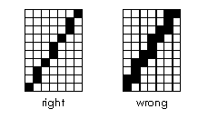

<!-- Classes And Methods - The Game Kit - Graphics Card Hook Functions -->

## Graphics Card Hook Functions

* * *

### define_cursor()

#### Index: 0

`int32 define_cursor(uchar* xorMask,  
uchar* andMask,  
int32 width,  
int32 height,  
int32 hotX,  
int32 hotY);`

Tells the driver to create a cursor image as defined by the arguments. The first two arguments, `xorMask` and `andMask`, are bit vectors that represent the cursor image laid out in concatenated, byte-aligned rows (top to bottom). Parallel bits from the two vectors define the color of a single cursor pixel:

`xorMask`| `andMask`| Description  
---|---|---  
0| 0| White; replace the screen pixel with a white cursor pixel.  
1| 0| Black; replace the screen pixel with a black cursor pixel.  
0| 1| Transparent; let the color of the underlying screen pixel show through.  
1| 1| Inversion; invert the color of the screen pixel.  
  
The second two arguments, `width` and `height`, are the size of the cursor image in pixels. (Currently, the Application Server supports only 16x16 cursors.)

The (`hotX`, `hotY`) arguments define the "hot spot"—the pixel that precisely locates the cursor. Hot spot coordinates are relative to the cursor rectangle itself, where the pixel at the left top corner of the cursor image is (0, 0) and the one at the right bottom corner is (`width`-1, `height`-1).

If the cursor is currently showing (i.e. not hidden), this function should display the cursor image.

* * *

### move_cursor()

#### Index: 1

`int32 move_cursor(int32 screenX,  
int32 screenY);`

Tells the driver to move the cursor so the hot spot corresponds to (`screenX`, `screenY`). The arguments are display area coordinates (not frame buffer coordinates).

* * *

### show_cursor()

#### Index: 2

`int32 show_cursor(bool flag);`

If the `flag` argument is `true`, the driver should show the cursor image on-screen; if it's `false`, it should remove the cursor from the screen.

If the driver is asked to show the cursor before [`define_cursor()`](TheGameKit_CardHooks.md#define_cursor "define_cursor\(\)") is called, it should show it at (0, 0).

* * *

### draw_line_with_8_bit_depth()

#### Index: 3

`int32 draw_line_with_8_bit_depth(int32 startX,  
int32 endX,  
int32 startY,  
int32 endY,  
uint8 colorIndex,  
bool clipToRect,  
int16 clipLeft,  
int16 clipTop,  
int16 clipRight,  
int16 clipBottom);`

Tells the driver to draw a straight, 8-bit color, minimally thin line.

  * The line begins at (`startX`, `startY`) and ends at (`endX`, `endY`), inclusive. The arguments are frame buffer coordinates.

  * `colorIndex` gives the color of the line as an index into the 8-bit color table.

  * If `clipToRect` is `true`, the function should draw only the portion of the line that lies within the clipping rectangle defined by the last four arguments. The sides of the rectangle are included in the drawing area. If `clipToRect` is `false`, the final four arguments should be ignored

To produce minimal thinness, the line should color only one pixel per row or column, as the absolute slope of the line is more or less than 45 degrees; in other words, the line should move between rows or columns on the diagonal, not by overlapping. Here's how you should (and shouldn't) produce a mostly-vertical line; for the mostly-horizontal version, turn your head sideways:

* * *

### draw_line_with_32_bit_depth()

#### Index: 4

`int32 draw_line_with_32_bit_depth(int32 startX,  
int32 endX,  
int32 startY,  
int32 endY,  
uint32 color,  
bool clipToRect,  
int16 clipLeft,  
int16 clipTop,  
int16 clipRight,  
int16 clipBottom);`

This is the same as [`draw_line_with_8_bit_depth()`](TheGameKit_CardHooks.md#draw_line_with_8_bit_depth "draw_line_with_8_bit_depth\(\)") except for the color argument. Here, `color` is a 32-bit value with 8-bit red, green, blue, and alpha components. The components are arranged in the order that the driver specified when it received the `B_GET_GRAPHICS_CARD_INFO` request.

* * *

### draw_rect_with_8_bit_depth()

#### Index: 5

`int32 draw_rect_with_8_bit_depth(int32 left,  
int32 top,  
int32 right,  
int32 bottom,  
uint8 colorIndex);`

Tells the driver to fill a rectangle, specified by the first four arguments, with the color at `colorIndex` in the 8-bit color table. The arguments are frame buffer coordinates. The sides of the rectangle should be included in the area being filled.

* * *

### draw_rect_with_32_bit_depth()

#### Index: 6

`int32 draw_rect_with_32_bit_depth(int32 left,  
int32 top,  
int32 right,  
int32 bottom,  
uint32 color);`

This is the same as [`draw_rect_with_8_bit_depth()`](TheGameKit_CardHooks.md#draw_rect_with_8_bit_depth "draw_rect_with_8_bit_depth\(\)") except for the `color` argument. Here, `color` is a 32-bit value with 8-bit red, green, blue, and alpha components. The components are arranged in the order that the driver specified when it received the `B_GET_GRAPHICS_CARD_INFO` request.

* * *

### blit()

#### Index: 7

`int32 blit(int32 sourceX,  
int32 sourceY,  
int32 destinationX,  
int32 destinationY,  
int32 width,  
int32 height);`

Tells the driver to copy pixel data from a source rectangle to a destination rectangle. All coordinates and sizes are in frame buffer space. The left top pixel of the source rectangle is at (`sourceX`, `sourceY`) in the frame buffer. The left top pixel of the destination rectangle is at (`destinationX`, `destinationY`) in the frame buffer. Both rectangles are `width` pixels wide and `height` pixels high. The `width` and `height` arguments will always contain positive values, and the rectangles are guaranteed to lie wholly within the frame buffer.

* * *

###  draw_array_with_8_bit_depth(), indexed_color_line

#### Index: 8

`int32 draw_array_with_8_bit_depth(indexed_color_line* array,  
int32 numItems,  
bool clipToRect,  
int16 clipLeft,  
int16 clipTop,  
int16 clipRight,  
int16 clipBottom);`

Tells the driver to draw an array of lines in 8-bit depth. The line `array` holds a total of `numItems`. Each item is specified as an indexed_color_line structure, which contains the following fields (all coordinates are in frame buffer space):

Field| Description  
---|---  
int16 `x1`| The x coordinate of one end of the line.  
int16 `y1`| The y coordinate of one end of the line.  
int16 `x2`| The x coordinate of the other end of the line.  
int16 `y2`| The y coordinate of the other end of the line.  
int16 `color`| The color of the line, expressed as an index into the color map.  
  
If `clipToRect` is `true`, the function should draw only the portions of the lines that lie within the clipping rectangle defined by the last four arguments. The sides of the rectangle are included in the drawing area. If `clipToRect` is `false`, the final four arguments should be ignored

The lines should be minimally thin, as described under [`draw_line_with_8_bit_depth()`](TheGameKit_CardHooks.md#draw_line_with_8_bit_depth "draw_line_with_8_bit_depth\(\)")

* * *

###  draw_array_with_32_bit_depth(), rgb_color_line

#### Index: 9

`int32 draw_array_with_32_bit_depth(rgb_color_line* array,  
int32 numItems,  
bool clipToRect,  
int16 clipLeft,  
int16 clipTop,  
int16 clipRight,  
int16 clipBottom);`

Except for the color specification, which is encoded in the rgb_color_line structure, this is the same as [`draw_array_with_8_bit_depth()`](TheGameKit_CardHooks.md#draw_array_with_8_bit_depth "draw_array_with_8_bit_depth\(\), indexed_color_line"). The rgb_color_line structure contains these fields:

Field| Description  
---|---  
int16 `x1`| The x coordinate of one end of the line.  
int16 `y1`| The y coordinate of one end of the line.  
int16 `x2`| The x coordinate of the other end of the line.  
int16 `y2`| The y coordinate of the other end of the line.  
rgb_color `color`| The color of the line, expressed as a full 32-bit value.  
  
* * *

### sync()

#### Index: 10

`int32 sync();`

The driver should implement this function to block until all other currently-executing hook functions have finished. (More accurately, you only have to wait for those hook functions that actually touch the frame buffer.) The return value is ignored.

You should only implement this function if the card can perform any of the hook functions asynchronously. If all hook functions are synchronous, you should set the index 10 function to `NULL`.

After receiving a `sync()` call, your driver won't receive anymore hook functions until `sync()` returns. Thus, you don't have to guard against in-coming hook functions while sitting in `sync()`.

* * *

### invert_rect()

#### Index: 11

`int32 invert_rect(int32 left,  
int32 top,  
int32 right,  
int32 bottom);`

Tells the driver to invert the colors in the rectangle specified by the arguments. The sides of the rectangle are included in the inversion.

* * *

### draw_line_with_16_bit_depth()

#### Index: 12

`int32 draw_line_with_16_bit_depth(int32 startX,  
int32 endX,  
int32 startY,  
int32 endY,  
uint16 color,  
bool clipToRect,  
int16 clipLeft,  
int16 clipTop,  
int16 clipRight,  
int16 clipBottom);`

This is the same as [`draw_line_with_8_bit_depth()`](TheGameKit_CardHooks.md#draw_line_with_8_bit_depth "draw_line_with_8_bit_depth\(\)") except for the color argument. Here, `color` is a 16-bit value with red, green, blue, and (possibly) alpha components. The components are arranged in the order that the driver specified when it received the `B_GET_GRAPHICS_CARD_INFO` request.

* * *

### draw_rect_with_16_bit_depth()

#### Index: 13

`int32 draw_rect_with_16_bit_depth(int32 left,  
int32 top,  
int32 right,  
int32 bottom,  
uint16 color);`

This is the same as [`draw_rect_with_8_bit_depth()`](TheGameKit_CardHooks.md#draw_rect_with_8_bit_depth "draw_rect_with_8_bit_depth\(\)") except for the color argument. Here, `color` is a 16-bit value with red, green, blue, and (possibly) alpha components. The components are arranged in the order that the driver specified when it received the `B_GET_GRAPHICS_CARD_INFO` request.
