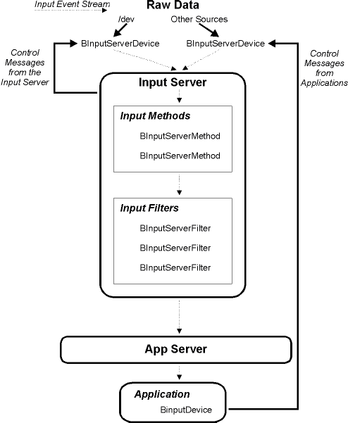

<!-- System Overview - The Input Server - Introduction -->

## Introduction

The Input Server is a system service that accepts user events (on the mouse and keyboard, typically) at one end, and dispatches them to the App Server at the other. In between, the Input Server runs the events through a series of filters that can inspect and modify them. The generation and filtering of events is performed by the add-ons that the Input Server loads; the Server itself just provides the plumbing. Event-generating add-ons (called input devices) typically correspond to one or more device drivers, although this isn't a requirement. An event-filtering add-on (input filter) processes the events that are fed to it; input filters aren't intended to correspond to hardware. A third type of Input Server add-on—an input method—is used to implement input method mechanisms, which convert keyboard events into character sets that can't be easily represented on a standard keyboard, such as Kanji.

Each of these add-on types (input devices, filters, and methods) is represented by a C++ class: [`BInputServerDevice`](BInputServerDevice.md "BInputServerDevice"), [`BInputServerFilter`](BInputServerFilter.md "BInputServerFilter"), and [`BInputServerMethod`](BInputServerMethod.md "BInputServerMethod"). For each add-on you want to create, you subclass the appropriate class and override its hook functions. An additional class—[`BInputDevice`](BInputDevice.md "BInputDevice")—lets a "normal" application send messages back through the Input Server to the input devices; a [`BInputDevice`](BInputDevice.md "BInputDevice") object can be useful if you're creating a preference app for a custom Input Server add-on, for example.

A map of the Input Server world looks like this:

Note that the Input Server and its add-ons (and [`BInputDevice`](BInputDevice.md "BInputDevice")) all live in user space, so, in theory, there's nothing that a "normal" application can do that an Input Server add-on can't do. However, Input Server add-ons are loaded early in the boot process, before some system services (such as the Media and Network servers) have started. Attempting to use services from these servers before they've started is a good way to wedge the system.

The BeOS provides a few Input Server add-ons: It installs input devices that handle a variety of mice and keyboard drivers, and an input filter that the Screen Saver engine uses to detect user activity (on the mouse and keyboard). BeOS's only built-in input method is installed when you choose the Japanese language option during the installation process.

Currently, events that are generated by the BeOS joystick drivers do not go through the Input Server.

* * *

### Drivers and Input Devices

As mentioned above, most input devices (i.e. input-generating add-ons) correspond to one or more device drivers. For example, the BeOS mouse input device manages all the mouse drivers that the OS provides.

It's important to keep in mind that an input device is not the same as the device driver(s) it manages—they're separate pieces of code that execute in separate address spaces: the drivers run in the kernel, the add-ons run in the Input Server. An input device can open() a driver, but it must not explicitly load the driver. In other words, the add-on shouldn't re-invent or subvert the kernel's driver-loading mechanism.

Similar to drivers, Input Server add-ons must be scrupulous about managing their memory and threads:

  * Memory that an add-on allocates must be freed when the add-on is unloaded, otherwise the add-on will leak.

  * The hook functions that are invoked on your add-on are executed in threads that must stay as "live" as possible. If your add-on does a lot of processing that can be performed asynchronously—for example, if it's an input device that's "watching" a piece of hardware—the add-on should spawn a thread.

#### Building

Like all add-ons, Input Server add-ons are compiled as shared libraries. The add-ons must link against input_server, renamed (as a symbolic link) to `_APP_`. In other words, you set up a symbolic link like this:
    
    
    $ cd <yourProjectDirectory>
    $ ln -s /boot/beos/system/servers/input_server _APP_

And then link against `_APP_`.

#### Installing

The input server looks for add-ons in the `input_server` directory within `B_BEOS_ADDONS_DIRECTORY`, `B_COMMON_ADDONS_DIRECTORY`, and `B_USER_ADDONS_DIRECTORY`. Where you install your add-ons depends on what type of add-on it is:

  * `input_server/devices` is for input devices

  * `input_server/filters` is for input filters

  * `input_server/methods` is for input methods

  * You can install your input devices in the latter two directories—i.e. those under `B_COMMON_ADDONS_DIRECTORY`, and `B_USER_ADDONS_DIRECTORY`.

  * The `B_BEOS_ADDONS_DIRECTORY` is reserved for add-ons that are supplied by the BeOS.

#### Loading

The Input Server automatically loads (or attempts to load) all add-ons at boot time.

Currently, the Input Server doesn't dynamically load add-ons. This is a particular annoyance if you're developing and testing an add-on. To work around this lack, move your add-on into the appropriate directory, and then quit and restart the Input Server from a Terminal:
    
    
    /system/servers/input_server -q

This will gracefully shutdown the Input Server and then re-launch it. The first thing the Server does when it comes back up is re-load the add-ons from its add-on directories.

Your mouse and keyboard (and other input devices) will go dead for a moment while this is happening. This is normal.

* * *

### Input Server and You

The Input Server gives applications a chance to take advantage of useful features present in input devices more interesting than your typical 101-key keyboard and 3-button mouse.

#### Mice and Tablets

The Input Server extends the plain `B_MOUSE_MOVED` message (which triggers a [`BView`](BView.md "BView")'s [`MouseMoved()`](BView.md#BView_MouseMoved "MouseMoved\(\)") function) beyond its ordinary existence to let things like tablets pass along extra information about a user's actions. For example, drawing tablets can track the user's movement with greater precision than a mouse, and can include drawing pressure and tilt information. Some also include an "eraser."

If an application can do something useful with this information (and let's face it; drawing applications that respond to pressure and tilt on a drawing pad are useful as well as being cool), it'll be present in the `B_MOUSE_MOVED` message:
    
    
    void MyView::MouseMoved(BPoint *where,
                             uint32 transit, BMessage *drag_msg)
    {
       BMessage *moved_msg = Window()->CurrentMessage();
       ...
    }

The extra information that a "mouse" input device could add to the `B_MOUSE_MOVED` messages includes:

  * more precise position information

  * drawing pressure

  * pen tilt

  * "eraser" mode

#### Precision Position Information

Tablets store the absolute position of the pointer with as much precision as they can in the `be:tablet_x` and `be:tablet_y` fields:
    
    
    float x, y;
    x = moved_msg->FindFloat( "be:tablet_x" );
    y = moved_msg->FindFloat( "be:tablet_y" );

These entries will be scaled to the range [0.0 to 1.0].

#### Pressure

Tablet pressure is stored as a float in the range [0.0 to 1.0] (minimum to maximum), present in the `be:tablet_pressure` field:
    
    
    float pressure;
    pressure = moved_msg->FindFloat( "be:tablet_pressure" );

#### Tilt

Pen tilt is expressed as a pair of floats in the range [0.0 to 1.0], where (-1.0, -1.0) tilts to the left-top, (1.0, 1.0) tilts to the right-bottom, and (0.0, 0.0) is no tilt. These floats are found in the `be:tablet_tilt_x` and `be:tablet_tilt_y` fields:
    
    
    float tilt_x, tilt_y;
    tilt_x = moved_msg->FindFloat( "be:tablet_tilt_x" );
    tilt_y = moved_msg->FindFloat( "be:tablet_tilt_y" );

#### Eraser Mode

The pen's eraser mode is expressed as an int32 in the `be:tablet_eraser` field:
    
    
    int32 erase_mode;
    erase_mode = moved_msg->FindInt32( "be:tablet_eraser" );

A value of 1 means the pen is reversed (i.e. the eraser is on) and 0 means the pen is behaving normally. Other eraser modes may be defined in the future.

* * *

### Supporting Input Methods in Views

When the user is entering text using an input method, such as the Japanese language input method that became an installation option in R4, there are two ways that applications can handle their input:

  1. in-line: the text entry interface object lets them enter text directly

  2. bottom-line: the input method itself pops up a window to accept the user's input, and then passes `B_KEY_DOWN` messages simulating the characters to the application; the app doesn't have to do anything to support bottom-line input

If your application's text-entry needs are met by the Interface Kit's [`BTextControl`](BTextControl.md "BTextControl") and [`BTextView`](BTextView.md "BTextView") objects, it'll automatically use the in-line mode, which gives the user a much better experience. If you're writing your own text widget, you'll have to do a little work to let the user input text directly.

Doing this is a very good idea; making your application behave well when dealing with foreign (to you) languages will improve your application's acceptance around the world.

#### Messages from Input Methods

When interacting with an input method, your view's [`MessageReceived()`](BView.md#BView_MessageReceived "MessageReceived\(\)") function will receive `B_INPUT_METHOD_EVENT` messages; inside is a `be:opcode` field (an int32 value) indicating the kind of event:

Constant| Description  
---|---  
`B_INPUT_METHOD_STARTED`| Tells your view that a new input transaction has begun. Inside the message is a [`BMessenger`](BMessenger.md "BMessenger") named `be:reply_to`; you should store this because it's your only way of talking to the input method while the transaction is going on.  
`B_INPUT_METHOD_STOPPED`| Lets you know the transaction is over; you should discard the [`BMessenger`](BMessenger.md "BMessenger") at this point because it's gone stale.  
  
In between the `B_INPUT_METHOD_STARTED` and `B_INPUT_METHOD_STOPPED` messages, you'll receive various `B_INPUT_METHOD_CHANGED` and `B_INPUT_METHOD_LOCATION_REQUEST` messages as the transaction proceeds.

`B_INPUT_METHOD_CHANGED` does most of the work in an input transaction; its message contains the following important fields:

Entry| Type| Description  
---|---|---  
`be:string`| `B_STRING_TYPE`| The text the user is currently entering; display it at the insertion point. [`BTextView`](BTextView.md "BTextView") also highlights the text in blue to show that it's part of a transitory transaction.  
`be:selection`| `B_INT32_TYPE`| A pair of `B_INT32_TYPE` offsets into the `be:string` if any of the text `be:string` is currently selected by the user. [`BTextView`](BTextView.md "BTextView") highlights this selection in red instead of drawing it in blue.  
`be:clause_start`| `B_INT32_TYPE`| Zero or more offsets into the `be:string` for handling languages (such as Japanese) that separate a sentence or phrase into numerous clauses. An equal number of `be:clause_start` and `be:clause_end` pairs delimit these clauses; [`BTextView`](BTextView.md "BTextView") separates the blue/red highlighting wherever there is a clause boundary.  
`be:clause_end`| `B_INT32_TYPE`| Zero or more offsets into `be:string`; there will be as many `be:clause_end` entries as there are `be:clause_start`.  
`be:confirmed`| `B_BOOL_TYPE`| True when the user has entered and "confirmed" the current string and wishes to end the transaction. [`BTextView`](BTextView.md "BTextView") unhighlights the blue/red text and waits for a `B_INPUT_METHOD_STOPPED` (to close the transaction) or another `B_INPUT_METHOD_CHANGED` (to start a new transaction immediately).  
  
`B_INPUT_METHOD_LOCATION_REQUEST` is the input method's way of asking you for the on-screen location of each character in your representation of the `be:string`. This information can be used by the input method to pop up additional windows giving the user an opportunity to select characters from a list or anything else that makes sense. When you get a `B_INPUT_METHOD_LOCATION_REQUEST`, reply to the `be:reply_to` messenger (that you saved from the `B_INPUT_METHOD_STARTED` message) with a `B_INPUT_METHOD_EVENT` message, filling in the following fields:

Entry| Type| Description  
---|---|---  
`be:opcode`| `B_INT32_TYPE`| Use `B_INPUT_METHOD_LOCATION_REQUEST` for the opcode.  
`be:location_reply`| `B_POINT_TYPE`| The co-ordinates of each character (there should be one `be:location_reply` for every character in `be:string` in screen co-ordinates not view or window co-ordinates).  
`be:height_reply`| `B_FLOAT_TYPE`| The height of each character in `be:string`.  
  
* * *

### App and Input Events

If you're writing an application and want to record or react to input events without writing an Input Server add-on (which, of course, requires an Input Server restart), you can:

  1. Create a window off-screen, at a co-ordinate like (-10.0, -10.0).

  2. Add a view to the window at (0.0, 0.0).

  3. [`Show()`](BWindow.md#BWindow_Show "Show\(\), Hide\(\), IsHidden\(\), Minimize\(\), IsMinimized\(\)") and then [`Hide()`](BWindow.md#BWindow_Hide) the window; this is necessary or the App Server won't send you any messages.

  4. Move the hidden window to (0.0, 0.0).

  5. Implement the window's [`DispatchMessage()`](BWindow.md#BWindow_DispatchMessage "DispatchMessage\(\)") function to handle `B_KEY_DOWN`, `B_MOUSE_UP`, or whatever other input events you're interested in observing.

Modifying these messages won't affect any other applications in the system; by the time they reach your application, they've already passed through the Input Server.

You can see this trick in action in Doug Fulton's masterful Whistle application (found at ftp://ftp.be.com/pub/samples/midi_kit/Whistle.zip).
