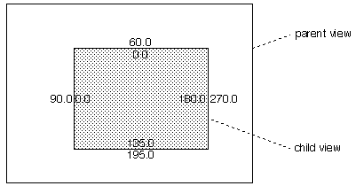
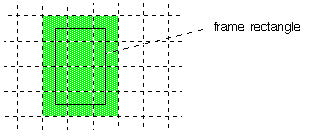
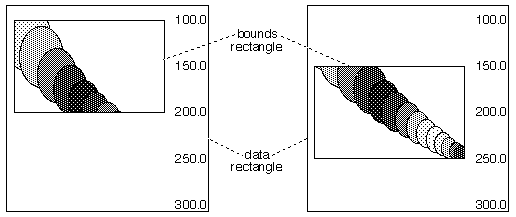
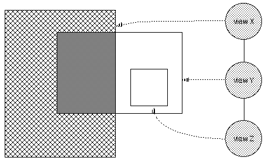
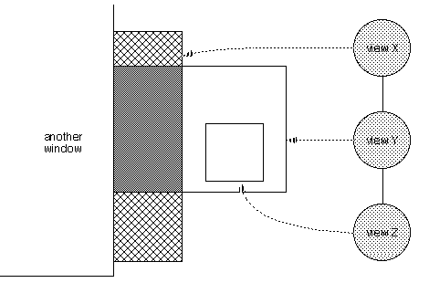
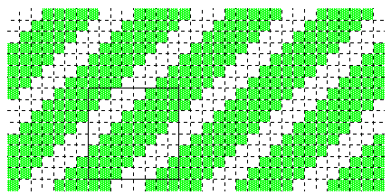
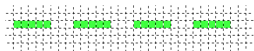

<!-- System Overview - The Interface Kit - Drawing -->

## Drawing

This section discusses the framework in which [`BView`](BView.md "BView")s draw. Detailed descriptions of the functions mentioned here can be found in the [`BView`](BView.md "BView") and [`BWindow`](BWindow.md "BWindow") class descriptions.

* * *

### View Geometry

Each view is assigned a coordinate system of its own. By default, the coordinate origin—(0.0, 0.0)—is located at the left top corner of the view rectangle. The x-axis extends to the right and the y-axis extends downward; coordinate units count screen pixels. (For a detailed discussion of the coordinate systems assumed by the Interface Kit, see "[The Coordinate Space](TheInterfaceKit_The_Coordinate_Space.md "The Coordinate Space")")

When a view is added as a child of another view, it's located within the coordinate system of its parent. A child is considered part of the contents of the parent view. If the parent moves, the child moves with it; if the parent view scrolls its contents, the child view is shifted along with everything else in the view.

Since each view retains its own internal coordinate system no matter who its parent is, where it's located within the parent, or where the parent is located, a [`BView`](BView.md "BView")'s drawing and message-handling code doesn't need to be concerned about anything exterior to itself. To do its work, a [`BView`](BView.md "BView") need look no farther than the boundaries of its own view rectangle.

#### Frame and Bounds Rectangles

Although a [`BView`](BView.md "BView") doesn't have to look outside its own boundaries, it does have to know where those boundaries are. It can get this information in two forms:

  * Since a view is located within the coordinate system of its parent, the view rectangle is initially defined in terms of the parent's coordinates. This defining rectangle for a view is known as its frame rectangle. (See the [`BView`](BView.md "BView") constructor and the [`Frame()`](BView.md#BView_Frame "Frame\(\)") function.)

  * When translated from the parent's coordinates to the internal coordinates of the view itself, the same rectangle is known as the bounds rectangle. (See the [`Bounds()`](BView.md#BView_Bounds "Bounds\(\)") function.)

The following illustration shows a child view 180.0 units wide and 135.0 units high. When viewed from the outside, from the perspective of its parent's coordinate system, it has a frame rectangle with left, top, right, and bottom coordinates at 90.0, 60.0, 270.0, and 195.0, respectively. But when viewed from the inside, in the view's own coordinate system, it has a bounds rectangle with coordinates at 0.0, 0.0, 180.0, and 135.0:

When a view moves to a new location in its parent, its frame rectangle changes but not its bounds rectangle. When a view scrolls its contents, its bounds rectangle changes, but not its frame. The frame rectangle positions the view in the world outside; the bounds rectangle positions the contents inside the view.

Since a [`BView`](BView.md "BView") does its work in its own coordinate system, it refers to the bounds rectangle more often than to the frame rectangle.

#### Nonfractional Coordinates

Because views are areas within windows and windows are displayed on-screen, the edges of a view must line up on rows and columns of screen pixels. It's easy to achieve this result, since coordinate units correspond to screen pixels; one unit is the distance from the center of a pixel to the center of an adjacent pixel. Therefore, all you must do is define the view rectangle with nonfractional coordinates, as in the illustration above.

#### Pixel and Coordinate Dimensions

It was mentioned that the child view in the illustration above is 180.0 coordinate units wide and 135.0 units high. However, this view actually covers 181 pixel columns and 136 pixel rows on-screen.

Two facts conspire to determine this result. First, as stated, coordinate units correspond to screen pixels. Second, the coordinate axes don't lie between pixels but right in the middle of them. The x-axis splits a row of pixels and the y-axis runs down the center of a column of pixels; the coordinate origin where they meet is at the very center of a pixel. Therefore, a view rectangle covers one more pixel in each direction than its coordinate dimensions would indicate.

Imagine an implausibly tiny frame rectangle like the one in the following diagram:

Since the pixels on the edges of this 2.0 * 3.0 rectangle are treated as being inside the rectangle, the view covers a 3 pixel * 4 pixel area.

This fact is important when laying out views and drawing in the bounds rectangle (or drawing any rectangle, for that matter). However, when discussing view coordinates and rectangles in general, it's easier and more accurate to speak in terms of coordinate values, not pixels—and that's the practice in this chapter. However, see "Mapping Coordinates to Pixels" for more on how coordinate values relate to pixels.

#### Scrolling

A [`BView`](BView.md "BView") scrolls its contents by shifting coordinate values within the view rectangle—that is, by altering the bounds rectangle. If, for example, the top of a view's bounds rectangle is at 100.0 and its bottom is at 200.0, scrolling downward 50.0 units would put the top at 150.0 and the bottom at 250.0. Contents of the view with y-coordinate values of 150.0 to 200.0, originally displayed in the bottom half of the view, would be shifted to the top half. Contents with y-coordinate values from 200.0 to 250.0, previously unseen, would become visible at the bottom of the view, as shown in the following illustration:

Scrolling doesn't move the view—it doesn't alter the frame rectangle—it moves only what's displayed inside the view. In the illustration above, a "data rectangle" encloses everything the [`BView`](BView.md "BView") is capable of drawing. For example, if the view is able to display an entire book, the data rectangle would be large enough to enclose all the lines and pages of the book laid end to end. However, since a [`BView`](BView.md "BView") can draw only within its bounds rectangle, everything in the data rectangle with coordinates that fall outside the bounds rectangle would be invisible. To make unseen data visible, the bounds rectangle must change the coordinates that it encompasses. Scrolling can be thought of as sliding the view's bounds rectangle to a new position on its data rectangle, as is shown in the illustration above. However, as it appears to the user, it's moving the data rectangle under the bounds rectangle. The view doesn't move; the data does.

#### The Clipping Region

The Application Server clips the images that a [`BView`](BView.md "BView") produces to the region where it's permitted to draw.

This region is never any larger than the view's bounds rectangle; a view cannot draw outside its bounds. Furthermore, since a child is considered part of its parent, a view can't draw outside the bounds rectangle of its parent either—or, for that matter, outside the bounds rectangle of any ancestor view. In addition, since child views draw after, and therefore logically in front of, their parents, a view concedes some of its territory to its children.

Thus, the visible region of a view is the part of its bounds rectangle that's inside the bounds rectangles of all its ancestors, minus the frame rectangles of its children. This is illustrated in the following figure. It shows a hierarchy of three views—X, Y, and Z. The area filled with a crosshatch pattern is the visible region of view X; it omits the area occupied by its child, view Y. The visible region of view Y is colored dark gray; it omits the part of the view that lies outside its parent. View Z has no visible region, for it lies outside the bounds rectangle of its ancestor, view X:

The visible region of a view might be further restricted if its window is obscured by another window or if the window it's in lies partially off-screen. The visible region includes only those areas that are actually visible to the user. For example, if the three views in the previous illustration were in a window that was partially blocked by another window, their visible regions might be considerably smaller. This is shown in the next figure:

Note that in this case, view X has a discontinuous visible region.

The Application Server clips the drawing that a view does to a region that's never any larger than the visible region. On occasion, it may be smaller. For the sake of efficiency, while a view is being automatically updated, the clipping region excludes portions of the visible region that don't need to be redrawn:

  * When a view is scrolled, the Application Server may be able to shift some of its contents from one portion of the visible region to another. The clipping region excludes any part of the visible region that the server was able to update on its own; it includes only the part where the [`BView`](BView.md "BView") must produce images that were not previously visible.

  * If a view is resized larger, the clipping region may include only the new areas that were added to the visible region. (But see the flags argument for the [`BView`](BView.md "BView") constructor.)

  * If only part of a view is invalidated (by the [`Invalidate()`](BView.md#BView_Invalidate "Invalidate\(\)") function), the clipping region is the intersection of the visible region and the invalid rectangle.

An application can also limit the clipping region for a view by passing a [`BRegion`](BRegion.md "BRegion") object to [`ConstrainClippingRegion()`](BView.md#BView_ConstrainClippingRegion "ConstrainClippingRegion\(\)"). The clipping region won't include any areas that aren't in the region passed. The Application Server calculates the clipping region as it normally would but intersects it with the specified region.

You can obtain the current clipping region for a view by calling [`GetClippingRegion()`](BView.md#BView_GetClippingRegion "GetClippingRegion\(\)"). (See also the [`BRegion`](BRegion.md "BRegion") class description.)

#### The View Color

Every view has a basic, underlying color. It's the color that fills the view rectangle before the [`BView`](BView.md "BView") does any drawing. The Application Server paints the view with this color before any view-specific drawing functions are called. The user may catch a glimpse of the color when the view is first shown on-screen, when it's resized larger, and when it's erased in preparation for an update. It will also be seen wherever the [`BView`](BView.md "BView") fails to draw in the visible region.

In a sense, the view color is the canvas on which the [`BView`](BView.md "BView") draws. It doesn't enter into any of the object's drawing operations except to provide a background. Although it's one of the [`BView`](BView.md "BView")'s graphics parameters, it's not one that any drawing functions refer to.

The default view color is white. You can assign a different color to a view by calling [`BView`](BView.md "BView")'s [`SetViewColor()`](BView.md#BView_SetViewColor "SetViewColor\(\), ViewColor\(\)") function. If you set the view color to `B_TRANSPARENT_COLOR`, the Application Server won't erase the view's clipping region before an update. This is appropriate only if the view erases itself by touching every pixel in the clipping region when it draws.

#### The Background Bitmap

Every view may additionally have a background bitmap. The Application Server draws this bitmap after it fills in the view color and before any view-specific drawing functions are called. The view color will be visible in regions the background bitmap doesn't cover.

A view begins life without a background bitmap. A background bitmap may be added with [`BView`](BView.md "BView")'s [`SetViewBitmap()`](BView.md#BView_SetViewBitmap "SetViewBitmap\(\), ClearViewBitmap\(\)") function and subsequently removed with [`ClearViewBitmap()`](BView.md#BView_ClearViewBitmap).

* * *

### The Mechanics of Drawing

Views draw through the following set of primitive functions:

  * [`DrawString()`](BView.md#BView_DrawString "DrawString\(\)") draws a string of characters. [`DrawChar()`](BView.md#BView_DrawChar "DrawChar\(\)") is a variant of this function; it draws just a single character.

  * [`DrawPicture()`](BView.md#BView_DrawPicture "DrawPicture\(\), DrawPictureAsync\(\)") executes a set of recorded drawing instructions.

  * [`DrawBitmap()`](BView.md#BView_DrawBitmap "DrawBitmap\(\), DrawBitmapAsync\(\)") produces an image from a bitmap.

  * [`DrawBitmap()`](BView.md#BView_DrawBitmap "DrawBitmap\(\), DrawBitmapAsync\(\)")CopyBits() copies an image from one location to another.

  * [`FillEllipse()`](BView.md#BView_FillEllipse), [`FillRegion()`](BView.md#BView_FillRegion "FillRegion\(\)"), and other `Fill…()` functions fill closed shapes.

  * [`StrokeLine()`](BView.md#BView_StrokeLine "StrokeLine\(\)"), [`StrokeArc()`](BView.md#BView_StrokeArc), and other `Stroke…()` functions stroke lines along defined paths.

  * [`BeginLineArray()`](BView.md#BView_BeginLineArray "BeginLineArray\(\), AddLine\(\), EndLineArray\(\)"), [`AddLine()`](BView.md#BView_AddLine), and [`EndLineArray()`](BView.md#BView_EndLineArray) draw a set of straight lines, all of the same width, but possibly in different colors.

The way these functions work depends not only on the values that they're passed—the particular string, bitmap, arc, or ellipse that's to be drawn—but on previously set values in the [`BView`](BView.md "BView")'s graphics environment.

#### Graphics Environment

Each [`BView`](BView.md "BView") object maintains its own graphics environment for drawing. The view color, coordinate system, and clipping region are fundamental parts of that environment, but not the only parts. It also includes a number of parameters that can be set and reset at will to affect the next image drawn. These parameters are:

  * Font attributes that determine the appearance of text the [`BView`](BView.md "BView") draws. (See [`SetFont()`](BView.md#BView_SetFont "SetFont\(\), GetFont\(\)") and the [`BFont`](BFont.md "BFont") class.)

  * Two pen parameters—a location and a size. The pen location determines where the next drawing will occur, and the pen size determines the thickness of stroked lines. (See [`MovePenBy()`](BView.md#BView_MovePenBy "MovePenBy\(\), MovePenTo\(\), PenLocation\(\)") and [`SetPenSize()`](BView.md#BView_SetPenSize "SetPenSize\(\), PenSize\(\)").)

  * Two current colors—a high color and a low color—that can be used either alone or in combination to form a pattern or halftone. The high color is used for most drawing. The low color is sometimes set to the underlying view color so that it can be used to erase other drawing or, because it matches the view background, make it appear that drawing has not touched certain pixels.

(The high and low colors roughly match what other systems call the fore and back, or foreground and background, colors. However, neither color truly represents the color of the foreground or background. The terminology high and low is meant to keep the sense of two opposing colors and to match how they're defined in a pattern. A pattern bit is turned on for the high color and turned off for the low color. See the [`SetHighColor()`](BView.md#BView_SetHighColor "SetHighColor\(\), HighColor\(\) , SetLowColor\(\) , LowColor\(\)") and [`SetLowColor()`](BView.md#BView_SetLowColor) functions in the [`BView`](BView.md "BView") class description and the "[Patterns](TheInterfaceKit_Drawing.md#TheInterfaceKit_Drawing_Patterns "Patterns")" section.

  * A drawing mode that determines how the next image is to be rendered. (See "[Drawing Modes](TheInterfaceKit_Drawing.md#TheInterfaceKit_Drawing_Drawing_Modes "Drawing Modes")" and the [`SetDrawingMode()`](BView.md#BView_SetDrawingMode "SetDrawingMode\(\), DrawingMode\(\)") function.)

By default, a [`BView`](BView.md "BView")'s graphics parameters are set to the following values:

Font| The system plain font (be_plain_font)  
---|---  
Pen position| (0.0, 0.0)  
Pen size| 1.0 coordinate units  
High color| Black (red, green, and blue components all equal to 0)  
Low color| White (red, green, and blue components all equal to 255)  
Drawing mode| Copy mode (`B_OP_COPY`)  
View color| White (red, green, and blue components all equal to 255)  
Clipping region| The visible region of the view  
Coordinate system| Origin at the left top corner of the bounds rectangle  
  
However, as "[Views and the Server](TheInterfaceKit_Drawing.md#TheInterfaceKit_Drawing_Views_Server "Views and the Server")" explains, these values have meaning only when the [`BView`](BView.md "BView") is assigned to a window.

#### The Pen

The pen is a fiction that encompasses two properties of a view's graphics environment: the current drawing location and the thickness of stroked lines.

The pen location determines where the next image will be drawn—but only if another location isn't explicitly passed to the drawing function. Some drawing functions alter the pen location—as if the pen actually moves as it does the drawing—but usually it's set by calling [`MovePenBy()`](BView.md#BView_MovePenBy "MovePenBy\(\), MovePenTo\(\), PenLocation\(\)") or [`MovePenTo()`](BView.md#BView_MovePenTo).

The pen that draws lines (through the various `Stroke…()` functions) has a malleable tip that can be made broader or narrower by calling the calling [`SetPenSize()`](BView.md#BView_SetPenSize "SetPenSize\(\), PenSize\(\)") function. The larger the pen size, the thicker the line that it draws.

The pen size is expressed in coordinate units, which must be translated to a particular number of pixels for the display device. This is done by scaling the pen size to a device-specific value and rounding to the closest integer. For example, pen sizes of 2.6 and 3.3 would both translate to 3 pixels on-screen, but to 7 and 10 pixels respectively on a 300dpi printer.

The size is never rounded to 0; no matter how small the pen may be, the line never disappears. If the pen size is set to 0.0, the line will be as thin as possible—it will be drawn using the fewest possible pixels on the display device. (In other words, it will be rounded to 1 for all devices.)

If the pen size translates to a tip that's broader than 1 pixel, the line is drawn with the tip centered on the path of the line. Roughly the same number of pixels are colored on both sides of the path.

A later section, "[Picking Pixels to Stroke and Fill](TheInterfaceKit_The_Coordinate_Space.md#TheInterfaceKit_The_Coordinate_Space_Picking_Pixels "Picking Pixels to Stroke and Fill")", illustrates how pens of different sizes choose the pixels to be colored.

#### Colors

The high and low colors are specified as rgb_color values—full 32-bit values with separate red, green, and blue color components, plus an alpha component for transparency. Although there may sometimes be limitations on the colors that can be rendered on-screen, there are no restrictions on the colors that can be specified.

#### Color Spaces

The way colors are specified for a bitmap depends on the color space in which they're interpreted. The color space determines the depth of the bitmap data (how many bits of information are stored for each pixel), the interpretation of the data (whether it represents shades of gray or true colors, whether it's segmented into color components, what the components are, and so on), and the arrangement of components within the data (whether big-endian or little-endian). These six basic color spaces are recognized:

`B_GRAY1`| One bit of data per pixel, where 1 is black and 0 is white.  
---|---  
`B_GRAY8`| Eight bits of data per pixel, where a value of 255 is black and 0 is white.  
`B_CMAP8`| Eight bits of data per pixel, interpreted as an index into a list of 256 colors. The list is part of the system color map and is the same for all applications.  
`B_RGB15`| Three components of data per pixel—blue, green, and red, in that order—with 5 bits each for red, green, and blue. The first bit of the pixel data is not associated with any color component.  
`B_RGBA15`| Four components of data per pixel—blue, green, red, and alpha, in that order—with 5 bits each for red, green, and blue, and 1 bit for alpha.  
`B_RGB16`| Three components of data per pixel—blue, green, and red, in that order—with 5 bits each for red and blue, and 6 bits for green.  
`B_RGB32`| Four components of data per pixel—blue, green, red, and alpha, in that order—with 8 bits per component. A component value of 255 yields the maximum amount of red, green, or blue, and a value of 0 indicates the absence of that color.  
  
The components in the `B_RGB32`, `B_RGB16`, and `B_RGB15` color spaces are meshed rather than separated into distinct planes; all four components are specified for the first pixel before the four components for the second pixel, and so on. The order of bytes for these two types is little-endian, which means that for `B_RGB32` data, the component bytes appear in the order blue, green, red, and alpha.

Counterpart color spaces are defined for big-endian data. `B_RGB32_BIG`, `B_RGBA16_BIG`, `B_RGBA15_BIG`, and `B_RGB15`_BIG, are equivalent to `B_RGB32`, `B_RGB16`, `B_RGBA15`, and `B_RGB15`—except for the order of bytes. The Be operating system retains data in the little-endian formats; the big-endian color spaces are defined only to label noncompatible data that the system must convert and to allow drivers to communicate precise formats to the operating system.

Alpha should be 0 for 100% transparent, or 255 (for 8-bit alpha channels) for 100% opaque. For 1-bit alpha channels, a value of 1 indicates opaque.

#### The Screen

The screen can be configured to display colors in either the `B_CMAP8`, `B_RGB15`, or `B_RGB32` color spaces. When it's in the `B_CMAP8` or `B_RGB15` color spaces, specified rgb_colors are displayed as the closest available color. (See the [`BBitmap`](BBitmap.md "BBitmap") and [`BScreen`](BScreen.md "BScreen") classes.)

#### Patterns

Most functions that stroke a line or fill a closed shape don't draw directly in either the high or the low color. Rather they take a pattern, an arrangement of one or both colors that's repeated over the entire surface being drawn. A pattern might consist of just the high color, just the low color, or some combination of the two.

By combining the low color with the high color, patterns can produce dithered colors that lie somewhere between two hues in the `B_CMAP8` color space. Patterns also permit drawing with less than the solid high color (for intermittent or broken lines, for example) and can take advantage of drawing modes that treat the low color as if it were transparent, as discussed in the next section.

A pattern is defined as an 8-pixel by 8-pixel square. The pattern type is 8 bytes long, with 1 byte per row and 1 bit per pixel. Rows are specified from top to bottom and pixels from left to right. Bits marked 1 designate the high color; those marked 0 designate the low color. For example, a pattern of wide diagonal stripes could be defined as follows:
    
    
    pattern stripes = { 0xc7, 0x8f, 0x1f, 0x3e,
                      0x7c, 0xf8, 0xf1, 0xe3 };

Patterns repeat themselves across the screen, like tiles laid side by side. The pattern defined above looks like this:

The dotted lines in this illustration show the separation of the screen into pixels. The thicker black line outlines one 8 * 8 square that the pattern defines.

The outline of the shape being filled or the width of the line being stroked determines where the pattern is revealed. It's as if the screen was covered with the pattern just below the surface, and stroking or filling allowed some of it to show through. For example, stroking a 1-pixel wide horizontal path in the pattern illustrated above would result in a dotted line, with the dashes (in the high color) slightly longer than the spaces between (in the low color):

When stroking a line or filling a shape, the pattern serves as the source image for the current drawing mode, as explained in "[Drawing Modes](TheInterfaceKit_Drawing.md#TheInterfaceKit_Drawing_Drawing_Modes "Drawing Modes")" next. The nature of the mode determines how the pattern interacts with the destination image, the image already in place.

The Interface Kit defines three patterns:

`B_SOLID_HIGH`| Consists only of the high color.  
---|---  
`B_SOLID_LOW`| Has only the low color.  
`B_MIXED_COLORS`| Mixes the two colors evenly, like the pattern on a checkerboard.  
  
`B_SOLID_HIGH` is the default pattern for all drawing functions. Applications can define as many other patterns as they need.

#### Drawing Modes

When a [`BView`](BView.md "BView") draws, it in effect transfers an image to a target location somewhere in the view rectangle. The drawing mode determines how the image being transferred interacts with the image already in place at that location. The image being transferred is known as the source image; it might be a bitmap or a pattern of some kind. The image already in place is known as the destination image.

In the simplest and most straightforward kind of drawing, the source image is simply painted over the destination; the source replaces the destination. However, there are other possibilities. There are ten different drawing modes—ten distinct ways of combining the source and destination images. The modes are designated by drawing_mode constants that can be passed to [`SetDrawingMode()`](BView.md#BView_SetDrawingMode "SetDrawingMode\(\), DrawingMode\(\)"):

`B_OP_COPY`| `B_OP_ADD`  
---|---  
`B_OP_OVER`| `B_OP_SUBTRACT`  
`B_OP_ERASE`| `B_OP_BLEND`  
`B_OP_INVERT`| `B_OP_MIN`  
`B_OP_SELECT`| `B_OP_MAX`  
  
`B_OP_COPY` is the default mode and the simplest. It transfers the source image to the destination, replacing whatever was there before. The destination is ignored.

In the other modes, however, some of the destination might be preserved, or the source and destination might be combined to form a result that's different from either of them. For these modes, it's convenient to think of the source image as an image that exists somewhere independent of the destination location, even though it's not actually visible. It's the image that would be rendered at the destination in `B_OP_COPY` mode.

#### Bitmaps and Patterns

The modes work for all [`BView`](BView.md "BView") drawing functions—including those that stroke lines and fill shapes, those that draw characters, and those that image bitmaps. The way they work depends foremost on the nature of the source image—whether it's a pattern or a bitmap. For the `Fill…()` and `Stroke…()` functions, the source image is a pattern that has the same shape as the area being filled or the area the pen touches as it strokes a line. For [`DrawBitmap()`](BView.md#BView_DrawBitmap "DrawBitmap\(\), DrawBitmapAsync\(\)"), the source image is a rectangular bitmap.

In a sense, a pattern is simply a bitmap that's one bit deep. It's a bitmap consisting of two colors, one which maps to the current high color and another that maps to the current low color. As we shall see later, a `B_MONOCHROME_1_BIT` bitmap acts just like a pattern. However, patterns and bitmaps generally behave differently:

  * Only a source pattern has designated high and low colors. Even if a source bitmap has colors that match the current high and low colors, they're not handled like the colors in a pattern; they're treated just like any other color in the bitmap.

  * On the other hand, only a source bitmap can have transparent pixels. In the `B_CMAP8` color space, a pixel is made transparent by assigning it the `B_TRANSPARENT_MAGIC_CMAP8` value. In the `B_RGB32` color space, a pixel assigned the `B_TRANSPARENT_MAGIC_RGBA32` value is considered transparent. These values have meaning only for source bitmaps, not for source patterns. If the current high or low color in a pattern happens to have a transparent value, it's still treated as the high or low color, not like transparency in a bitmap. For big endian color spaces, the transparency color should be byte-swapped from its little endian counterpart.

`B_TRANSPARENT_MAGIC_CMAP8`| 8-bit indexed color transparent pixel.  
---|---  
`B_TRANSPARENT_MAGIC_RGBA15`| 15-bit transparent pixel.  
`B_TRANSPARENT_MAGIC_RGBA15_BIG`| 15-bit transparent pixel, big-endian.  
`B_TRANSPARENT_MAGIC_RGBA32`| 32-bit transparent pixel.  
`B_TRANSPARENT_MAGIC_RGBA32_BIG`| 32-bit transparent pixel, big-endian.  
  
#### Drawing Modes and Color Spaces

The way the drawing modes work also depends on the color space of the source image and the color space of the destination. The following discussion concentrates on drawing where the source and destination both contain colors. This is the most common case, and also the one that's most general.

The source and destination images can have different color spaces. For example, a source bitmap might be defined in the `B_CMAP8` space while the destination is displayed in the full color `B_RGB32` color space. The drawing operation merely combines the colors in the two images in some way. It doesn't transfer the color space of the source image to the destination. The image that results from the drawing operation will always be in the color space of the destination image.

#### Mode Definitions

When applied to colors, the ten drawing modes fall naturally into four groups:

  * The `B_OP_COPY` mode, which copies the source image to the destination.

  * The `B_OP_OVER`, `B_OP_ERASE`, `B_OP_INVERT`, and `B_OP_SELECT` modes, which—despite their differences—all treat the low color in a pattern as if it were transparent.

  * The `B_OP_ADD`, `B_OP_SUBTRACT`, and `B_OP_BLEND` modes, which combine colors in the source and destination images.

  * The `B_OP_MIN` and `B_OP_MAX` modes, which choose between the source and destination colors.

The following paragraphs describe each of these groups in turn.

##### Copy Mode

In `B_OP_COPY` mode, the source image replaces the destination. This is the default drawing mode and the one most commonly used. Because this mode doesn't have to test for particular color values in the source image, look at the colors in the destination, or compute colors in the result, it's also the fastest of the modes.

If the source image contains transparent pixels, their transparency will be retained in the result; the transparent value is copied just like any other color. However, the appearance of a transparent pixel when shown on-screen is indeterminate. If a source image has transparent portions, it's best to transfer it to the screen in `B_OP_OVER` or another mode. In all modes other than `B_OP_COPY`, a transparent pixel in a source bitmap preserves the color of the corresponding destination pixel.

##### Transparency Modes

Four drawing modes—`B_OP_OVER`, `B_OP_ERASE`, `B_OP_INVERT`, and `B_OP_SELECT`—are designed specifically to make use of transparency in the source image; they're able to preserve some of the destination image. In these modes (and only these modes) the low color in a source pattern acts just like transparency in a source bitmap.

Each of these modes has a different effect on the destination image—but only in those places where the source image is not transparent. One of the modes, `B_OP_OVER`, transfers some of the source image to the destination. The other three modes play with the destination in some way—erase it, invert it, or select colors in it—without regard to the source image. For these modes, the only thing that matters about the source image is where it's transparent and where it's not. Each of the four modes is described below:

  * The `B_OP_OVER` mode places the source image "over" the destination; the source provides the foreground and the destination the background. In this mode, the source image replaces the destination image (just as in the `B_OP_COPY` mode)—except where a source bitmap has transparent pixels and a source pattern has the low color. Transparency in a bitmap and the low color in a pattern retain the destination image in the result.

  * By masking out the unwanted parts of a rectangular bitmap with transparent pixels, this mode can place an irregularly shaped source image in front of a background image. Transparency in the source foreground lets the destination background show through. The versatility of `B_OP_OVER` makes it the second most commonly used mode, after `B_OP_COPY`.

  * The `B_OP_ERASE` mode doesn't draw the source image at all. Instead, it erases the destination image. Like `B_OP_OVER`, it preserves the destination image wherever a source bitmap is transparent or a source pattern has the low color. But everywhere else—where the source bitmap isn't transparent and the source pattern has the high color—it removes the destination image, replacing it with the low color.

Although this mode can be used for selective erasing, it's simpler to erase by filling an area with the B_SOLID_LOW pattern in `B_OP_COPY` mode.

  * The `B_OP_INVERT` mode, like `B_OP_ERASE`, doesn't draw the source image. Instead, it inverts the colors in the destination image. As in the case of the `B_OP_OVER` and `B_OP_ERASE` modes, where a source bitmap is transparent or a source pattern has the low color, the destination image remains unchanged in the result. Everywhere else, the color of the destination image is inverted.

The inversion of an rgb_color is the complement of its color components. For example, the inversion of a red value of 58 would be 197 (255 - 58).

  * The `B_OP_SELECT` mode also doesn't draw the source image. It replaces the high color in the destination image with the low color and the low color with the high color. As for the other modes in this group, where a source bitmap is transparent or a source pattern has the low color, the destination image remains unchanged in the result. Everywhere else, the high and low colors are switched.

This is similar to the `B_OP_INVERT` mode, except that `B_OP_SELECT` affects at most only two colors in the destination image. The destination is preserved not only where the source is transparent, but also where its colors don't match the current high and low colors.

These four modes also work for monochrome images. If the source image is monochrome, the distinction between source bitmaps and source patterns breaks down. Two rules apply:

  * If the source image is a monochrome bitmap, it acts just like a pattern. A value of 1 in the bitmap designates the current high color, and a value of 0 designates the current low color. Thus, 0, rather than `B_TRANSPARENT_MAGIC_*`, becomes the transparent value.

  * If the source and destination are both monochrome, the high color is necessarily black (1), and the low color is necessarily white (0)—but otherwise the drawing modes work as described. With the possible colors this severely restricted, the three modes are reduced to boolean operations: `B_OP_OVER` is the same as a logical OR, `B_OP_INVERT` and `B_OP_SELECT` are the same as logical exclusive OR, and `B_OP_ERASE` is the same as an inversion of logical AND.

##### Blending Modes

Three drawing modes—`B_OP_ADD`, `B_OP_SUBTRACT`, and `B_OP_BLEND`—combine the source and destination images, pixel by pixel, and color component by color component. As in most of the other modes, transparency in a source bitmap preserves the destination image in the result. Elsewhere, the result is a combination of the source and destination. The high and low colors of a source pattern aren't treated in any special way; they're handled just like other colors.

  * `B_OP_ADD` adds each component of the source color to the corresponding component of the destination color, with a component value of 255 as the limit. Colors become brighter, closer to white.

By adding a uniform gray to each pixel in the destination, for example, the whole destination image can be brightened by a constant amount.

  * `B_OP_SUBTRACT` subtracts each component of the source color from the corresponding component of the destination color, with a component value of 0 as the limit. Colors become darker, closer to black.

For example, by subtracting a uniform amount from the red component of each pixel in the destination, the whole image can be made less red.

  * `B_OP_BLEND` averages each component of the source and destination colors (adds the source and destination components and divides by 2). The two images are merged into one.

These modes work only for color images, not for monochrome ones. If the source or destination is specified in the `B_CMAP8` color space, the color will be expanded to a full `B_RGB32` value to compute the result; the result is then contracted to the closest color in the `B_CMAP8` color space.

##### Selection Modes

Two drawing modes—`B_OP_MAX` and `B_OP_MIN`—compare each pixel in the source image to the corresponding pixel in the destination image and select one to keep in the result. If the source pixel is transparent, both modes select the destination pixel. Otherwise, `B_OP_MIN` selects the darker of the two colors and `B_OP_MAX` selects the brighter of the two. If the source image is a uniform shade of gray, for example, `B_OP_MAX` would substitute that shade for every pixel in the destination image that was darker than the gray.

Like the blending modes, `B_OP_MIN` and `B_OP_MAX` work only for color images.

* * *

### Views and the Server

Windows lead a dual life—as on-screen entities provided by the Application Server and as [`BWindow`](BWindow.md "BWindow") objects in the application. [`BView`](BView.md "BView")s have a similar dual existence—each [`BView`](BView.md "BView") object has a shadow counterpart in the server. The server knows the view's location, its place in the window's hierarchy, its visible area, and the current state of its graphics parameters. Because it has this information, the server can more efficiently associate a user action with a particular view and interpret the [`BView`](BView.md "BView")'s drawing instructions.

[`BWindow`](BWindow.md "BWindow")s become known to the Application Server when they're constructed; creating a [`BWindow`](BWindow.md "BWindow") object causes the server to produce the window that the user will eventually see on-screen. A [`BView`](BView.md "BView"), on the other hand, has no effect on the server when it's constructed. It becomes known to the server only when it's attached to a [`BWindow`](BWindow.md "BWindow"). The server must look through the application's windows to see what views it has.

A [`BView`](BView.md "BView") that's not attached to a window therefore lacks a counterpart in the server. This restricts what some functions can do. Three groups of functions are affected:

  * Drawing functions—[`DrawBitmap()`](BView.md#BView_DrawBitmap "DrawBitmap\(\), DrawBitmapAsync\(\)"), [`FillRect()`](BView.md#BView_FillRect), [`StrokeLine()`](BView.md#BView_StrokeLine "StrokeLine\(\)"), and so on—don't work for unattached views. A [`BView`](BView.md "BView") can't draw unless it's in a window.

  * The scrolling functions—[`ScrollTo()`](BView.md#BView_ScrollTo) and [`ScrollBy()`](BView.md#BView_ScrollBy "ScrollBy\(\), ScrollTo\(\)")—require the [`BView`](BView.md "BView") to be in a window. Manipulations of a view's coordinate system are carried out in its server counterpart.

  * Functions that indirectly depend on a [`BView`](BView.md "BView")'s graphics parameters—such as [`GetMouse()`](BView.md#BView_GetMouse "GetMouse\(\)"), which reports the cursor location in the [`BView`](BView.md "BView")'s coordinates—also require the [`BView`](BView.md "BView") to belong to a window. These functions need information that an unattached [`BView`](BView.md "BView") can't provide.

However, the functions that set and return graphics parameters—such as [`SetFont()`](BView.md#BView_SetFont "SetFont\(\), GetFont\(\)"), [`SetDrawingMode()`](BView.md#BView_SetDrawingMode "SetDrawingMode\(\), DrawingMode\(\)"), [`PenLocation()`](BView.md#BView_PenLocation), and [`SetHighColor()`](BView.md#BView_SetHighColor "SetHighColor\(\), HighColor\(\) , SetLowColor\(\) , LowColor\(\)")—are not restricted. A view's graphic state is kept within the server (where it's needed to carry out drawing instructions), but also cached by the [`BView`](BView.md "BView"). Therefore, it's possible to assign a value to a graphics parameter before the server knows about the view. The value is simply cached until the view becomes part of a window's view hierarchy; the [`BView`](BView.md "BView") then hands it to the server. The server and the client-side cache are always kept in synch.

#### Attaching to a Window

Although you can set a [`BView`](BView.md "BView")'s graphics parameters before it belongs to a window and has a counterpart in the Application Server, some of its initialization may need to wait until the [`BView`](BView.md "BView") receives an [`AttachedToWindow()`](BView.md#BView_AttachedToWindow "AttachedToWindow\(\), AllAttached\(\)") notification informing it that it has been added to a window's view hierarchy. For example, if a view adopts the background color of its parent, it can only set the view color in [`AttachedToWindow()`](BView.md#BView_AttachedToWindow "AttachedToWindow\(\), AllAttached\(\)"):
    
    
    void MyView::AttachedToWindow(void)
    {
       if ( Parent() )
          SetViewColor(Parent()->ViewColor());
       . . .
    }

[`AttachedToWindow()`](BView.md#BView_AttachedToWindow "AttachedToWindow\(\), AllAttached\(\)") is called for each view that's added to a window, beginning with the root view being attached, followed by each of its children, and so on down the hierarchy. After all views have been notified with an [`AttachedToWindow()`](BView.md#BView_AttachedToWindow "AttachedToWindow\(\), AllAttached\(\)") function call, they each get an [`AllAttached()`](BView.md#BView_AllAttached) notification, but in the reverse order. A parent view that must adjust itself to calculations made by a child view when it's attached to a window can wait until [`AllAttached()`](BView.md#BView_AllAttached) to do the work.

These two function calls are matched by another pair—[`DetachedFromWindow()`](BView.md#BView_DetachedFromWindow "DetachedFromWindow\(\), AllDetached\(\)") and [`AllDetached()`](BView.md#BView_AllDetached)—which notify [`BView`](BView.md "BView")s that they're about to be removed from the window.

#### Preparing to Draw

A [`BView`](BView.md "BView") doesn't have to draw anything within its frame rectangle—it can just be a container for other [`BView`](BView.md "BView")s that do draw there. However, most views that you implement will draw. And most views draw by implementing the [`Draw()`](BView.md#BView_Draw "Draw\(\)") function. This function is called upon to present the view on-screen (or, when printing, on a page). It's implemented using the primitive drawing functions listed above. If your [`BView`](BView.md "BView") includes a [`Draw()`](BView.md#BView_Draw "Draw\(\)") implementation, you must include `B_WILL_DRAW` in the [`BView`](BView.md "BView")'s flags upon construction.

#### The Update Mechanism

The Application Server sends a message to a [`BWindow`](BWindow.md "BWindow") whenever any of the views within the window need to be updated. The [`BWindow`](BWindow.md "BWindow") then calls the [`Draw()`](BView.md#BView_Draw "Draw\(\)") function of each out-of-date [`BView`](BView.md "BView") so that it can redraw the contents of its on-screen display.

Update messages can arrive at any time. A [`BWindow`](BWindow.md "BWindow") receives one when the window is first placed on screen, or is shown after being hidden

  * The window is first placed on-screen, or is shown again after having been hidden.

  * Any part of the window becomes visible after being obscured.

  * The views in the window are rearranged—for example, if a view is resized or a child is removed from the hierarchy.

  * Something happens to alter what a particular view displays. For example, if the contents of a view are scrolled, the [`BView`](BView.md "BView") must draw any new images that scrolling makes visible. If one of its children moves, it must fill in the area the child view vacated.

  * The application forces an update by "invalidating" a view, or a portion of a view.

As update messages arrive, they jump to the head of the [`BWindow`](BWindow.md "BWindow")'s message queue.

#### Forcing an Update

When a user action or a [`BView`](BView.md "BView") function alters a view—if the view is scrolled, for example—an update message is sent and the [`BView`](BView.md "BView")'s [`Draw()`](BView.md#BView_Draw "Draw\(\)") function is automatically called. But if the [`Draw()`](BView.md#BView_Draw "Draw\(\)") function depends on some other state that's defined by your application, you need to tell the Application Server that your [`BView`](BView.md "BView") needs an update message. You do this by invoking [`BView`](BView.md "BView")'s [`Invalidate()`](BView.md#BView_Invalidate "Invalidate\(\)") function.

For example, let's say your `D2DView` subclass connects some dots by reading points out of a [`BList`](BList.md "BList") and drawing lines between them:
    
    
    void D2DView::Draw(BRect update)
    {
       int32 i = 1;
       if (dotList->CountItems() > 1) {
          MovePenTo(*(BPoint *)dotList->ItemAt(0);
          while (i < dotList->CountItems())
             StrokeLine(*(BPoint *)dotList->ItemAt(i++));
       }
    }

Each "dot specification" is added through `DotView`'s `AddDot()` function. `AddDot()` includes a call to [`Invalidate()`](BView.md#BView_Invalidate "Invalidate\(\)") in order to force the view to be redrawn:
    
    
    void D2DView::AddDot(BPoint p)
    {
       dotList->AddItem(new BPoint(p));
       Invalidate();
    }

##### Forcing an Update while Responding to an Event

The hook functions that respond to user events—[`KeyDown()`](BView.md#BView_KeyDown "KeyDown\(\)"), [`MouseDown()`](BView.md#BView_MouseDown "MouseDown\(\)"), and so on—are executed in the same thread that receives window update messages. If you do something in your implementation of one of these hook functions that causes an update, the update message won't be processed until your hook function exits. If your hook function does a lot of processing, your interface can become unresponsive.

To get around this problem, call [`BWindow`](BWindow.md "BWindow")'s [`UpdateIfNeeded()`](BWindow.md#BWindow_UpdateIfNeeded "UpdateIfNeeded\(\)") function from within your hook functions' implementations. [`UpdateIfNeeded()`](BWindow.md#BWindow_UpdateIfNeeded "UpdateIfNeeded\(\)") forces any pending update messages to be processed immediately. The function doesn't return until the "dirty" views are all done re-drawing. (Note that [`UpdateIfNeeded()`](BWindow.md#BWindow_UpdateIfNeeded "UpdateIfNeeded\(\)") only works from within the [`BWindow`](BWindow.md "BWindow")'s message loop thread.)

For example, let's say you want to add a random dot (within a 100x100 square) everytime the user hits a key:
    
    
    void D2DView::KeyDown(const char *bytes, int32 numBytes)
    {
       AddDot(BPoint(rand()%100, rand()%100);
       Window()->UpdateIfNeeded();
       ...
    }

Since `AddDot()` calls [`Invalidate()`](BView.md#BView_Invalidate "Invalidate\(\)"), we know that there's an update message pending. However, the update won't normally be processed until [`KeyDown()`](BView.md#BView_KeyDown "KeyDown\(\)") exits, so we call [`UpdateIfNeeded()`](BWindow.md#BWindow_UpdateIfNeeded "UpdateIfNeeded\(\)"), which sees the update and calls `D2DView`'s [`Draw()`](BView.md#BView_Draw "Draw\(\)") function. When [`Draw()`](BView.md#BView_Draw "Draw\(\)") is finished, [`UpdateIfNeeded()`](BWindow.md#BWindow_UpdateIfNeeded "UpdateIfNeeded\(\)") returns and [`KeyDown()`](BView.md#BView_KeyDown "KeyDown\(\)") continues.

#### Erasing the Clipping Region

Just before sending an update message, the Application Server prepares the clipping region of each [`BView`](BView.md "BView") that is about to draw by erasing it to the view background color. Note that only the clipping region is erased, not the entire view, and perhaps not the entire area where the [`BView`](BView.md "BView") will, in fact, draw.

The server forgoes this step only if the [`BView`](BView.md "BView")'s background color is set to `B_TRANSPARENT_COLOR`. See "[The View Color](TheInterfaceKit_Drawing.md#TheInterfaceKit_Drawing_View_Color "The View Color")" above.

#### Drawing during an Update

While drawing, a [`BView`](BView.md "BView") may set and reset its graphics parameters any number of times—for example, the pen position and high color might be repeatedly reset so that whatever is drawn next is in the right place and has the right color. These settings are temporary. When the update is over, all graphics parameters are reset to their initial values.

If, for example, [`Draw()`](BView.md#BView_Draw "Draw\(\)") sets the high color to a shade of light blue, as shown below,
    
    
    SetHighColor(152, 203, 255);

it doesn't mean that the high color will be blue when [`Draw()`](BView.md#BView_Draw "Draw\(\)") is called next. If this line of code is executed during an update, light blue would remain the high color only until the update ends or [`SetHighColor()`](BView.md#BView_SetHighColor "SetHighColor\(\), HighColor\(\) , SetLowColor\(\) , LowColor\(\)") is called again, whichever comes first. When the update ends, the previous graphics state, including the previous high color, is restored.

Although you can change most graphics parameters during an update—move the pen around, reset the font, change the high color, and so on—the coordinate system can't be touched; a view can't be scrolled while it's being updated. If the view's coordinate system were to change, it would alter the current clipping region and confuse the update mechanism.

#### Drawing outside of an Update

Graphics parameters that are set outside the context of an update are not limited; they remain in effect until they're explicitly changed. For example, if application code calls [`Draw()`](BView.md#BView_Draw "Draw\(\)"), perhaps in response to an interface message, the parameter values that [`Draw()`](BView.md#BView_Draw "Draw\(\)") last sets would persist even after the function returns. They would become the default values for the view and would be assumed the next time [`Draw()`](BView.md#BView_Draw "Draw\(\)") is called.

Default graphics parameters are typically set as part of initializing the [`BView`](BView.md "BView") once it's attached to a window—in an [`AttachedToWindow()`](BView.md#BView_AttachedToWindow "AttachedToWindow\(\), AllAttached\(\)") function. If you want a [`Draw()`](BView.md#BView_Draw "Draw\(\)") function to assume the values set by [`AttachedToWindow()`](BView.md#BView_AttachedToWindow "AttachedToWindow\(\), AllAttached\(\)"), it's important to restore those values after any drawing the [`BView`](BView.md "BView") does that's not the result of an update. For example, if a [`BView`](BView.md "BView") invokes [`SetHighColor`](BView.md#BView_SetHighColor "SetHighColor\(\), HighColor\(\) , SetLowColor\(\) , LowColor\(\)") while drawing in response to an interface message, it will need to restore the default high color when done.

If [`Draw()`](BView.md#BView_Draw "Draw\(\)") is called outside of an update, it can't assume that the clipping region will have been erased to the view color, nor can it assume that default graphics parameters will be restored when it's finished.
