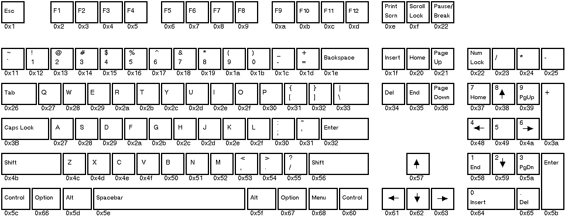

<!-- Special Topics - The Keyboard - Key Codes -->

## Key Codes

Each key on a computer's keyboard is assigned a numerical code which is reported as the `key` field in the `B_KEY_DOWN` or `B_UNMATCHED_KEY_DOWN` message. Likewise, the `key` field of the `B_KEY_UP` or `B_UNMATCHED_KEY_UP` message indicates which key was released.

The Print Screen key is trapped by BeOS; it doesn't generate a key down message, but it does generate a key up.

The following illustration shows the keycodes for most of the keys on standard keyboards.

Some keyboards vary slightly from this; however, even if keys are in different locations than those depicted here, they'll still have the same key code values.

Note that the Option key on Macintosh keyboards and the Windows key on many PC keyboards share the same keycode.

Some other keys that don't appear on this diagram include:

Key| Keycode  
---|---  
System Request| 0x7E  
Break| 0x7F  
Euro| 0x69  
Keypad| 0x6A  
Mac Power Key| 0x6B
