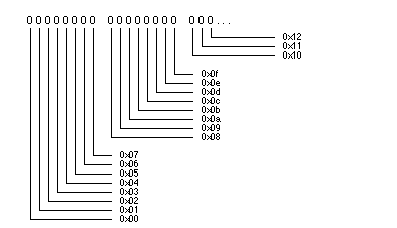

<!-- Special Topics - The Keyboard - Key States -->

## Key States  
  
You can look at the state of all the keys on the keyboard at a given moment in time. This information is captured and reported in two ways:

  1. As the `states` field in every `B_KEY_DOWN` message, and

  2. As the `key_states` bitfield reported by [`get_key_info()`](TheInputServer_Functions.md#get_key_info "get_key_info\(\)").

In both cases, the bitfield is an array of 16 bytes,
    
    
    uint8 states[16];

with one bit standing for each key on the keyboard. Bits are numbered from left to right, beginning with the first byte in the array, as illustrated below:

Bit numbers start with 0 and match key codes. For example, bit 0x3c corresponds to the a key, 0x3d to the s key, 0x3e to the d key, and so on. The first bit is 0x00, which doesn't correspond to any key. The first meaningful bit is 0x01, which corresponds to the Escape key.

When a key is down, the bit corresponding to its key code is set to 1. Otherwise, the bit is 0. However, for the three keys that toggle keyboard locks—Caps Lock (key 0x3b), Num Lock (key 0x22), and Scroll Lock (key 0x0f)—the bit is set to 1 if the lock is on and set to 0 if the lock is off, regardless of the state of the key itself.

To test the bitfield against a particular key,

  * Select the byte in the `states` array that contains the bit for that key,

  * Form a mask for the key that can be compared to that byte, and

  * Compare the byte to the mask.

For example:
    
    
    if (states[keyCode>>3] & (1 << (7 - (keyCode%8)))) {
       /* the key is down */
    }
