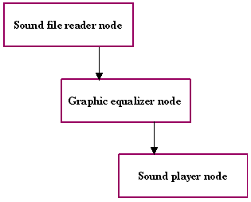
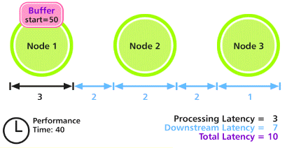
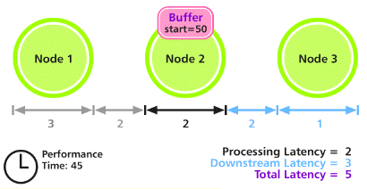
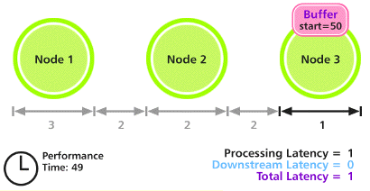
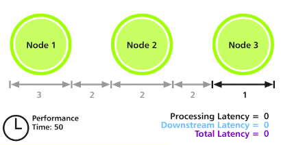

<!-- System Overview - The Media Kit - Introduction -->

## Introduction

The Media Kit provides powerful support for all forms of media (including, but not limited to, audio and video), including both playback and recording from and to a wide variety of media and devices.

There are two levels of Media Kit programming: the high level, where an application accesses the Media Kit to play and record sound and video, and the low level, which involves actually creating the nodes that manipulate media data.

* * *

### Media Kit Concepts

This section is a general overview of key Media Kit concepts.

#### Nodes

The first thing that you need to understand as a media programmer working with the BeOS is the concept of a node. Generically speaking, a node is a specialized object in the media system that processes buffers of media data. All nodes are indirectly derived from the [`BMediaNode`](BMediaNode.md "BMediaNode") class (but never directly from [`BMediaNode`](BMediaNode.md "BMediaNode"); instead, nodes are derived from specialized node type classes).

Nodes can be loaded from add-on modules, or they can be created within an application itself. See the [`BMediaAddOn`](BMediaAddOn.md "BMediaAddOn") class for details.

The node kind (defined by the [node_kind](TheMediaKit_Constants.md#Enums_node_kind "node_kind") type) is a description of the basic capabilities of a node. See "[Types of Nodes](TheMediaKit_Overview_Introduction.md#TheMediaKit_TypesOfNodes "Types of Nodes")".

A [media_node](TheMediaKit_DefinedTypes.md#media_node "media_node") is a structure that an application uses when working with media nodes; interactions with the Media Roster are almost always done using this structure instead of an object actually derived from [`BMediaNode`](BMediaNode.md "BMediaNode"). The reason for this that applications will often need to share nodes, and due to protected memory, it's not really feasible to pass a [`BMediaNode`](BMediaNode.md "BMediaNode") pointer among the applications.

Note

No portion of the media node protocol is optional; if you don't follow all the rules precisely, you risk hurting media performance, and since BeOS is the Media OS, that would be a bad thing.

For more detailed information about the architecture of the Media Kit (in particular, how nodes relate to one another), please see the [`BMediaNode`](BMediaNode.md "BMediaNode") class.

##### Types of Nodes

There are several basic kinds of nodes. Each of them is derived originally from the [`BMediaNode`](BMediaNode.md "BMediaNode") class. Any nodes that you might implement will be derived, in turn, from one or more of these node types. The node kind indicates which of these types a node implements.

###### Producers

A producer (a node derived from the [`BBufferProducer`](BBufferProducer.md "BBufferProducer") class) outputs media buffers, which are then received by consumers. A producer might be generating nodes on its own (for example, a tone generator might be using a mathematical formula to generate a sound, or an audio file player might be loading data from disk and sending buffers containing its audio data). Other producers might be responsible for acquiring data from media hardware (such as a video camera) and passing the media buffers to consumers down the line.

In the example in the "[Communicating With Nodes](TheMediaKit_Overview_Introduction.md#TheMediaKit_CommunicatingWithNodes "Communicating With Nodes")" section, the sound file reader node is an example of a producer.

###### Consumers

Consumers (nodes derived from [`BBufferConsumer`](BBufferConsumer.md "BBufferConsumer"), receive buffers from a producer and process them in some manner. For example, a sound card's software would provide a consumer node that receives audio buffers and plays them through the card's hardware.

In the example in the "[Communicating With Nodes](TheMediaKit_Overview_Introduction.md#TheMediaKit_CommunicatingWithNodes "Communicating With Nodes")" section, the sound player node is an example of a consumer.

###### Consumer/Producers (Filters)

A consumer/producer (a node that derives from both [`BBufferConsumer`](BBufferConsumer.md "BBufferConsumer") and [`BBufferProducer`](BBufferProducer.md "BBufferProducer")) is also called a filter. A filter accepts buffers (like a consumer), processes them in some manner, then sends them back out again (like a producer). This can be used to alter sound or video data.

For example, an audio filter might add a reverb effect to sound buffers, or a video filter might add captioning to a video stream.

In the example in the "[Communicating With Nodes](TheMediaKit_Overview_Introduction.md#TheMediaKit_CommunicatingWithNodes "Communicating With Nodes")" section, the equalizer node is an example of a filter node.

###### Controllables

If a node wishes to provide the user options for configuring its functionality, the node can derive from [`BControllable`](BControllable.md "BControllable"). This provides features for creating a network of controllable parameters, and for publishing this information to Media Kit-savvy applications (including the Media preference applications).

###### Time Sources

A time source node broadcasts timing information that can be used by other nodes. All nodes are slaved to a time source, which provides synchronization among all nodes slaved to that time source. Typically, applications won't need to worry about this, because any node created through the [`BMediaRoster`](BMediaRoster.md "BMediaRoster") class are automatically slaved to the system (default) time source.

Note

A node can be derived from any of these types ([`BBufferProducer`](BBufferProducer.md "BBufferProducer"), [`BBufferConsumer`](BBufferConsumer.md "BBufferConsumer"), [`BTimeSource`](BTimeSource.md "BTimeSource"), and [`BControllable`](BControllable.md "BControllable")), in any combination, as appropriate.

##### The Node Kind

The [node_kind](TheMediaKit_Constants.md#Enums_node_kind "node_kind") type is used to identify which of these interfaces a node implements; this lets the Media Kit know which APIs your node supports. These flags include `B_BUFFER_PRODUCER`, `B_BUFFER_CONSUMER`, `B_TIME_SOURCE`, and `B_FILE_INTERFACE`.

There are other flags available in the node kind; these indicate special node functions supported by the node. These are `B_PHYSICAL_INPUT`, which indicates that the node is a physical input device, `B_PHYSICAL_OUTPUT`, which indicates that the device is a physical output device, and `B_SYSTEM_MIXER`, which indicates that the node is the system mixer.

The primary purpose to these flags is to help user interfaces determine how to draw the interface for these nodes; they get special icons in the Media preference application, for example.

##### Deriving From Multiple Classes

For example, if you're creating a sound card node that plays audio to stereo speakers, you would need to derive from [`BBufferConsumer`](BBufferConsumer.md "BBufferConsumer") (in order to receive audio buffers). You could also derive from [`BTimeSource`](BTimeSource.md "BTimeSource") if your sound card has the ability to provide timing information to others. And if you want the user to be able to control the volume, balance, and so forth, you would also derive from [`BControllable`](BControllable.md "BControllable").

If your sound card also provides a digitizer input, you would actually create a second node to support that feature. It would inherit from [`BBufferProducer`](BBufferProducer.md "BBufferProducer") (so it can generate audio buffers for other nodes to use). It might also derive from [`BTimeSource`](BTimeSource.md "BTimeSource") and [`BControllable`](BControllable.md "BControllable").

But not all nodes necessarily represent a physical hardware device. If you want to create a filter—for example, a noise-reduction filter—you can create a node to do this too. Simply derive from both [`BBufferConsumer`](BBufferConsumer.md "BBufferConsumer") (so you can receive buffers) and [`BBufferProducer`](BBufferProducer.md "BBufferProducer") (so you can send back out the altered buffers).

#### Source & Destination vs. Output & Input

Beginning Media Kit programmers may have trouble understanding the difference between a [media_source](TheMediaKit_DefinedTypes.md#media_source "media_source") and a [media_output](TheMediaKit_DefinedTypes.md#media_output "media_output"), and a [media_destination](TheMediaKit_DefinedTypes.md#media_destination "media_destination") and a [media_input](TheMediaKit_DefinedTypes.md#media_input "media_input").

The [media_source](TheMediaKit_DefinedTypes.md#media_source "media_source") and [media_destination](TheMediaKit_DefinedTypes.md#media_destination "media_destination") structures describe a "socket" of sorts (much like in networking). These are the ends of the connection, much like the jacks you might plug cables into to connect various components of a stereo system. They're relatively small, lightweight descriptions containing only the information needed during real-time manipulation of nodes. Buffers travel from the source to the destination. You can use the basic operators (=, ==, and !=) on these objects.

media_source::`null` and media_destination::`null` represent uninitialized endpoints.

The [media_output](TheMediaKit_DefinedTypes.md#media_output "media_output") and [media_input](TheMediaKit_DefinedTypes.md#media_input "media_input") structures describe an actual connection between a [media_source](TheMediaKit_DefinedTypes.md#media_source "media_source") and a [media_destination](TheMediaKit_DefinedTypes.md#media_destination "media_destination"), including the source and destination, the connetion's name, and the format of the data the connection is intended to handle. These are larger, and contain additional information needed when presenting a user interface describing the connections between nodes.

The [media_input](TheMediaKit_DefinedTypes.md#media_input "media_input") structure describes the receiving (upstream) end of a connection; [media_output](TheMediaKit_DefinedTypes.md#media_output "media_output") describes the sender (the downstream end).

Although [media_output](TheMediaKit_DefinedTypes.md#media_output "media_output") and [media_input](TheMediaKit_DefinedTypes.md#media_input "media_input") contain all the information of the [media_source](TheMediaKit_DefinedTypes.md#media_source "media_source") and [media_destination](TheMediaKit_DefinedTypes.md#media_destination "media_destination") structures, the latter structures exist because when you're doing real-time manipulation of media data, you don't want to be tossing large blocks of data around unless you have to. And you don't have to.

#### Media Formats

The [media_format](TheMediaKit_DefinedTypes.md#media_format "media_format") structure describes the type of media being passed through a connection. The application and the nodes with which it's working negotiate the format through a sequence of calls and callbacks.

This structure contains a basic media type (such as `B_MEDIA_RAW_AUDIO` or `B_MEDIA_ENCODED_VIDEO`) and a union containing additional information depending on the basic type.

##### Raw Audio

The media_format structure describing `B_MEDIA_RAW_AUDIO` media contains the following information:

Frame rate| The number of frames of audio per second.  
---|---  
Format| The data type of each audio sample.  
Channel count| The number of samples per frame. For example, stereo sound has two channels (left and right).  
Byte order| Indicates whether the data is big-endian or little-endian.  
Buffer size| The number of bytes of data per buffer.  
  
##### Raw Video

The [media_format](TheMediaKit_DefinedTypes.md#media_format "media_format") structure describing `B_MEDIA_RAW_VIDEO` media contains the following information:

Field rate| The number of fields (buffers) of video per second.  
---|---  
Interlace| The number of fields per frame.  
Display information| The color space, line width, line count, bytes per row, and so forth.  
  
##### Format Wildcards

A format wildcard indicates unspecified parts of the format. This is used during negotiation so a node or application can say "I don't care about this partifular part of the format; I'm flexible." For example, if your application is negotiating with a video node, and you can handle any bit depth of video, you would specify a wildcard in the color space field of the format.

Each format type has one wildcard object.

For example, if you're preparing to negotiate with an audio node, and don't care about the frame rate, the following code will set up the media_format structure for negotiation:
    
    
    media_format format;
    media_raw_audio_format wc;
    
    wc = media_raw_audio_format::wildcard;
    
    format.type = B_MEDIA_RAW_AUDIO;
    format.u.raw_audio.frame_rate = wc.frame_rate;

##### Audio: Samples and Frames and Buffers (Oh my)

A sample is a single value that defines the amplitude of an audio waveform at a given instant in time. This value can be represented in a number of ways: as a one-byte integer, as a two-byte integer, as a floating-point value, or in other ways. The native audio sample format in BeOS is floating-point, where a value of 0.0 represents a wave point with no amplitude. Positive values indicate a sample whose amplitude is above the zero point, and negative values represent samples below the zero point.

A frame is the set of samples that describes a sound at a given instant in time. If the audio contains multiple channels, a frame contains multiple samples, one for each channel. A monaural audio stream contains one sample per frame, while a stereo audio stream contains two samples per frame. Surround sound formats contain even more samples per frame of audio.

A buffer is a more efficient way of sending audio from one node to another. Instead of beaming around thousands of individual frames, frames are grouped into buffers that are then transferred en masse along the chain of nodes. This improves throughput and reduces overhead.

See "[media_raw_audio_format](TheMediaKit_DefinedTypes.md#media_raw_audio_format "media_raw_audio_format")" for more information about describing audio formats.

##### Video: Interlacing, Fields, and Frames

Video can be represented either as non-interlaced or interlaced data. Both NTSC video (the standard format for television video in the United States) and PAL video (the standard in many other countries) are interlaced.

Typically, a video stream will have either one or two fields per frame. If the video isn't interlaced, there's only one field, which contains all the scan lines in the video stream. If the video is interlaced, there are usually two fields per frame (it might be more, but two is most common). One field contains the even lines of the frame, the other contains the odd lines.

Video buffers in the BeOS Media Kit always contain either a complete frame or a complete field; buffers never contain partial frames or fields.

See "[media_raw_video_format](TheMediaKit_DefinedTypes.md#media_raw_video_format "media_raw_video_format")" for more information about describing the format of video data.

##### Reference Material

This chapter doesn't pretend to be a tutorial on the intricacies of audio and video data formats. There are plenty of good reference books on these subjects. Here's a list of books our engineers suggest:

  * The Art of Digital Audio by John Watkinson (ISBN 0240513207)

  * Compression in Audio and Video by John Watkinson (ISBN 0240513940)

  * Digital Audio Signal Processing by Udo Zolzer (ISBN 0471972266)

  * Introduction to Signal Processing by Sophocles Orphanidis (ISBN )

  * Principles of Digital Audio by Ken C. Pohlmann (ISBN 0070504695)

  * A Programmer's Guide to Sound by Tim Kientzle (ISBN 0201419726)

  * Video Demystified by Keith Jack (ISBN 18780723X)

#### Buffers

A [`BBuffer`](BBuffer.md "BBuffer") is a packet of media data that can be passed between nodes. It contains a header that describes the data and the actual data being transmitted.

The buffer header contains inforrmation that tells you what the data is:

Start time| The time at which the data should be performed.  
---|---  
Size used| The number of valid data bytes in the buffer.  
  
Additional information based on the media type.

For optimal performance, the media system stores buffer data in shared memory areas so that different applications and nodes can access the same buffer, without having to copy it around in memory. Buffers are passed from one node to the next by giving each node a [`BBuffer`](BBuffer.md "BBuffer") that references the same area of memory.

#### Communicating With Nodes

The [`BMediaRoster`](BMediaRoster.md "BMediaRoster") class provides the application interface to all available nodes (whether they're created by the application or by an add-on). An application instantiates the nodes it needs, then establishes the connections between them that will accomplish the desired task.

For example, if an application wants to play a sound file through a graphic equalizer, it might first instantiate a node that reads sound data from a disk file and outputs audio buffers, then instantiate a node that performs filtering on audio buffers, and finally, a node that plays sound buffers to the speakers.

Once these three nodes are instantiated, the application creates the links between them. The output of the audio file reading node is connected to the input of the equalizer node, then the equalizer node's output is connected to the sound player node's input.:

Once these connections are established, the application can then begin playing the sound file, by telling the first node what sound file to play, and then starting all of the nodes running. The sound file reader creates buffers containing audio data, and passes those along to the equalizer node, which alters them, then passes them along to the sound player node, which plays the buffers and recycles them for reuse. A more detailed example of how to work with nodes to play back media data is given in the [`BMediaRoster`](BMediaRoster.md "BMediaRoster") class.

##### Connections at the Low Level

Each media node maintains a control port. The Media Kit interacts with the node by sending messages to the node's control port.

#### Time

One of the most important issues in manipulating media data is to properly track and synchronize precisely-timed events. There are several kinds of time (and you don't even have to be Stephen Hawking to understand them):

##### Media Time

Media time is time relative to a particular media file, and is represented in terms of microseconds since the beginning of the file. Seek operations are performed using media time.

##### Real Time

Real time is the time reported by the system clock, and is represented in terms of microseconds since the computer was booted. It's used in conjunction with system calls, such as [`snooze()`](TheKernelKit_ThreadsAndTeams.md#snooze "snooze\(\), snooze_until\(\)"), [`read_port_etc()`](TheKernelKit_Ports.md#read_port_etc), and so forth.

##### Performance Time

Performance time is the time at which events should occur at the final output. It's reported by a time source node, which establishes the relationship between real time and performance time.

Usually a single time source is the master clock for all the nodes in a node chain.

##### Performance Time vs. Real Time

There are two reasons why performance time and real time may differ: if the master clock isn't the system time, there may be drift over time. Also, latency caused by the time it takes for data to pass from one node to another can cause drift as well.

#### Latency

Latency is the amount of time it takes to do something. There are four kinds of latency:

  1. Algorithmic latency is any intentional or unavoidable delay added to the processing of buffers, such as retimestamping buffers so they're performed later. This also includes delays caused, for example, by a filter node requiring that it hold samples for a while to compute delay or echo effects.

  2. Processing latency is the time it takes for a node to process a buffer.

  3. Scheduling latency is the amount of time it takes to schedule a buffer.

  4. Downstream latency is the amount of time that passes between the time a node sends a buffer to the time at which the buffer can be performed. This includes the internal latencies of every downstream node.

##### A Latency Example

Let's consider a case in which three nodes are connected. The first node has a processing latency of 3 microseconds, the second has a processing latency of 2 microseconds, and the last has a processing latency of 1 microsecond.

Note

This example uses the term "microseconds" because the Media Kit measures time in microseconds; however, the latencies used in this example may not be indicative of a real system.

In addition, 2 microseconds is required for buffers to pass from one node to the next. The total latency of this chain of nodes, then, is 3 + 2 + 2 \+ 2 + 1 = 10 microseconds.

A buffer is scheduled to be played at a performance time of 50 microseconds. In order to get this buffer to the last node in time to be played at the right time, it needs to begin being processed at 40 microseconds. We see this in the diagram below.

After the buffer has been processed by Node 1 and has been passed along to Node 2, 5 microseconds have passed. Node 2 will take 2 microseconds to process the buffer. This gets us to a performance time of 45 microseconds:

Node 2 processes the buffer, and passes it along to Node 3. This takes a total of 4 microseconds (2 microseconds of processing time plus 2 microseconds to be sent to Node 3). We arrive at the performance time of 49 microseconds:

Finally, Node 3 processes the buffer; this requires 1 microsecond of processing time. At this point, the performance time of 50 microseconds has been reached, and the buffer has been performed on schedule.

* * *

### Using the Media Kit

If you're writing an application that wants to record or play back some form of media data (such as a sound or a video file), all your media needs are served by the [`BMediaRoster`](BMediaRoster.md "BMediaRoster") class. This class provides access to the various nodes, and lets you establish the relationships among them that are necessary to perform the tasks you'd like to accomplish.

Note

The [`BMediaNode`](BMediaNode.md "BMediaNode") is an abstract class; you don't call its functions directly. Instead, you use [`BMediaRoster`](BMediaRoster.md "BMediaRoster") calls to issue requests to the various nodes available on the BeOS system on which your application is running. In addition, you can't derive a new class directly from [`BMediaNode`](BMediaNode.md "BMediaNode"); instead, derive from one of the system-defined subclasses ([`BBufferConsumer`](BBufferConsumer.md "BBufferConsumer"), [`BBufferProducer`](BBufferProducer.md "BBufferProducer"), [`BControllable`](BControllable.md "BControllable"), and so forth).

Media Kit error code constants can be found in `media/MediaDefs.h`.

#### The Media Roster

The Media Roster manages an application's communication with the media system. Each application has at most one instance of the media roster. The roster is obtained by calling [`BMediaRoster`::`Roster()`](BMediaRoster.md#BMediaRoster_Roster "Roster\(\), CurrentRoster\(\)"); if it already exists, the current roster object is returned.

This section briefly summarizes some of the functions served by the Media Roster; for more detailed information, see the [`BMediaRoster`](BMediaRoster.md "BMediaRoster") class.

##### Finding the Right Nodes

There are several standard nodes, which the user configures using the Media preference application, plus the system mixer. The [`BMediaRoster`](BMediaRoster.md "BMediaRoster") class provides convenience routines to quickly get references to these nodes, such as [`GetAudioMixer()`](BMediaRoster.md#BMediaRoster_GetAudioMixer) and [`GetVideoOutput()`](BMediaRoster.md#BMediaRoster_GetVideoOutput). See the [`BMediaRoster`](BMediaRoster.md "BMediaRoster") class for details.

If you need some other node, you can browse through the available nodes to find the one best-suited for your needs. Nodes are created from dormant nodes, which live inside media add-ons. Each dormant node is a reference to a node flavor, a structure that describes the nodes the dormant node can create.

Once you've identified the best node for your purposes, you negotiate and establish a connection to the node. This is discussed in the [`BMediaRoster`](BMediaRoster.md "BMediaRoster") overview.

##### Controlling Nodes

Once your nodes are created and connected to each other, you can control them by using the [`BMediaNode`](BMediaNode.md "BMediaNode") functions [`Preroll()`](BMediaNode.md#BMediaNode_Preroll "Preroll\(\)"), [`Seek()`](BMediaNode.md#BMediaNode_Seek "Seek\(\)"), [`Start()`](BMediaNode.md#BMediaNode_Start "Start\(\)"), and [`Stop()`](BMediaNode.md#BMediaNode_Stop "Stop\(\)"). These let you move to specific points in the media file and start and stop playback or recording.

You can also set the nodes' time sources, run modes, and play rates.

##### Displaying a User Interface

[`BControllable`](BControllable.md "BControllable") nodes can present a user interface representing the aspects of itself that the user can configure. Each of these configurable aspects are called a parameter. The [`BMediaRoster`](BMediaRoster.md "BMediaRoster") provides functions that let you create a user interface for a node's parameters. See [`BMediaRoster::StartControlPanel()`](BMediaRoster.md#BMediaRoster_StartControlPanel "StartControlPanel\(\)") for the easiest way to do this.

#### Media Files

The approved way to access files containing media data is via the [`BMediaFile`](BMediaFile.md "BMediaFile") and [`BMediaTrack`](BMediaTrack.md "BMediaTrack") classes. If you're using a node-based playback or recording system, and you want to have easy access to media files, you can get access to the node used by the [`BMediaFile`](BMediaFile.md "BMediaFile") class by calling [`BMediaRoster::SniffRef()`](BMediaRoster.md#BMediaRoster_SniffRef "SniffRef\(\), SniffRefFor\(\)").

See "[Reading and Writing Media Files](TheMediaKit_Overview_ReadingWriting.md "Reading and Writing Media Files")" for an example of how to access media files the right way.

#### The Audio Mixer

The audio mixer accepts as input audio data which it then mixes and outputs to the audio output device or devices the user has selected in the Audio preference application. Your application can get a media_node referencing the audio mixer using the [`BMediaRoster::GetAudioMixer()`](BMediaRoster.md#BMediaRoster_GetAudioMixer) function. You can't intercept audio being output by the audio mixer; they go directly to the output device.

Buffers containing any standard raw audio format can be sent to the audio mixer; the mixer will convert the data into the appropriate format for playback.

The audio mixer is always running, and is slaved to the most appropriate time source. You should never change its time source or start or stop the audio mixer (in other words, don't call the [`BMediaNode`](BMediaNode.md "BMediaNode") calls [`SetTimeSourceFor()`](BMediaNode.md#BMediaNode_SetTimeSource "SetTimeSource\(\), TimeSource\(\)"), [`Start()`](BMediaNode.md#BMediaNode_Start "Start\(\)"), or [`Stop()`](BMediaNode.md#BMediaNode_Stop "Stop\(\)") on the audio mixer).

#### The Audio Input

The audio input creates audio buffers from external sources, such as microphones or line in ports. The physical hardware device from which the sound is input is configured by the user using the Audio preference application.

In the current implementation of the Media Kit, the audio input doesn't let you change the sampling rate. This may change in the future. To ensure that your application will continue to work in the future, don't assume that the current sampling rate will remain in effect; instead, you should look at the [media_format](TheMediaKit_DefinedTypes.md#media_format "media_format") structure in the [media_output](TheMediaKit_DefinedTypes.md#media_output "media_output") you're using for your connection to the audio input:
    
    
    /* it's the wrong frame rate */
    if (input->format.media_raw_audio_format.frame_rate !=
       MY_FRAME_RATE) {
    }

The audio input is exclusive: only one connection to it is allowed at a time. If you need to receive buffers from the input from two consumers, you'll need to create a special node that receives audio buffers, then sends copies of them to all the consumers that are attached to it.

#### Audio Playback Made Easy

If all you want to do is play back raw audio (such as AIFF or WAVE files), the Media Kit provides the [`BSoundPlayer`](BSoundPlayer.md "BSoundPlayer") class to simplify this process. [`BSoundPlayer`](BSoundPlayer.md "BSoundPlayer") hides the inner workings of the Media Kit from you to make your life simple. See these two classes for more information; an example on how to play audio files is given in the [`BSoundPlayer`](BSoundPlayer.md "BSoundPlayer") [class overview](BSoundPlayer_Overview.md "BSoundPlayer").

You might also want to consider the various sound playback classes provided by the Game Kit, such as [`BSimpleGameSound`](BSimpleGameSound.md "BSimpleGameSound") and [`BFileGameSound`](BFileGameSound.md "BFileGameSound").

If this is still too much for you, you can use the [`play_sound()`](TheMediaKit_Functions.md#play_sound "play_sound\(\)") global C function to play a sound file. The [`stop_sound()`](TheMediaKit_Functions.md#stop_sound "stop_sound\(\)") function can be used to stop a sound started using [`play_sound()`](TheMediaKit_Functions.md#play_sound "play_sound\(\)"), and [`wait_for_sound()`](TheMediaKit_Functions.md#wait_for_sound "wait_for_sound\(\)") lets you block until the sound finishes playing.

* * *

### Creating New Node Classes

You can create your own nodes to perform different types of media processing. Nodes can be provided in add-ons that the Media Kit can load dormant nodes from, or in the application itself. This is discussed in detail in the sections on [`BMediaNode`](BMediaNode.md "BMediaNode"), [`BBufferConsumer`](BBufferConsumer.md "BBufferConsumer"), and [`BBufferProducer`](BBufferProducer.md "BBufferProducer").

Note

If your node uses multiple threads, make sure you thread-protect calls to other nodes (in particular, be sure you thread-protect calls to the [`BTimeSource`](BTimeSource.md "BTimeSource")). Use a semaphore or other appropriate protection mechanism.

As a general rule, you should use the [`BMediaEventLooper`](BMediaEventLooper.md "BMediaEventLooper") class to handle the low-level scheduling and queuing of media events. See "A BMediaEventLooper Example" for an example of how this is done, including an explanation of the key points of creating a new media node.

#### Creating a Media Add-on

This is discussed in detail in the [`BMediaAddOn`](BMediaAddOn.md "BMediaAddOn") class overview.

#### Application-based Nodes

You can create your own node subclasses in an application if your application has special needs; just derive from the appropriate base class (such as [`BBufferConsumer`](BBufferConsumer.md "BBufferConsumer")) as normal. Note, however, that your application should never directly call any of your subclass' functions; instead, you should register the node with the media roster, and control it via [`BMediaRoster`](BMediaRoster.md "BMediaRoster") calls, just like any other node, by using the [media_node](TheMediaKit_DefinedTypes.md#media_node "media_node") that describes your node.

Once you've written the code for your node class, you can register it with the Media Server by calling [`BMediaRoster::RegisterNode()`](BMediaRoster.md#BMediaRoster_RegisterNode "RegisterNode\(\), UnregisterNode\(\)"). When you're done with the node, you need to unregister it by calling [`BMediaRoster::UnregisterNode()`](BMediaRoster.md#BMediaRoster_UnregisterNode). The easiest way to do this is just have the node class unregister itself when it's deleted.

#### Timing Issues

When dealing with a number of nodes cooperating in processing data, there are always important timing concerns. This section covers how various types of nodes need to behave in order to maintain proper timing.

##### Calculating Buffer Start Times

To calculate the presentation time at which a buffer should be performed, you should keep track of how many frames have been played, then multiply that value by 1000000LL/sample_rate (and, if your calculation is being done using floating-point math, you should `floor()` the result). You can then apply whatever offset you want to [`Seek()`](BTimeSource.md#BTimeSource_Seek "Seek\(\)") to.
    
    
    buf->Header()->size_used = your_buf_frames * your_frame_size;
    buf->Header()->start_time =
    your_total_frames*1000000LL/your_format.frame_rate;
    your_total_frames += your_buf_frames;

You shouldn't compute the start time by adding the previous buffer's duration to its start time; the accumulation of rounding errors over time will cause dropped samples about three times per second if you do.

##### Producers

Producers that produce buffers intended for output need to stamp each buffer it creates with a `startTime`, which indicates the performance time at which the buffer should be played. If the producer is playing media from a file, or synchronizing sound, this is the time at which the media should become analog.

In order to compute this `startTime` properly, the producer must prepare the buffers in advance, by the amount of time reported by [`BBufferProducer::FindLatencyFor()`](BBufferProducer.md#BBufferProducer_FindLatencyFor "FindLatencyFor\(\)"). The producer also needs to respond to the [`BBufferProducer::LateNoticeReceived()`](BBufferProducer.md#BBufferProducer_LateNoticeReceived "LateNoticeReceived\(\)") hook function by at least updating the time stamps it's putting on the buffers it's sending out, so they'll be played by the downstream nodes, which should be checking those times to play them at the correct time (and may be dropping buffers if they're late). If this isn't done, things will tend to get further and further behind.

Note

In general, it's best to try to produce buffers as late as possible without actually causing them to arrive at their destination late (ie, they should be sent at or before the time `presentationTime` \- `downstreamLatency`). This will ensure the best overall performance by reducing the number of buffers that are pending (especially if the user starts playing with time such that your node gets seeked or stopped). Also, if you're producing buffers that have a real-world connection, such as to a video display, producing them too early might cause them to be displayed early.

If a producer is producing buffers that are being generated by a physical input (such as a microphone jack, for example) handle things somewhat differently. They stamp the generated buffers with the performance time at which they were captured (this should be the time at which the first sample in the buffer was taken). This means that when these buffers are transmitted downstream, they'll always be "late" in the eyes of any node they arrive at.

This also means you can't easily hook a physical input to a physical output, because buffers will always arrive at the output later than the timestamped value. You need to insert another node between the two to adjust the time stamps appropriately so they won't be "late" anymore.

Note

You can call [`BMediaRoster::SetProducerRunModeDelay()`](BMediaRoster.md#BMediaRoster_SetProducerRunModeDelay "SetProducerRunModeDelay\(\)") on a physical input producer to make it appropriately retimestamp buffers it generates automatically when recording.

Additionally, nodes that record data (such as file-writing nodes), in the `B_RECORDING` run mode, shouldn't care about buffers that arrive late; this lets data be recorded without concern for this issue.

##### Consumers

If the consumer is the device that recognizes the media (ie, it plays the audio or video contained in the buffers it receives), it needs to report the correct latency back to the producer for the time it takes buffers to reach the analog world (ie, the amount of time it takes to present the data in the buffer to the user, whether it's audio or video). Buffers that are received shouldn't be played until the `startTime` stamped on the buffers arrives. If buffers arrive late, the consumer should send a late notice to the producer, so it can make the necessary adjustments, and not pass the buffer along at all; be sure to [`Recycle()`](BBuffer.md#BBuffer_Recycle "Recycle\(\)") the buffers so they can be reused.

##### Consumer/Producers (Filters)

A consumer/producer (filter) must report the correct latency for the time a buffer takes to pass through the filter from the time it's received to the time it's retransmitted, plus the downstream latency. It shouldn't change the time stamp, unless this explicitly part of the filter's purpose. The filter should also handle late packets as described under Producers and Consumers above.

##### Media Applications

The application that starts the nodes and the time source to which they're slaved needs to provide them with the correct starting times. For example, if several nodes have been connected, they've all been slaved to an appropriate time source, and you want to start them all up, you need to take the following steps:

  1. Find the latency of the entire network, so you can give it time to come up to speed.

  2. Start all the nodes with the performance time at which they should start playing.

  3. Seek the time source to the performance time and real time that you want the performance time to be related to. This is crucial: it establishes the relationship between performance time and real time; if you forget to do this, things will look and sound very unpleasant as the media tries desperately to adjust to the actual time.

    
    
    bigtime_t latency;
    Roster->GetLatencyFor(node1, &latency);
    
    Roster->PrerollNode(node1);
    Roster->PrerollNode(node2);
    Roster->PrerollNode(node3);
    Roster->StartNode(node1, 0);
    Roster->StartNode(node2, 0);
    Roster->StartNode(node3, 0);
    
    bigtime_t now = system_time();
    Roster->SeekNode(timesourceNode, -latency, now + 10000);
    Roster->StartNode(timesourceNode, now + 10000);

The extra 10,000 microseconds is added in case the code gets preempted while preparing to start the `timesourceNode`; this gives us a little fudge factor so we don't start out behind.

##### B_OFFLINE Run Mode

Nodes that run in offline mode are a special case in the timing world.

###### Consumers

Consumers in `B_OFFLINE` mode derive their current time from the arrival of buffers on their inputs. The current performance time is the minumum of all times received on its active inputs. Active inputs are those inputs that are connected and haven't received a [`ProducerDataStatus()`](BBufferConsumer.md#BBufferConsumer_ProducerDataStatus "ProducerDataStatus\(\)") call indicating that there are no buffers coming. You receive a time when you get a buffer `start_time` or a [`ProducerDataStatus()`](BBufferConsumer.md#BBufferConsumer_ProducerDataStatus "ProducerDataStatus\(\)") call with `B_PRODUCER_STOPPED`.

Consumers in offline mode should call [`RequestAdditionalBuffer()`](BBufferConsumer.md#BBufferConsumer_RequestAdditionalBuffer "RequestAdditionalBuffer\(\)") once it's received and processed a buffer on one of its inputs in order to obtain further buffers.

###### Producers

Just send buffers in sequence in `B_OFFLINE` mode. The recommended behavior is to send the first buffer, then wait for an [`AdditionalBufferRequested()`](BBufferProducer.md#BBufferProducer_AdditionalBufferRequested "AdditionalBufferRequested\(\)") call before sending the next buffer. If this request doesn't arrive within a reasonable amount of time (a second or so, depending on your application), your node should accept that it's working with a not-so-bright consumer and start sending buffers at your convenience.

Warning

Don't call the time source from your producer in `B_OFFLINE` mode.

If a producer has ever received an [`AdditionalBufferRequested()`](BBufferProducer.md#BBufferProducer_AdditionalBufferRequested "AdditionalBufferRequested\(\)") call, it should assume that the consumer knows what it's doing and should only send buffers on request.

* * *

### Installing Media Nodes and Drivers

Media node add-ons should be installed in the `/boot/home/config/add-ons/media` directory.

Media drivers should be installed in `/boot/home/config/add-ons/kernel/drivers/bin`. Then create a simlink to the driver in `/boot/home/config/add-ons/kernel/drivers/dev/_`type`_`, where _`type`_ is the type of driver you're installing (audio, video, etc).

After installing a media node add-on, you have to restart the Media Server for it to become available for use.

* * *

### About enum Members of Classes

The Media Kit has several classes (most notably, [`BMediaNode`](BMediaNode.md "BMediaNode")) that contain, as members, enums. For instance, in [`BMediaNode`](BMediaNode.md "BMediaNode"), you'll find the following:
    
    
    class BMediaNode {
       ...
       enum run_mode {
          B_OFFLINE = 1,
          B_DECREASE_PRECISION,
          B_INCREASE_LATENCY,
          B_DROP_DATA,
          B_RECORDING
       };
       ...
    };

In this case, you can freely use `B_OFFLINE` and so forth from within objects derived from [`BMediaNode`](BMediaNode.md "BMediaNode"), but if you want to use these values from other classes (or outside any class), you need to use the notation `BMediaNode`::`B_OFFLINE` to use these constants. This is true of any enum defined within a class; this will be called-out specifically in the descriptions of any constants in this chapter.

* * *

### About Multiple Virtual Inheritance

Virtual inheritance is slightly different from regular inheritance in C++. The constructor for the virtual base class has to be explicitly (or implicitly) called from the most-derived class being instantiated, rather than being called from the direct descendant class actually defining the virtual inheritance.

In simple terms, this means that whenever you derive a new class from a class that uses virtual inheritance, your derived class's constructor should explicitly call the parent class's constructor.
