# User’s Guide to Olo

*Your Complete Guide to the Olo Desktop.* First Edition · November 2026.

Everything you need to work, explore and build with Olo and your agents.

This is the guide that olo-desktop.com opens as a book (`#manual`), as Markdown for agents. Its pictures are in `img/`, beside this file (each linked whole; the book shows the part a caption names); page numbers are the book’s.


## About This Book

This guide is written for anyone sitting down at Olo for the first time, whether you are coming from a Mac, Windows, another Linux desktop or an old favourite from the 1990s. Six short chapters walk through Olo in the order you will meet it: the desktop itself, your files, terminals and coding agents, everyday apps, personalising your setup, and a quick reference at the back.

Read straight through from page 4, or click any chapter tab along the page edge (or open the Contents, page 3) to turn directly to what you need. Keep this guide near your computer.

## Edition Notice

**First Edition, November 2026.** This guide covers the beta release of Olo Desktop for Fedora 44 and 45 on x86_64 computers (and aarch64 when built from source). Olo is free and open-source software, published under the MIT License. Until October 2026, Olo was known as Tabula; earlier installations upgrade in place.

Every screenshot in this guide was captured directly from Olo’s own applications running on an Agent Screen at 2× scale, using made-up names, folders, calendars and messages. Because Olo is beta software, a few menus or labels may shift slightly as releases progress.

## Contents

- Welcome to Olo: page 4
- How to Use This Guide: page 5
- Chapter 1. First Steps on Your Olo Desktop: page 6. Meet the yellow tab, Deskbar, the command palette and seven tiling layouts.
  - The Desktop at a Glance: page 7
  - Windows, Tabs and Menus: page 8
  - The Command Palette: page 8
  - Workspaces, Tiling and Your Keyboard: page 9
- Chapter 2. Files, Folders and Finding Things: page 10. Browse folders in Tracker, preview anything, inspect disks and protect your files.
  - Working in Tracker: page 11
  - Quick Look, Viewer and Archives: page 12
  - Disks, Space and Backups: page 13
- Chapter 3. Terminals, Remote Machines and Coding Agents: page 14. Shells, remote Rex hosts, child agents, Agent Screens and Token Pool.
  - Terminal and Rex: page 15
  - Agents Under Your Tab: page 16
  - Agent Screens and Token Pool: page 17
- Chapter 4. Everyday Tools and Your Phone: page 18. Write, plan, store passwords, text from your phone and explore the toolbox.
  - Writing and Planning: page 19
  - Passwords, Telegram and Your Phone: page 20
  - Weather, Screenshot and the Toolbox: page 21
- Chapter 5. Making Olo Yours: page 22. Switch classic looks, tune night light and displays, and keep Olo healthy.
  - Looks, Colour Schemes and Icon Sets: page 23
  - Light, Dark and Night; Displays and Sound: page 24
  - Upgrades, Olo Doctor and Olo Rescue: page 25
- Chapter 6. Quick Reference: page 26. Keyboard shortcut cards, how agents read Olo, the index and colophon.
  - Shortcut Card I: The Desktop: page 26
  - Shortcut Card II: Windows, Tiling and Every App: page 27
  - Two Readers: page 28
- Index and Colophon: page 29

## Welcome to Olo

Congratulations, and welcome to Olo.

When you first log in, you may notice a quiet familiarity: a bright yellow tab resting atop the window you are using, a tidy **Deskbar** tucked into the top-right corner, folders that open where you expect them, and a menu bar sitting right inside each window where its commands belong. Those ideas proved their worth decades ago on BeOS, and they still make a desktop feel clear the moment your hand reaches the mouse.

Olo brings that clarity to Linux in 2026. From the Wayland window server up through more than two dozen native apps, every piece is written in Rust on one shared kit. Nothing polls in the background, nothing redraws a frame when the screen has not changed, and every piece of per-frame work is measured before it ships. At rest, your computer genuinely rests.

Yet work today looks very different from 1995. Alongside your files, calendar and messages live coding agents and the remote machines they run on. Olo gives them first-class rooms of their own: **Rex** for local and remote sessions, **Agent Screens** they can read and drive without nudging your pointer, and **Token Pool** to share subscriptions across machines.

Olo is beta software, still growing and sharpening with every release, and it sits safely beside GNOME whenever you wish to switch back. Turn the page, get your bearings, and make yourself at home.

Yours,  
Olo

## How to Use This Guide

You do not need to memorise anything before you begin. Most chapters include a short step you can try straight away, and Chapter 6 gathers every essential shortcut onto two quick-reference cards (pages 26–27).

Olo ships with the Mac keyboard profile. In it, ⌘ is the Super key (carrying the Windows logo on most PC keyboards), and Caps Lock acts as a second Control key. Every shortcut in this guide uses that default profile. Prefer Windows or BeOS bindings? Open **Preferences ▸ Keyboard** to switch profiles, enable opening the command palette with a single tap of ⌘, or click Save As… to keep a customised profile under its own name; edit any binding under Shortcuts.

- **Bold** and **▸**: Names you see on screen and menu paths, such as **File ▸ New Folder**.
- ⌘Space and `code`: Key combinations to press (modifiers in ⌃ ⌥ ⇧ ⌘ order) and text you type.
- **Figure 2-1** and **(page 11)**: Numbered screenshots (one with the mark at the end of its caption opens whole) and page cross-references.
- **Try This**: A quick, safe exercise you can test on your desktop right now.
- **Tip**: A faster key, hidden preference or workflow worth keeping up your sleeve.
- **Note**: A piece of craft or history from Olo and its BeOS lineage, or a plain word about beta behaviour.
- **Shortcuts**: The keys you will reach for most in that section, one to a row.

## Chapter 1. First Steps on Your Olo Desktop

*Page 6*

Every good desktop should make sense in the first sixty seconds. In this chapter, we take a brisk tour of Olo’s desktop: the yellow tabs that crown each window, the **Deskbar** keeping watch in the top-right corner, the **command palette** that puts every app and setting a keystroke away, and the tiling layouts that keep a busy screen calm.

**In This Chapter**

- The Desktop at a Glance: page 7
- Windows, Tabs and Menus: page 8
- The Command Palette: page 8
- Workspaces, Tiling and Your Keyboard: page 9

> **Try This:** Launch your first app
>
> 1. Press ⌘Space to open the command palette.
> 2. Type `trac` for **Tracker**.
> 3. Press Return. Your first window opens straight away.

### The Desktop at a Glance

*Page 7*

Everything on your screen has one clear job and stays out of the way until asked. The desktop itself belongs to Tracker, holding your disks, your Home folder and any files you keep within reach.

At the top right of every display sits Deskbar: the **Olo** menu (your apps and any AppImages in `~/AppImages`), a clock showing upcoming Calendar events, a tray for network, battery, volume, notifications, upgrades and **Olo Doctor**, optional live system meters and App Glances, and each workspace’s open windows. Need full width? Press ⌃⌘D to fold Deskbar into its corner, and again whenever you want it back.

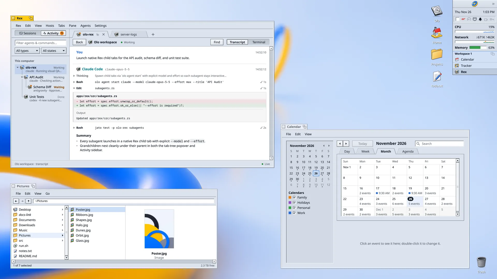
*Figure 1-1. The Olo desktop at work, shown reduced, with numbered callouts to its main landmarks*

1. Window tab: yellow on the active window, grey on the rest, with close and zoom boxes.
2. Window menu bar: every window carries its own menus right above the work they act on.
3. Desktop icons: your disks, Home and desktop files, managed directly by Tracker.
4. Deskbar: the Olo menu, clock with upcoming events, status tray, live meters and open windows.
5. Rex: a coding agent running with its nested child agents and live transcript beside it.
6. Tracker: your Pictures folder open in Column view, previewing a selected image on the right.

### Windows, Tabs and Menus

*Page 8*

Every window wears its title on a tab along its top edge, yellow on the active window and grey on the rest, with a close box at the left and a zoom box at the right. Double-click any tab (or press ⌃⌘M) to roll the window up to its tab alone. Windows can share one tab bar as a group (⌃Tab steps between them), and every window keeps its own menu bar right where its commands act.

To tidy a busy desk, **Fan Out** (⌃⌘/) lays every tab side by side, **Cascade** (⌃⌘\) stacks windows in order, and ⌃⌘Z undoes the arrangement. Hide a window (⌘M), hide an app (⌘H), or show the desktop (⌘F3).

### The Command Palette

Press ⌘Space to open the **command palette**. Type to search apps, the front app’s menus, shortcuts, single **Preferences** settings (opening the control spotlit), open windows, **Rex** panes, **Passwords**, **Calendar**, **To-Do**, paths and live sums. Type `todo` and a task to capture it, `/ask` to ask an AI model (aware of your **Terminal**), or `/ws` for the web. A small model, trained on your own choices on the computer, ranks what it offers.

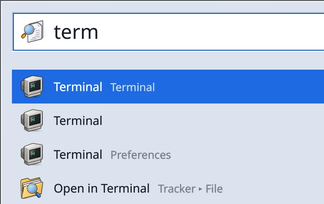
*Figure 1-2. The command palette answering “term” with a running window, an app, a Preferences panel and a Tracker menu item*

### Workspaces, Tiling and Your Keyboard

*Page 9*

Each display keeps its own workspaces (**Preferences ▸ Workspaces**). Switch with ⌃← and ⌃→, or go straight to one with ⌃1 to ⌃9; add ⇧ to take the active window along. Press ⌃↑ for **Overview**, showing every workspace with a jump letter on each window. Press ⌘Tab for **Twitcher**, ⌥Tab for apps on visible workspaces, or ⌘` for windows of the current app.

In **Deskbar**’s tray, each workspace chooses Standard, **Focus** (⌃⌥⌘O, one zoomed window at a time), or **Auto-Tiling** (⌃⌥⌘T), with seven layouts: Main and Stack, Halves, Columns, Rows, Grid, Spiral and Scrolling (⌃⌥⌘Space cycles them; ⌃⌥⌘ with H, J, K or L moves between tiles, as Vim’s keys do). In any mode, tile a window by hand: ⌃⌥← and ⌃⌥→ for halves; ⌃⌥ with U, I, J or K for quarters, or D, F or G for thirds; ⌃⌥Return to zoom and ⌃⌥⌫ to restore. Every Olo app fits down to a quarter screen.

*Figure 1-3. Olo’s seven auto-tiling layouts, chosen per workspace*: Main and Stack, Halves, Columns, Rows, Grid, Spiral and Scrolling.

> **Tip:** Reach any button without a mouse
>
> Tick Press Control twice for keyboard hints in **Preferences ▸ Keyboard ▸ Typing**, then press ⌃ twice. Yellow key caps appear over every control; type a letter to pick it, or press Esc to clear them.

## Chapter 2. Files, Folders and Finding Things

*Page 10*

Your files deserve a home that feels solid, quick and predictable. **Tracker** manages both the desktop and every folder you open, whether on your local disk, tucked inside an archive, or sitting on a remote **Rex** host. Alongside it come instant previews in **Quick Look**, **Viewer**, and three dedicated tools to inspect disk space, partition drives and keep encrypted backups.

**In This Chapter**

- Working in Tracker: page 11
- Quick Look, Viewer and Archives: page 12
- Disks, Space and Backups: page 13

> **Note:** Folders remember how you like them
>
> Tracker remembers each folder’s sort order and column widths by its path, in Olo’s own state files, where BeOS kept them inside the directory itself. Sort Downloads by name and Music by date; each stays that way, in any window.

### Working in Tracker

*Page 11*

Open any folder from the desktop and Tracker gives it a window of its own (or brings its existing window straight to the front). Open a subfolder inside that window and it navigates in place; click Back or Forward (⌘[ and ⌘], or your mouse’s side buttons) to retrace your steps. Prefer a separate window? Right-click the folder and choose Open in New Window.

Four views suit four kinds of work: Icon (⌘1), Mini Icon (⌘2), List (⌘3) and Column (⌘4). Set your default in **Preferences ▸ Tracker**. Need a file on a remote machine? Press ⇧⌘G (Go to File or Folder) and enter `rex://HOST/PATH` to browse any Rex host’s folders alongside your own.

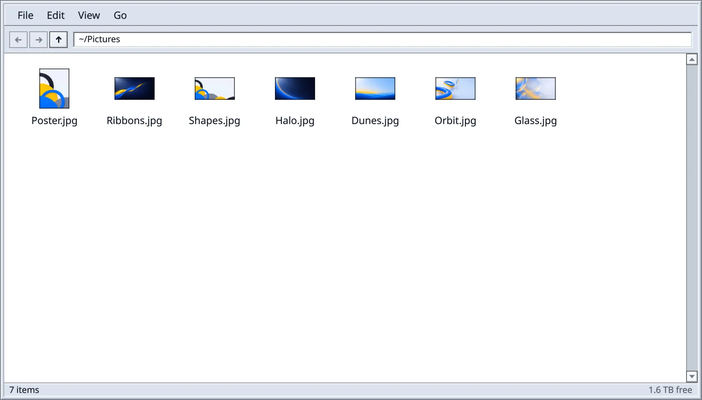
*Figure 2-1. Tracker’s Pictures folder in Icon view, under its menus and its Back, Forward and Parent buttons*

To search across your files, press ⌥⌘Space from anywhere to open **Find**. Search by Name, Contents, or Name or contents; results stream in immediately as they are found. Searches ignore letter case unless you type a capital, and skip hidden or git-ignored files unless you ask for them.

**Shortcuts**

| Keys | What they do |
|---|---|
| ⇧⌘N | New Folder |
| ⌘N | New Window |
| ⌘↑ | Open Parent |
| ⌘I | Get Info |
| ⌘E | Edit Name |
| ⌘⌫ | Move to Trash |

### Quick Look, Viewer and Archives

*Page 12*

Select almost any file in **Tracker** and press ⌘Y for **Quick Look**. Without launching a heavy program, Olo decodes images, PDFs, video, audio, formatted documents, spreadsheets and archives directly in process so you can inspect them at once and close the preview just as quickly.

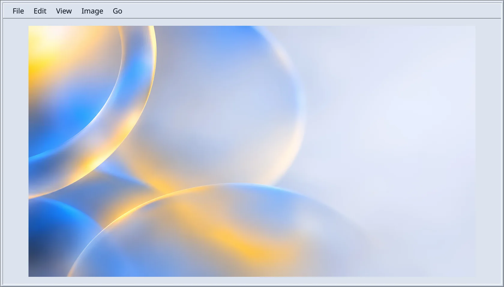
*Figure 2-2. Viewer’s File, Edit, View, Image and Go menus, above a picture*

Double-click a picture, a PDF or a video to open it in **Viewer**. For photographs and graphics, Viewer offers crop, rotate (⌘L and ⌘R), flip and resize, plus on-device optical character recognition (OCR) so you can drag across text inside any picture and copy it. For PDFs, fill out forms, add signatures, search text, or step through slides in Full Screen (⌃⌘F) and Presentation modes. Viewer also opens `.pptx` slide decks, plays audio, and decodes video on the GPU from 0.25× to 2× speed.

Archives need no helper app either: Tracker opens zip, tar, 7z, RAR, ISO, UDF and cpio archives right in a folder window, and makes zip, tar and 7z ones (zip and 7z with a password, if you like).

> **Tip:** Copy text straight out of a picture
>
> Open a screenshot or a photo in Viewer and drag over its words. The OCR runs on your computer: nothing is sent anywhere.

### Disks, Space and Backups

*Page 13*

When storage grows tight, open **DiskUsage** from the **Olo** menu. It scans your drive and paints a ring chart of where every megabyte lives. Click a ring to step into a folder, the centre to step back out, and drag what you don’t need into the **Collector** at the bottom. From there, Move to Trash can be undone; Delete… removes the files for good.

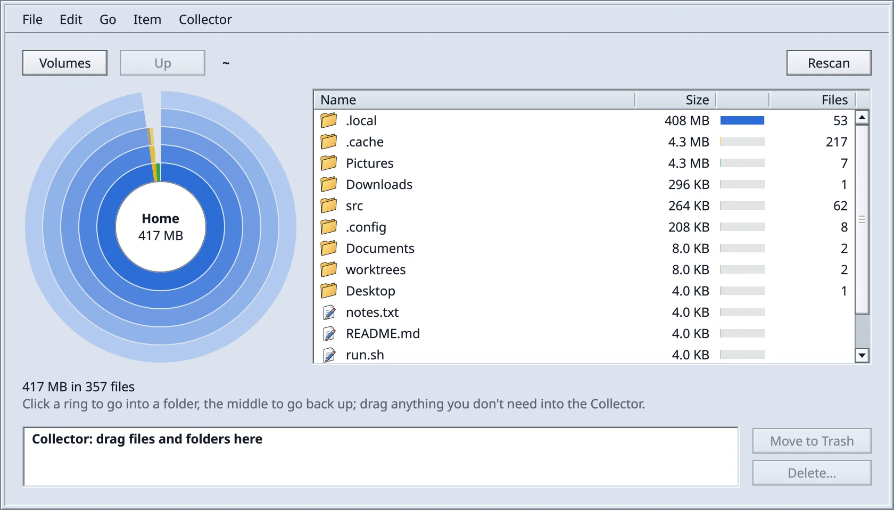
*Figure 2-3. DiskUsage drawing a Home folder of 417 MB as rings, beside its folders and files*

To protect what matters, set up **DiskBackup**: automatic backups, hourly by default, versioned, deduplicated and encrypted, to a folder or to Google Drive, sending only the chunks that changed. By default it keeps your Home folder, skipping caches and what can be built again. Backed-up files wear a green tick in Tracker, and right-clicking one offers Older Versions… to bring back an earlier copy.

**DriveSetup** draws each drive to scale, unlocks LUKS volumes, formats and resizes partitions, writes disk images to USB sticks and benchmarks drives.

## Chapter 3. Terminals, Remote Machines and Coding Agents

*Page 14*

In Olo, **Claude Code**, **Codex** and **Antigravity** (`agy`) are not awkward guests squeezed into a plain terminal window: they are citizens of the desktop. Every agent’s state (working, waiting for you, done or failed) appears directly on its tab, in **Deskbar**, and in clickable notifications that jump straight to the pane that needs you, whether it is running on your laptop or on a remote server.

**In This Chapter**

- Terminal and Rex: page 15
- Agents Under Your Tab: page 16
- Agent Screens and Token Pool: page 17

> **Tip:** Jump straight to the next waiting agent
>
> When several agents are working across tabs or remote hosts in **Rex**, press ⌘J from anywhere in the window to land immediately on the next agent waiting for your answer.

### Terminal and Rex

*Page 15*

For local work, **Terminal** keeps its shells inside a separate daemon (`olo-termd`) so reloads and upgrades never close them. Its Rust shell, brush, is bash-compatible with on-device command suggestions. Organise tabs into groups, create Git worktrees in process with New Worktree…, and watch each tab’s pull request and checks live. A command needing your password while nobody is at its terminal asks you in an Olo window (`olo-sudo`).

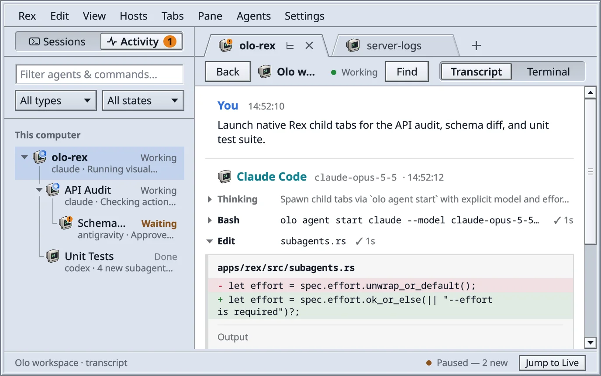
*Figure 3-1. Rex’s Activity sidebar: the olo-rex agent and the child agents it started, one waiting for your answer*

For local and remote workspaces alike, Rex connects over SSH or Tailscale and keeps sessions alive on the server across sleeps, reloads and network changes, echoing your typing at once over slow links. Split panes with ⌘D right, ⌥⌘D down, ⇧⌘Return zoom and ⌥⌘S sidebar. Add Host… sets up Ubuntu and Fedora machines; each host’s Account window installs coding agents and git identity, and **Move to Another Host** migrates a working setup with Go Back. Switch any agent pane between terminal and **Transcript**.

> **Try This:** Toggle between raw output and Transcript
>
> In Rex, click Transcript at the top right of an active agent pane to read turns and collapsible diffs, then click Terminal whenever you want the raw stream back.

### Agents Under Your Tab

*Page 16*

In **Rex**, an agent need not work alone: `olo agent` starts subagents (`claude`, `codex`, `agy`) or plain commands as child tabs under its tab, run by the host’s agents service even with your lid shut. `olo agent watch` waits without polling; `olo agent approve` answers prompts.

```
$ olo agent start claude --name api-audit \
    --model claude-opus-5-5 --effort max \
    --minder claude:claude-opus-5-5:max \
    --rules-text "Approve cargo test." --prompt-file brief.md
$ olo agent watch api-audit --since CURSOR
```
*Figure 3-2. A minded child tab started, then watched from the cursor its start returned*

A **minder** (`--minder`) watches several children: it answers routine prompts by each one’s rules (`--rules-text`, or a file with `--rules`) and escalates the rest to you. **Keep It Going** nudges an idle agent after two quiet minutes (at most hourly); **Auto Approve** answers permission prompts after a 30-second countdown you can stop, never a plan, and only if you turn it on.

In any Rex session, the `olo` bridge (Table 3-1) reaches back to your desktop. Each remote host starts with its eight permissions off (This Computer with them on): grant them in **Preferences ▸ Rex ▸ Hosts**. A child tab has only its own `--desktop` grant (`none` by default).

| | |
|---|---|
| `olo open` | Opens a link, or a host’s `localhost` port, in your browser |
| `olo forward` | Forwards a port to your desktop |
| `olo send` | Copies a file once to **Downloads ▸ Rex ▸ HOST** |
| `olo sync` | Keeps a host’s folder in step here, until `olo sync stop` (`--two-way`: deletions too) |
| `olo op` | Reads an item from your Passwords |
| `olo screen` | Works an Agent Screen |
| `olo run` | Asks to run a command on your desktop (Deny by default) |

*Table 3-1. The `olo` bridge, in any Rex session*

### Agent Screens and Token Pool

*Page 17*

When a task needs a browser or graphical app, **Agent Screens** (`olo-screen`) gives an agent a 120 Hz Olo desktop of its own, with session bus, Chrome profile and optional sound, without moving your pointer. `olo-screen start` answers with the new screen’s name (`agent`, or `agent-2` if that is taken), and commands such as `olo-screen run agent olo-styled-edit` and `olo-screen click agent --name Save` work on it by that name, reading widgets and web pages as structure. Watch it live, scrub back through its recorder and History, export MP4 video, share single passwords, or press ⌘K to **Take Control** (locking out agent input). Remote hosts run screens of their own after `olo screen install`, rootless and idle at zero CPU.

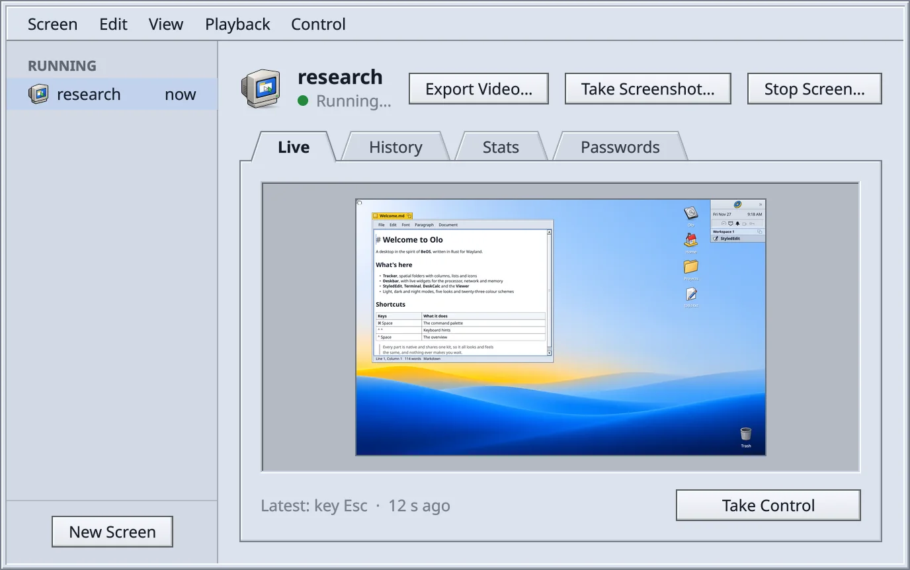
*Figure 3-3. An agent’s screen shown live in Agent Screens: StyledEdit open on an Olo desktop of its own*

**Token Pool** shares Claude, ChatGPT and Google subscriptions across Claude Code, Codex and Antigravity (`agy`) in three tabs (Accounts, Activity, Machines), spending earliest-expiring quotas first, deploying remote host pools (`olo-pool-host`) with zero-gap upgrades, and pinning live quota bars in **Deskbar**.

## Chapter 4. Everyday Tools and Your Phone

*Page 18*

A desktop is where you spend your ordinary Tuesday, not just your debugging marathons. Olo ships more than two dozen native apps built on the same kit, so menus, keys, scrolling and dark mode behave identically from your calendar to your calculator. This chapter walks through writing, planning, keeping secrets, texting from your phone over Bluetooth, checking the weather, capturing your screen, and the quiet diagnostic tools waiting in the toolbox.

**In This Chapter**

- Writing and Planning: page 19
- Passwords, Telegram and Your Phone: page 20
- Weather, Screenshot and the Toolbox: page 21

> **Try This:** Capture a task from anywhere
>
> Press ⌘Space, type `todo Pick up coffee`, and press Return. The command palette hands the task straight to **To-Do** without switching away from what you were doing.

### Writing and Planning

*Page 19*

**StyledEdit** handles everyday writing: styled prose, Markdown, highlighted code, tables, pictures, a ruler, Page View, spell-checking and printing. It opens Word, OpenDocument and RTF files as new documents, and **File ▸ Export** writes them back out, or as Markdown, HTML or PDF. Just like BeOS’s StyledEdit, it keeps its styles in the file’s extended attributes, so the text itself stays plain; ⌘B, ⌘I and ⌘U work as you expect.

**Calendar** brings Google, Fastmail and CalDAV calendars (Nextcloud, iCloud or any standard server) into Day, Week, Month and Agenda views backed by lossless iCalendar storage. Drag events to move them, answer invitations, or let its assistant draft an event that waits for your click. Upcoming events appear right under **Deskbar**’s clock.

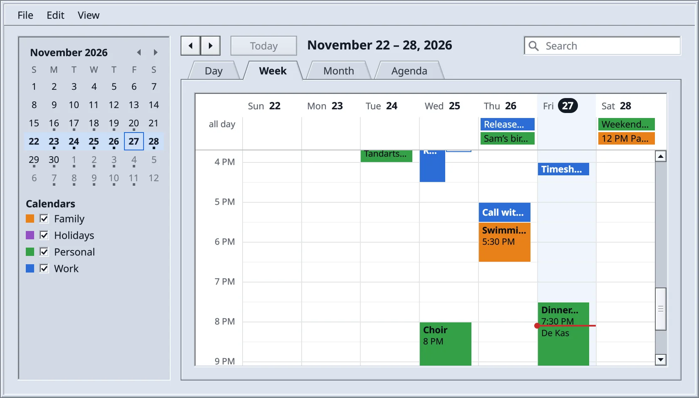
*Figure 4-1. Calendar’s four calendars, each in its own colour, ticked to show in the week*

**To-Do** keeps your tasks as plain `.ics` files, in Today, Upcoming, All, Done and lists of your own, as a list or a Kanban board, with quick entry in plain words, reminders and attachments. Connect Google, Fastmail, CalDAV, GitHub and Telegram accounts once in **Preferences ▸ Integrations**.

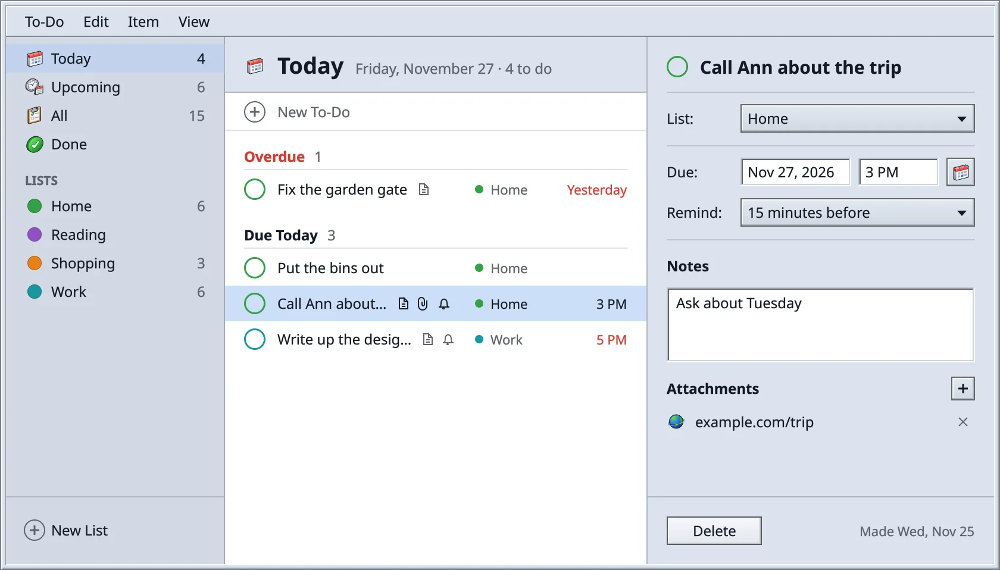
*Figure 4-2. To-Do’s Today, the overdue task at the head of the list*

### Passwords, Telegram and Your Phone

*Page 20*

**Passwords** keeps logins, passkeys, one-time codes (scan a QR code to add one) and SSH keys inside an encrypted vault on your computer (XChaCha20-Poly1305). It runs a session SSH agent automatically, provides a drop-in `op` command for scripts, shares single items with an Agent Screen when asked, and optionally syncs with your 1Password accounts.

**Telegram** is a pure-Rust client speaking Telegram’s own protocol directly: folders, forums, a separate Unknown Senders view, a persistent outbox that survives restarts, voice notes, stickers, and quick replies straight from a notification banner.

**Phone** pairs your iPhone or Android handset directly over Bluetooth, with nothing installed on the phone and no cloud account sitting in the middle. Read and reply to text messages, browse contacts, handle calls and pause or skip your phone’s music right from the desktop. When a sign-in verification code arrives by SMS or email, Olo spots it and offers it directly to the browser or agent tab waiting for it.

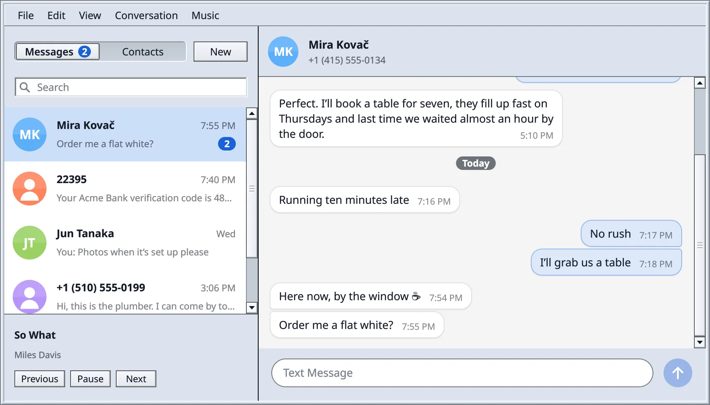
*Figure 4-3. Phone’s Messages: Mira’s conversation, and a bank’s verification code from 22395 in the list*

### Weather, Screenshot and the Toolbox

*Page 21*

**Weather** draws hour-by-hour forecasts from tomorrow.io in forty-four layers, down to the cloud base. Ask its assistant when to go for a run and it marks the best hours on the charts; a forecast can sit in **Deskbar** too.

**Screenshot** takes the whole screen, the active window or an area you drag, and records MP4 video (H.264, AV1, or HEVC where the graphics card has it) of just the frames that changed.

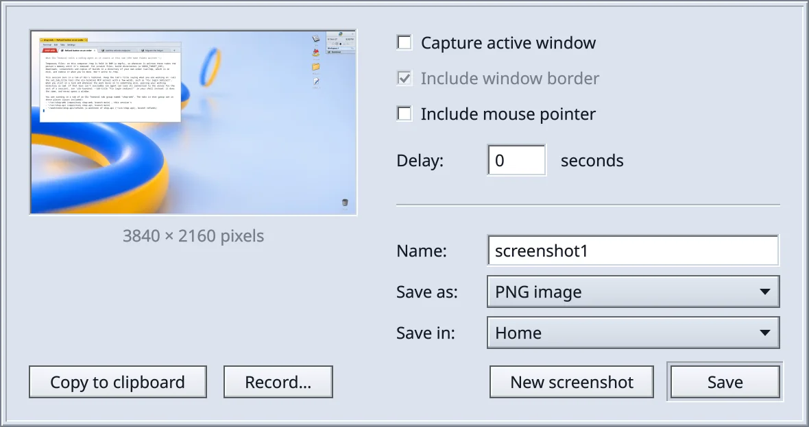
*Figure 4-4. Screenshot’s options: the active window and its border, the pointer, and a delay before it takes*

Rounding out the toolbox:

| | |
|---|---|
| **Activity Monitor** | Processes, GPUs, sensors and the Supervisor (⌥⌘Esc) |
| **Log Viewer** | The system journal, live, with a query language |
| **OS Updates** | Fedora’s updates through DNF5, with Undo |
| **Speed Test** | Upload, download and latency under load |
| **Kache** | Rust’s build cache, and why each miss missed |
| **DeskCalc** | BeOS’s desk calculator, with scientific keys |
| **Notifications** | Banners, an inbox and snooze |

**Shortcuts**

| Keys | What they do |
|---|---|
| ⇧⌘3 | The whole screen |
| ⇧⌘4 | An area you drag |
| ⇧⌘5 | Screenshot’s window |
| ⇧⌘6 | Record, or stop |
| ⌥Print | The active window |

## Chapter 5. Making Olo Yours

*Page 22*

Every corner of Olo is meant to fit the way you see, hear and work. Twenty-nine focused **Preferences** panels govern everything from themes to displays, sound, Bluetooth, power and security, and every change takes effect the instant you make it — no rebooting to see what a colour looks like. You do not even have to remember which panel holds a setting: the command palette takes you straight there.

**In This Chapter**

- Looks, Colour Schemes and Icon Sets: page 23
- Light, Dark and Night; Displays and Sound: page 24
- Upgrades, Olo Doctor and Olo Rescue: page 25

> **Try This:** Spotlight any single setting
>
> Press ⌘Space, type `night` (or any setting name), and press Return. Olo opens **Preferences ▸ Appearance** straight away and shines a quiet spotlight onto **Night Mode**.

### Looks, Colour Schemes and Icon Sets

*Page 23*

Open **Preferences ▸ Themes** and you can change the look of the entire desktop with a single click. Olo ships five classic looks, each bringing its own window frames, icons and paired 4K wallpaper, alongside twenty-three colour schemes (including Catppuccin, GitHub, One Dark Pro, Dracula, Tokyo Night, Solarized, Gruvbox, Nord, Rosé Pine and Kanagawa), all wearing Classic’s icons.

Six icon sets come built in: Classic, Platinum, BeOS, AmigaOS, Aqua and Flat, which suits any look. Click Customize… to edit any theme’s colours, icon set or wallpaper live, and GTK, Qt and Chrome follow straight away. Alongside classic systems’ tiled patterns redrawn for 4K, Olo includes six wallpapers of its own (Orbit, Halo, Ribbons, Shapes, Glass and Dunes). Olo draws every window pixel-exact at 1×, 1.25×, 1.5×, 1.75× and 2×, never resampling.

- [Classic](img/look-classic-1to1-2x.webp): After BeOS, Olo’s own
- [Platinum](img/look-platinum-1to1-2x.webp): After Mac OS 9
- [BeOS](img/look-beos-1to1-2x.webp): R5’s palette and icons
- [AmigaOS](img/look-amigaos-1to1-2x.webp): Workbench 3 flat chrome
- [Aqua](img/look-aqua-1to1-2x.webp): Early Mac OS X gel
- [Tokyo Night](img/look-tokyo-night-1to1-2x.webp): One of 23 schemes

*Figure 5-1. Six of Olo’s window tabs: five classic looks beside Tokyo Night* (In this edition, each look’s name links to its picture; on the page it is a picker: [manual.html#manual/p-23](manual.html#manual/p-23).)

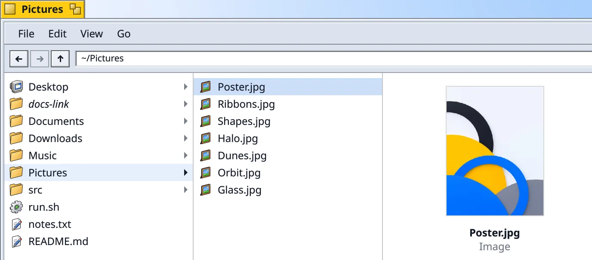
*Figure 5-2. Tracker’s tab, menu bar and toolbar, drawn in the chosen look at their own size*

> **Try This:** Preview every look live
>
> Choose any look’s tab in Figure 5-1 above to see its window’s tab, menu bar and toolbar appear at once in Figure 5-2.

### Light, Dark and Night; Displays and Sound

*Page 24*

In **Preferences ▸ Appearance**, choose Light, Dark or Automatic, which switches to Dark between your scheduled night hours. **Night Mode** can be Off, On or Scheduled between From and To, warming the screen from 2500 K to 6000 K and shifting gradually over one minute to three hours. Because Olo warms the display output directly rather than tinting windows, screenshots stay colour-true, and transitions fade over a second and a half.

| Setting | Choices |
|---|---|
| Theme | Light, Dark or Automatic (follows Night schedule) |
| Night Mode | Off, On or Scheduled (From … To …) |
| Warmth | 2500 K to 6000 K |
| Shift gradually | 1 minute to 3 hours |
| Window title size | 10 pt to 16 pt |

*Table 5-1. Appearance settings in Preferences ▸ Appearance*

Open **Preferences ▸ Display** to arrange monitors on a map: drag any display and it snaps edge to edge. Set each screen’s resolution, refresh rate, scale and HDR independently. A new resolution or refresh rate, or HDR turned on, reverts by itself after 15 seconds unless you keep it, in case the screen goes dark.

**Preferences ▸ Sound** puts outputs, microphones and volume in one window, alongside a panel for each of the rest, from Bluetooth and AirPods to Security and Language & Region — every choice taking effect live.

> **Try This:** Warm this very page
>
> On Olo, turn on Night Mode in **Preferences ▸ Appearance**: after dusk your screen warms, and this page with it.

### Upgrades, Olo Doctor and Olo Rescue

*Page 25*

Keeping Olo current never interrupts your afternoon. **Deskbar** watches Olo’s GitHub releases and offers each new version right inside its tray. Click Upgrade and Olo replaces the running desktop in place: your windows stay open and your terminals keep running, **Token Pool** hands its open streams over without a gap, **Rex** brings its port forwards back (connections through them reconnect), and a **DiskBackup** run picks up where it stopped, in the new version.

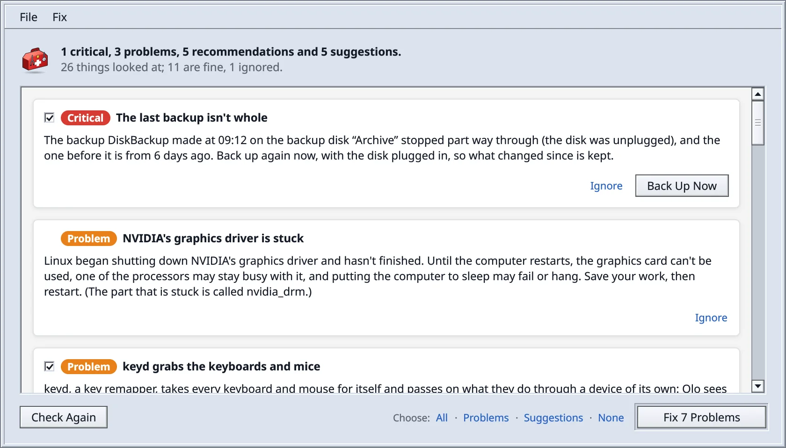
*Figure 5-3. Olo Doctor’s summary: one critical finding, three problems, five recommendations and five suggestions*

Whenever something feels off (a stuck driver, an incomplete backup or a setting that could work better), open **Olo Doctor**. It ranks every finding by how much it matters and, where a fix is available, places a button beside it that applies it. Anything needing elevated privilege asks for your password only when you click its button; click Ignore on anything you prefer to leave as it is and it stays quiet.

If a display change or runaway process ever wedges your desktop, press ⌃⇧⌘⌫ from anywhere, with the Control key itself (not Caps Lock), for **Olo Rescue**. It puts every window safely aside, switches displays to safe settings, and gives you an isolated shell, a process killer and every **Preferences** panel without quitting a single app. Leave Rescue and your whole workspace returns intact.

> **Note:** Beta hardware and your computer
>
> Olo is beta software, tested primarily on a Lenovo ThinkPad P1 Gen 9. On unfamiliar hardware, run the `olo-hardware` coding-agent skill to teach Olo your machine’s exact display, keys, touchpad and sensors.

## Chapter 6. Quick Reference

*Page 26*

Keep these two cards handy while the keys settle in. Each is the default Mac profile’s; press ⇧⌘/ any time for a live sheet, the front app’s keys too.

### Shortcut Card I: The Desktop

| Keys | What they do |
|---|---|
| ⌘Space | Command palette |
| ⌥⌘Space | Find (Tracker’s Find window) |
| ⌃⌘Space | Emoji and symbols |
| ⇧⌘/ | Keyboard shortcuts sheet |
| ⌘Tab | Switch applications (Twitcher) |
| ⌘` | Switch windows of the application |
| ⌃↑ | Overview of every window |
| ⌃1 | Workspace 1 (to ⌃9) |
| ⌃← | Previous workspace (⌃→ next) |
| ⌃⌘D | Hide or show Deskbar |
| ⌃⌘Q | Lock the screen |
| ⇧⌘3 | Screenshot of the screen |
| ⇧⌘4 | Screenshot of an area |
| ⇧⌘6 | Record the screen, or stop |
| ⌥⌘Esc | Activity Monitor |
| ⌃⇧⌘⌫ | Olo Rescue (Control itself) |

### Shortcut Card II: Windows, Tiling and Every App

*Page 27*

These window, tiling and standard app shortcuts work consistently across Olo, and every binding can be customised in **Preferences ▸ Keyboard ▸ Shortcuts**.

**Windows and tiling**

| Keys | What they do |
|---|---|
| ⌃⌥← | Left half (⌃⌥→ right) |
| ⌃⌥U | Top left quarter (I, J, K the others) |
| ⌃⌥D | Left third (F centre, G right) |
| ⌃⌥Return | Zoom or unzoom |
| ⌃⌥⌫ | Back to its own size |
| ⌃⌘M | Roll up or down |
| ⌃⌘/ | Fan out all windows |
| ⌃⌘Z | Undo window arrangement |
| ⌃⌥⌘Space | Next auto-tiling layout |
| ⌃⌥⌘T | Auto-tiling on or off |

**In every app**

| Keys | What they do |
|---|---|
| ⌘N | New |
| ⌘O | Open |
| ⌘S | Save |
| ⌘W | Close the window |
| ⌘Q | Quit |
| ⌘Z | Undo (⇧⌘Z redo) |
| ⌘F | Find (⌘G again) |

**In Tracker**

| Keys | What they do |
|---|---|
| ⌘Y | Quick Look |
| ⌘I | Get Info |
| ⌘⌫ | Move to Trash |

### Two Readers

*Page 28*

Olo has a second reader: your coding agents. Everything in an Olo window is also a tree of named controls with their places on the screen, in points. On its own **Agent Screen**, an agent reads it with `olo-screen tree` and acts by name, in Olo’s windows, Chrome’s pages, GTK and Qt alike, never guessing at pixels or touching your pointer.

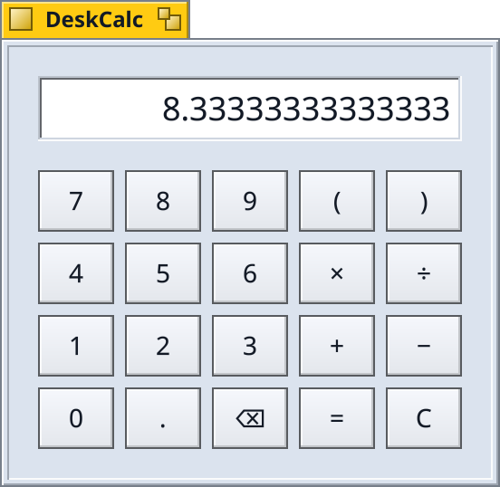

```
$ olo-screen click agent \
    --role Button --name "="
$ olo-screen tree agent
  Window "DeskCalc" at 53,66 266x238
    Button "7" at 69,134 42x34
    Button "8" at 117,134 42x34
    …
    Button "=" at 213,254 42x34
    TextInput "Expression" value="8.33333333333333" at 75,82 222x36
```
*Figure 6-1. DeskCalc after an agent pressed =, and part of its tree, in points*

The same discipline keeps Olo fast: at rest it does nothing. **DeskCalc**’s `1000 ÷ 120` is the 8.3 milliseconds a frame has at 120 Hz. On the website, tick **Agent view** in its Deskbar to read the page as an agent does; this guide is Markdown for agents too (`assets/manual.md`).

## Index

*Page 29*

- Activity Monitor: 21
- Agent Screens: 17, 28
- Agent view: 28
- agy (Antigravity): 14, 16
- App Glances: 7
- Appearance: 24
- AppImages: 7
- Archives: 12
- Auto Approve: 16
- Auto-Tiling: 9
- BeOS: 4, 19, 21, 23
- Bluetooth: 20, 24
- brush: 15
- CalDAV: 19
- Calendar: 7, 19
- Cascade: 8
- Child tabs: 16
- Chrome: 17, 23
- Claude Code: 14, 17
- Codex: 14, 17
- Collector: 13
- Colour schemes: 23
- Column view: 7, 11
- Command palette: 8, 18, 22
- Customize…: 23
- Deskbar: 7, 9, 17, 19, 21, 25
- DeskCalc: 21, 28
- DiskBackup: 13, 25
- DiskUsage: 13
- Display: 24
- DriveSetup: 13
- Fan Out: 8
- Find: 11
- Focus: 9
- Get Info: 11
- GitHub: 19, 25
- Go to File or Folder: 11
- Google Drive: 13
- GTK and Qt: 23, 28
- HDR: 24
- Home folder: 7, 13
- Icon sets: 23
- Integrations: 19
- Kache: 21
- Kanban board: 19
- Keep It Going: 16
- Keyboard
  - hints: 9
  - profiles: 5, 26
  - shortcut cards: 26, 27
- Log Viewer: 21
- Looks: 23
- LUKS: 13
- Markdown: 19, 28
- Menu bars: 8
- Minder: 16
- Move to Another Host: 15
- Move to Trash: 11, 13
- MP4 video: 17, 21
- Night Mode: 24
- Notifications: 7, 14, 21
- OCR: 12
- Older Versions…: 13
- olo (the bridge): 16
- olo agent: 16
- Olo Doctor: 7, 25
- Olo menu: 7, 13
- Olo Rescue: 25
- olo-screen: 17, 28
- OS Updates: 21
- Overview: 9
- Page View: 19
- Passwords: 16, 17, 20
- PDFs: 12, 19
- Phone: 20
- Port forwards: 16, 25
- Preferences: 22–25
- Quick Look: 10, 12
- Recording the screen: 21, 26
- Rex: 11, 15, 16, 25
- rex:// addresses: 11
- Scaling: 23
- Screenshot: 21
- Sound: 24
- Speed Test: 21
- SSH: 15, 20
- StyledEdit: 19
- Subagents: 16
- Supervisor: 21
- Tailscale: 15
- Take Control: 17
- Telegram: 20
- Terminal: 15, 16
- Themes: 23
- Tiling: 9
- To-Do: 18, 19
- Token Pool: 17, 25
- Tracker: 7, 11–13, 23
- Transcript: 15
- Twitcher: 9
- Upgrades in place: 25
- Viewer: 12
- Wallpapers: 23
- Weather: 21
- Widget tree: 28
- Window tabs: 7, 8
- Workspaces: 9
- Worktrees: 15
- Zoom: 8, 9

## Colophon

This guide is set in **Sora** for headings, **Noto Sans** for body copy, and **Noto Sans Mono** for code. Every picture shows Olo at its own size (on a 1× or 2× screen, one of its pixels to one of your screen’s), except the desktop on page 7, and every one was taken on an Agent Screen using made-up data. Like Olo, these pages rest while you read: no timers, and nothing moving until you turn a leaf. With warm thanks to BeOS, and to the manuals that once came in the box.

## Back cover

A whole desktop for Linux in the spirit of BeOS, written in Rust for Wayland from the window server up. Keep the clarity that made classic desktops a joy (yellow window tabs, Deskbar, spatial folders and instant response) while giving 2026’s coding agents, remote machines and subscriptions a proper home beside your work. Fast, light, measured, and free to try right beside GNOME.

**What’s Inside**

- Deskbar, Tracker and yellow tabs
- Seven per-workspace tiling layouts
- Rex, Terminal and child agents
- Agent Screens and Token Pool
- Five classic looks, 23 schemes

**System Requirements**

- Fedora 44 or 45 Workstation, x86_64
- Installs beside GNOME, untouched
- Olo is beta software · MIT License
